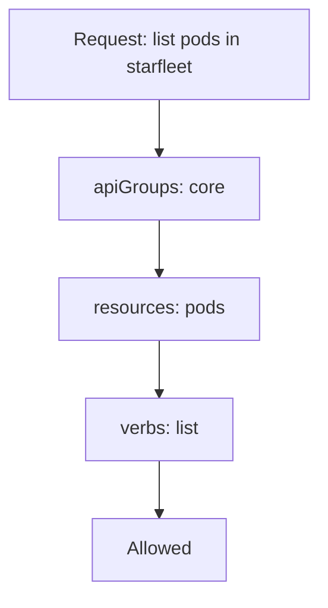

# Roles, Rules And Verbs

The `shuttle` ServiceAccount in `starfleet` must read the pods of its own namespace and do nothing else. Before any grant exists, the API server answers every request from `shuttle` with a refusal. This part builds the first grant: a `Role`, which is a namespaced list of rules. It shows what each field of a rule means, so that you can write a rule that matches the work and not more.

## Where authorization happens

Every request to the API server passes three stages in order: authentication, authorization and admission. Authentication decides who the caller is. Authorization decides whether that caller may do the requested action. Admission runs last and may change or reject the object.

The API server checks authorization with a list of modules, set by the flag `--authorization-mode`. A kubeadm cluster uses `Node,RBAC`. The `Node` module only serves kubelets. The `RBAC` module reads the Role and RoleBinding objects that you create. The API server asks each module in order. If a module allows the request, it stops and the request goes on. If no module allows it, the answer is `403 Forbidden`.

An authorization decision needs five facts from the request: the user and groups, the verb, the API group, the resource and, for a namespaced resource, the namespace. A Role rule describes the last four of these.

## Anatomy of a rule

A Role has a list of `rules`. Each rule holds three lists that must all match the request:

- `apiGroups` names the API group. The core group, which holds pods, Secrets, ConfigMaps and Services, is written as an empty string, `""`. Deployments are in `apps`.
- `resources` names the resource types, in lowercase and plural: `pods`, `secrets`, `deployments`. A subresource is written after a slash, for example `pods/log`.
- `verbs` names the actions: `get`, `list`, `watch`, `create`, `update`, `patch`, `delete` and `deletecollection`.

An optional fourth list, `resourceNames`, limits the rule to objects with those names. A request matches a rule when its API group, its resource and its verb each appear in the rule. The Role lives in one namespace, and its rules apply only to that namespace.



Each list in the rule must contain the matching value of the request. If one list does not, the rule does not apply.

## Read the verbs from the API

The verbs map to HTTP calls. `get` reads one named object. `list` reads a collection, and `watch` streams changes to it. `create`, `update`, `patch` and `delete` write. Ask the API server which verbs and which API group each resource has. The command below prints a table in which the `APIVERSION` column starts with the group and the `VERBS` column lists the verbs:

<!-- astrona:playground:renew -->

```sh
kubectl api-resources -o wide --namespaced=true | grep -E '^(NAME|pods |deployments )'
```

The output is long, so `grep` keeps the header row and the rows for `pods` and `deployments`. Read the version in the row for `pods`, which is `v1`. A version with no group in front means the core group. The row for `deployments` shows `apps/v1`, so its group is `apps`.

## Write the first Role

The quickest way to write a Role is `kubectl create role`. It builds the rule from flags. Use `--dry-run=client -o yaml` to print the object without sending it:

```sh
kubectl create role pod-reader -n starfleet --verb=get,list,watch --resource=pods --dry-run=client -o yaml
```

The printed object has one rule with `apiGroups: [""]`, `resources: ["pods"]` and the three verbs. The same Role from YAML is easier to keep and to review. Save this as `role-pod-reader.yaml`:

```yaml
apiVersion: rbac.authorization.k8s.io/v1
kind: Role
metadata:
  name: pod-reader
  namespace: starfleet
rules:
  - apiGroups: [""]
    resources: ["pods"]
    verbs: ["get", "list", "watch"]
```

Apply it:

```sh
kubectl apply -f role-pod-reader.yaml
```

Then check the result:

```sh
kubectl get role pod-reader -n starfleet -o yaml
```

The Role exists, and it grants nothing yet, because no binding connects it to an identity. A Role is only a list. Ask the authorizer about `shuttle` to confirm:

```sh
kubectl auth can-i list pods -n starfleet --as=system:serviceaccount:starfleet:shuttle
```

The answer is `no`. The flag `--as` makes `kubectl` send an impersonation request: it asks the API server to answer as if the request came from that identity. The name of a ServiceAccount in this form is `system:serviceaccount:<namespace>:<name>`.

## Match one request to one rule

Consider two requests from an identity that holds only the Role above. A request `list pods` in `starfleet` matches: the group is core, the resource is `pods` and `list` is in the verbs. A request `delete pods` in `starfleet` does not match, because `delete` is not in the list. A request `get pods` in `outpost` does not match either, because the Role belongs to `starfleet`.

The rule also does not match `pods/log`. A subresource is a separate resource name, so reading the logs of a pod needs `pods/log` in `resources`. The same holds for `pods/exec`, which runs a command in a container, and `deployments/scale`. A rule for `pods` never covers its subresources.

A rule with `resources: ["*"]` or `verbs: ["*"]` matches everything in that list, including resource types that a later Kubernetes version adds. A wildcard is almost never the narrowest grant, so avoid it.

## Limit a rule to named objects

The `resourceNames` list limits a rule to objects with the given names. A Role that lets a workload read one ConfigMap, and no other, looks like this:

```yaml
rules:
  - apiGroups: [""]
    resources: ["configmaps"]
    resourceNames: ["warp-settings"]
    verbs: ["get"]
```

The limit works for `get`, `update`, `patch` and `delete`, because the name is part of the request path. It does not work for `create`, because the object has no name yet when the API server decides. It works for `list` and `watch` only when the request itself selects one object by name, for example with `--field-selector metadata.name=warp-settings`. A request for the whole collection does not match.

You can now write a rule that matches exactly the group, resource and verbs the work needs. The Role is still unused. The next question is how a binding gives it to an identity, and who that identity can be.

## Common pitfalls

> [!WARNING]
> A Role grants nothing until a binding names it. An empty string for the core group is `""`, not a missing field: a rule without `apiGroups` matches no group. A rule for `pods` does not cover `pods/log` or `pods/exec`. Singular names such as `pod` do not match, so write the plural resource name. Adding `resourceNames` to a `create` rule or to a `list` rule that asks for the whole collection makes it match nothing.
