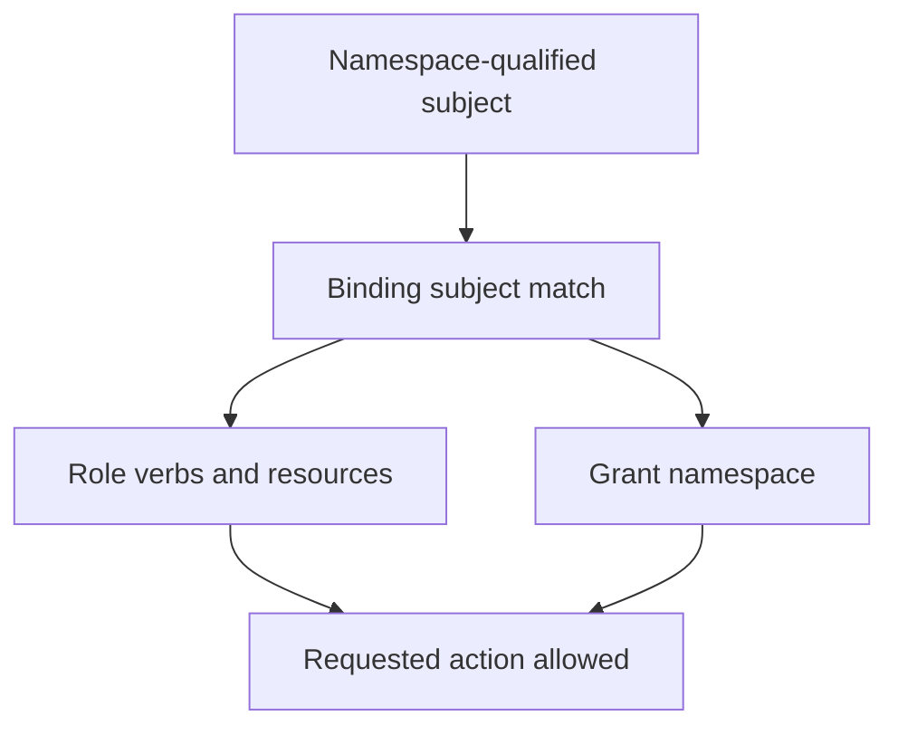

# RBAC Scope And Least Privilege

A controller can list Pods in one namespace while being denied access in another. The same ServiceAccount name in two namespaces also identifies two different accounts. Least privilege requires both identity scope and grant scope to be correct.

## Learning objectives

- Explain roles, bindings and scope.
- Evaluate additive effective grants.
- Identify indirect privilege through workload creation.

## Before you start

This chapter is standalone reading material; no running cluster or installed tools are required. A Pod is the Kubernetes unit for running one or more containers, and a namespace groups namespaced objects. Treat the worked configurations as teaching examples rather than recorded observations from a provisioned environment.

## Responsible components and behavior

The `shuttle` identity only needs to read Pods in `outpost`. Role-Based Access Control (RBAC) grants actions on resource types to identities through roles and bindings. A Role describes permissions within a namespace, while a ClusterRole is a cluster-scoped definition that can describe namespaced or cluster-scoped permissions.

A RoleBinding grants permissions within its own namespace. It can refer to a Role in that namespace or a ClusterRole. Referencing a ClusterRole through a RoleBinding does not turn the grant into a cluster-wide grant. A ClusterRoleBinding grants the referenced ClusterRole at cluster scope.

Rules distinguish resource types and verbs. Permission to get one object's data differs from permission to list a collection, watch changes, create objects or delete them. The API group also matters. A rule for core Pods does not automatically cover Deployments in another group.

Least privilege means granting only the permissions needed for a defined job. Read access to Secrets is sensitive because it can reveal credentials. Permission to create Pods may also enable access to mounted data or workload identities, depending on other controls. A superficially narrow verb can still have important indirect effects.

RBAC permissions are additive: another applicable binding may grant an action that one role omits. Removing a rule from one role does not guarantee the identity loses permission if another binding still grants it. Scope and all applicable grants must be considered.

For the `shuttle` scenario, a namespace-scoped read grant fits better than a cluster-wide administrative binding. Check the subject, verbs, resources and namespace together. A binding with the right role but the wrong ServiceAccount or namespace does not satisfy the intended access.

## Building A Narrow Read Grant

Assume `shuttle` in `outpost` needs to retrieve Pod details in that namespace. A suitable Role can allow the relevant read verbs on core Pods, and a RoleBinding can identify the intended ServiceAccount. The namespace of the binding determines where the grant applies. The ServiceAccount subject also needs the correct namespace so it identifies the expected workload identity.

If the same permission definition is useful in several namespaces, a ClusterRole can be reused through separate RoleBindings. That reuse does not make every binding cluster-wide. A ClusterRoleBinding has different scope and should only be used when the required access justifies it.

The difference between `get`, `list` and `watch` matters. Getting a known object requests one record. Listing obtains a collection. Watching streams subsequent changes. A component that watches a collection commonly needs a combination appropriate to its workflow rather than a vague “read” label. Rules should match the actual API operations.

## Indirect Privileges And Additive Grants

A grant to read Secrets can reveal credentials for another service. A grant to create Pods can expose a route to mounted data or workload identities, subject to the cluster's other controls. Permission analysis should therefore ask what the identity can accomplish through the resources it may create or read, not only whether the verb sounds harmless.

Several bindings can apply to one caller through its username or groups. Effective permissions are the union of those grants. Removing a broad rule from one Role is insufficient if a ClusterRoleBinding still grants it elsewhere. RBAC does not express a general explicit-deny rule that cancels another grant.

Review the subject, group memberships, verb, API group, resource and namespace together. A correct role with the wrong binding subject fails to provide needed access; a correct subject with an overly broad binding grants more than intended. Least privilege is the narrowest working combination of these fields and the surrounding admission protections.

## Work through the decision

Role-Based Access Control (RBAC) distinguishes request verbs. `get` retrieves a known object, `list` retrieves a collection, and `watch` streams changes. A component that watches a collection may need more than a single-object read grant. The API group and resource name must also match the operation.

An authorization check with impersonation evaluates the named subject if the caller can impersonate it. It is not a demonstration that a Pod possesses a usable token or that admission will accept a future object. An application grant should be justified by its actual API operations, then constrained through the narrowest binding scope that supports them.

A working grant needs both the intended identity and the intended action scope.

You can now describe an application permission precisely and test a bounded authorization question. Credential delivery, admission and indirect access effects still require separate consideration.

## Common pitfalls

> [!WARNING]
> A RoleBinding to a ClusterRole still grants permissions in the binding's namespace. RBAC grants combine; an omitted rule is not an explicit denial.
