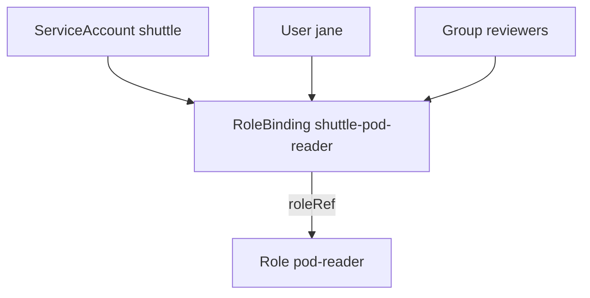

# RoleBindings And Subjects

A Role lists permissions but does not say who holds them. A `RoleBinding` does that: it names one Role and a list of subjects, and the API server then grants the rules of the Role to those subjects in the namespace of the binding. This part creates a binding for the `shuttle` ServiceAccount, shows the three kinds of subject and explains two rules that surprise many learners: the reference cannot be changed, and a binding can point at a ClusterRole without making the grant cluster-wide.

## The fields of a RoleBinding

A RoleBinding has two parts that matter. `roleRef` names the role that is granted. `subjects` lists who receives it. The binding lives in a namespace, and that namespace is the only place where the rules apply.

The `roleRef` has three fields: `kind` (`Role` or `ClusterRole`), `name` and `apiGroup`. The `apiGroup` is always `rbac.authorization.k8s.io`. A `roleRef` cannot be changed after the binding is created. The API server rejects an update that changes it. To point a binding at another role, delete the binding and create a new one. This rule exists so that a person who may only edit bindings cannot quietly swap a small role for a large one under an existing name.

## Create the binding

Save this as `rolebinding-shuttle.yaml`. It binds a Role named `pod-reader` to the ServiceAccount `shuttle`. The Role must exist first, so create it with a command that allows `get`, `list` and `watch` on pods in `starfleet`:

```sh
kubectl create role pod-reader -n starfleet --verb=get,list,watch --resource=pods
```

If the answer is `AlreadyExists`, the Role is left from an earlier step and you can go on. Then save the binding.

<!-- astrona:playground:renew -->

```yaml
apiVersion: rbac.authorization.k8s.io/v1
kind: RoleBinding
metadata:
  name: shuttle-pod-reader
  namespace: starfleet
subjects:
  - kind: ServiceAccount
    name: shuttle
    namespace: starfleet
roleRef:
  kind: Role
  name: pod-reader
  apiGroup: rbac.authorization.k8s.io
```

Apply it:

```sh
kubectl apply -f rolebinding-shuttle.yaml
```

Then check the result. The first answer is `yes` and the second is `no`:

```sh
kubectl auth can-i list pods -n starfleet --as=system:serviceaccount:starfleet:shuttle
kubectl auth can-i delete pods -n starfleet --as=system:serviceaccount:starfleet:shuttle
```

The RBAC module of the API server made the decision. It read the binding, found that `shuttle` is a subject, loaded the `pod-reader` Role and matched the request against its rules. The same command with `-n outpost` answers `no`, because the binding applies only in `starfleet`.

## The three kinds of subject

A subject has a `kind`, a `name` and, for some kinds, a namespace.

- `ServiceAccount` identifies a workload. It needs the `namespace` field. A ServiceAccount named `shuttle` in `starfleet` is a different identity from one named `shuttle` in `outpost`, and a binding that leaves out the namespace of the subject does not match either.
- `User` identifies a person by the name that authentication reports, for example the Common Name of a client certificate. Kubernetes keeps no list of users, so a binding can name a user who does not exist.
- `Group` identifies every identity that authentication reports with that group name. Every authenticated request also carries built-in groups. A ServiceAccount is in `system:serviceaccounts` and in `system:serviceaccounts:<namespace>`, and every authenticated caller is in `system:authenticated`.

A binding to a group is the usual way to grant a team access. A binding to `system:serviceaccounts:starfleet` would give the Role to every ServiceAccount in `starfleet`, including ones created later. Use a group subject only when that is what you want.



One binding can hold several subjects, and all of them receive the same role in the namespace of the binding.

## A RoleBinding can point at a ClusterRole

A `roleRef` may name a `ClusterRole` instead of a `Role`. A ClusterRole is a role that is not tied to a namespace, so one definition can be reused. The built-in ClusterRole `view` is an example: it allows reading most namespaced objects. When a RoleBinding points at it, the rules apply only in the namespace of the binding.

Create a binding that gives `scout` the built-in `view` role in `starfleet`, with `kubectl create rolebinding`:

```sh
kubectl create rolebinding scout-view -n starfleet --clusterrole=view --serviceaccount=starfleet:scout
```

Then check that the grant stops at the namespace border. The first answer is `yes`, the second is `no`:

```sh
kubectl auth can-i list deployments.apps -n starfleet --as=system:serviceaccount:starfleet:scout
kubectl auth can-i list deployments.apps -n outpost --as=system:serviceaccount:starfleet:scout
```

The word `ClusterRole` describes where the definition lives, not where the grant applies. The binding decides the reach. A ClusterRoleBinding would apply the same rules in every namespace.

## Read a binding back

Two commands show who holds what. `kubectl get rolebindings` lists the bindings in a namespace, and `kubectl describe` prints the subjects and the role:

```sh
kubectl get rolebindings -n starfleet
kubectl describe rolebinding shuttle-pod-reader -n starfleet
```

The `describe` output shows the role reference, the subjects and, below them, the rules of the Role, in a table with the columns for resources, resource names, verbs and non-resource URLs. This is the quickest way to answer "who can do this in this namespace" from the cluster itself.

You can now grant a Role to a ServiceAccount, a user or a group and tell why a ClusterRole in a RoleBinding stays inside one namespace. The question still open is what happens when one identity receives several bindings, and when a harmless looking grant gives more than its words say.

## Common pitfalls

> [!WARNING]
> A subject of kind `ServiceAccount` needs its `namespace`; the API server rejects the binding without it, and a wrong namespace names a different ServiceAccount. A binding only works in its own namespace, even when the `roleRef` is a ClusterRole. A `roleRef` cannot be edited: delete the binding and create it again. A name in a `User` or `Group` subject must match the name from authentication exactly, including the case.
