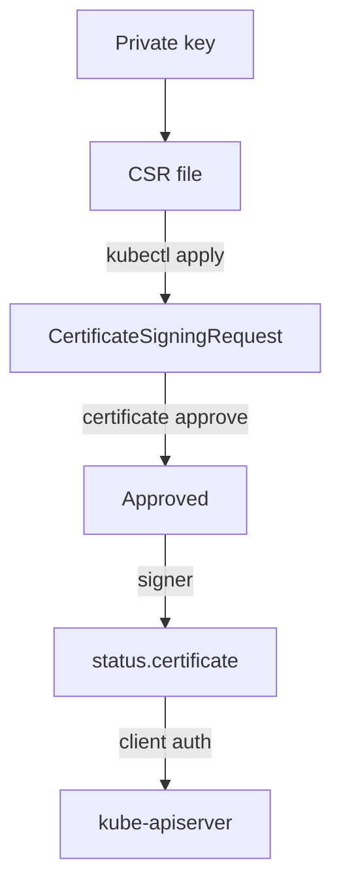

# Client Certificates And The CSR Flow

A new colleague, `jane`, needs to read pods in `starfleet`. Before any Role can name her, the cluster must be able to recognise her. Kubernetes has no user database, so the recognition has to come from a credential that the API server trusts. The most common credential for a person is an X.509 client certificate that the cluster's own certificate authority (CA) has signed. This part follows the whole path: jane creates a key, asks the cluster to sign a request, an administrator approves it and the signed certificate comes back.

## Who is the user?

The API server runs a chain of authenticators on every request. If the request carries a client certificate that was signed by the CA the API server trusts, the x509 authenticator accepts it. It reads the **Common Name (CN)** from the certificate subject as the username. It reads each **Organization (O)** value as a group name. A subject of `/CN=jane/O=reviewers` therefore makes the user `jane` a member of the group `reviewers`.

That is all. The API server does not look `jane` up anywhere, and nothing in the cluster knows she exists until she makes a request. Any certificate signed by the cluster CA is accepted, whatever its subject says. This is why the signing step must be controlled, and why the groups `system:masters` and names that start with `system:` need extra care.



The key never leaves jane's machine. Only the request, which holds the public key and the subject, goes to the cluster.

## Create the key and the request

Jane's machine creates the private key and a PKCS#10 certificate signing request. The subject holds the name and the group. Run these in an empty working directory:

<!-- astrona:playground:renew -->

```sh
openssl genrsa -out jane.key 2048
openssl req -new -key jane.key -out jane.csr -subj "/CN=jane/O=reviewers"
```

The first command writes the private key to `jane.key`. The second writes the request to `jane.csr`. Open neither file in a chat or a ticket: the key is the secret that proves she is jane.

## Submit the request to the cluster

The cluster object for a request is a `CertificateSigningRequest` in the `certificates.k8s.io/v1` API. Its `spec.request` field holds the PEM-encoded request file as base64 text. First print the value you need, on one line:

```sh
base64 < jane.csr | tr -d '\n'
```

Copy the output. Save this as `csr-jane.yaml`, and replace `<REQUEST>` with the text you copied:

```yaml
apiVersion: certificates.k8s.io/v1
kind: CertificateSigningRequest
metadata:
  name: jane
spec:
  request: <REQUEST>
  signerName: kubernetes.io/kube-apiserver-client
  expirationSeconds: 86400
  usages:
    - client auth
```

Apply it:

```sh
kubectl apply -f csr-jane.yaml
```

Then check the result:

```sh
kubectl get csr jane
```

The `CONDITION` column reads `Pending`. Nothing has signed the request yet, and nothing will until someone approves it.

## What each field decides

`signerName` selects which signer may issue the certificate. The signer `kubernetes.io/kube-apiserver-client` signs certificates that the API server honours as client certificates. The control plane never approves requests for this signer on its own, so a person with the right permission must do it. Other built-in signers exist for kubelet client certificates, kubelet serving certificates and legacy use, and each has its own rules.

`usages` lists what the certificate may be used for. For this signer it must include `client auth` and must not hold usages beyond `digital signature`, `key encipherment` and `client auth`. A request with a wrong signer or wrong usages is not signed, whatever the administrator does.

`expirationSeconds` asks for a lifetime. The smallest value the API accepts is 600 seconds. The signer may issue a shorter certificate than you ask for, so read the dates after signing. Without the field, the signer uses its own default.

## Approve and collect the certificate

Approval is its own permission. A person needs `update` on `certificatesigningrequests/approval` and the `approve` verb on the signer's name. The cluster administrator in the playground holds both. Approve the request:

```sh
kubectl certificate approve jane
```

After approval, the kube-controller-manager acts as the signer. It signs with the cluster CA key and writes the certificate into `status.certificate`, as base64 text. Read that field and decode it:

```sh
kubectl get csr jane -o jsonpath='{.status.certificate}' | base64 -d > jane.crt
openssl x509 -in jane.crt -noout -subject -issuer -dates
```

The subject line holds `CN=jane` and `O=reviewers`. The issuer is the cluster CA, and the two dates show how long the certificate lives. A command `kubectl certificate deny jane` exists for the opposite decision: it tells the signer not to sign.

## What the certificate does not do

The certificate proves who jane is, not what she may do. A request made with it passes authentication and then meets RBAC, which has no rule for `jane` yet. The next check shows the difference between an unknown user and a forbidden one:

```sh
kubectl auth can-i list pods -n starfleet --as=jane --as-group=reviewers
```

The answer is `no`. The `--as` and `--as-group` flags make `kubectl` send an impersonation request, so this check asks the authorizer about the name and group without using the certificate. It answers the RBAC question only.

Two limits matter in practice. A certificate cannot be revoked: the API server has no revocation list, so a leaked certificate works until it expires. Keep lifetimes short and remove the role bindings if a key leaks. Second, the API server keeps a finished `CertificateSigningRequest` only for a limited time: approved, denied and failed requests are deleted after one hour. Save `jane.crt` when you read it.

Jane now holds a signed certificate whose subject names her and her group. The cluster still does not let her do anything, and her `kubectl` does not yet know about the certificate. The next question is how a kubeconfig carries the key and the certificate, and how a binding connects the group to a Role.

## Common pitfalls

> [!WARNING]
> An approved request with an empty `status.certificate` has not been signed yet, or the wrong signer name or usages made the signer skip it. Check `signerName` and `usages` first. Never put a key into a `CertificateSigningRequest` or a ticket: only the request file goes to the cluster. A certificate stays valid until it expires, so a short `expirationSeconds` is the only revocation you have. Approve only the subjects you expect: a request for `system:masters` in `O` would make a cluster administrator.
