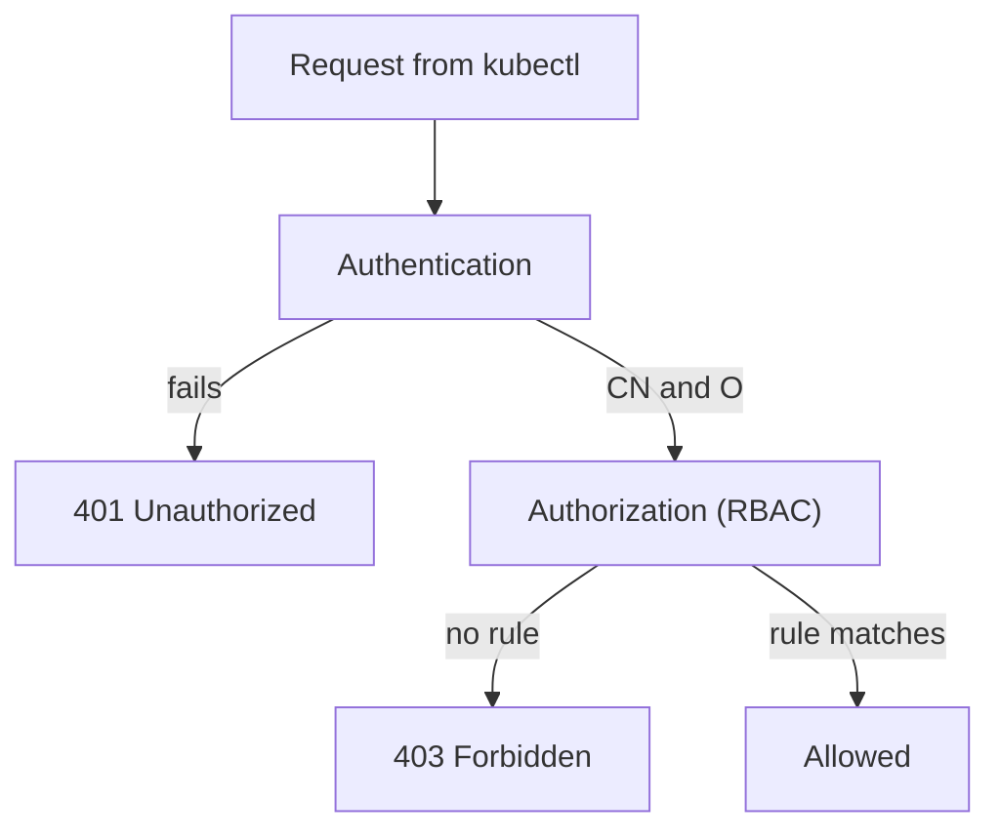

# Kubeconfig Credentials And Granting Access

A signed certificate is only a file. `kubectl` needs to know which cluster to call, which key and certificate to present and under which name to bundle them. The kubeconfig file holds that information. This part adds jane to a kubeconfig, shows the `Forbidden` answer an authenticated user without a grant receives, and then binds the group from her certificate to a Role so she can read pods in one namespace.

## The three lists in a kubeconfig

A kubeconfig has three lists and one pointer. `clusters` holds an API server address and the CA certificate that `kubectl` uses to check the server. `users` holds credentials: a client certificate and key, a token or an exec plugin. `contexts` pairs one cluster with one user and, if you like, a default namespace. `current-context` says which pair is used when you give no flag.

Nothing links jane's entry to jane's identity except her certificate. The name `jane` in the `users` list is only a label inside the file. The username that the API server sees is the CN inside the certificate.

## Add jane to the kubeconfig

Print the name of the cluster entry that your current kubeconfig already uses, so the new context can point at it:

<!-- astrona:playground:renew -->

```sh
kubectl config view --minify -o jsonpath='{.clusters[0].name}'
```

Use that name in place of `<CLUSTER>` below. The first command stores the key and the certificate, and `--embed-certs=true` copies the file contents into the kubeconfig so that the files can move. The second creates a context that uses them. Run both in the directory that holds `jane.key` and `jane.crt`:

```sh
kubectl config set-credentials jane --client-certificate=jane.crt --client-key=jane.key --embed-certs=true
kubectl config set-context jane --cluster=<CLUSTER> --user=jane --namespace=starfleet
```

The `--namespace` flag sets the default namespace for the context only. It does not give any permission. Now make a request as jane:

```sh
kubectl --context jane get pods
```

The answer is a `Forbidden` error. Read it: it names the user `jane`, the verb `list`, the resource `pods` and the namespace `starfleet`. This tells you that authentication worked, because the API server knew her name, and that authorization found no rule. An authentication failure would read `Unauthorized`, and it would mean the certificate or key is wrong, expired or signed by another CA.



A `401` and a `403` point at different layers, and each needs a different fix.

## Bind the group, not the person

Jane's certificate carries the group `reviewers`. Binding the group makes access follow the group: a second reviewer with a certificate that has the same `O` value gets the same access, and you do not edit the binding when people join or leave. Save this as `role-pod-reader.yaml`:

```yaml
apiVersion: rbac.authorization.k8s.io/v1
kind: Role
metadata:
  name: pod-reader
  namespace: starfleet
rules:
  - apiGroups: [""]
    resources: ["pods"]
    verbs: ["get", "list", "watch"]
---
apiVersion: rbac.authorization.k8s.io/v1
kind: RoleBinding
metadata:
  name: reviewers-pod-reader
  namespace: starfleet
subjects:
  - kind: Group
    name: reviewers
    apiGroup: rbac.authorization.k8s.io
roleRef:
  kind: Role
  name: pod-reader
  apiGroup: rbac.authorization.k8s.io
```

Apply it:

```sh
kubectl apply -f role-pod-reader.yaml
```

Then check the result, once as the real user and once with impersonation:

```sh
kubectl --context jane get pods
kubectl auth can-i delete pods -n starfleet --as=jane --as-group=reviewers
```

The first command lists the `scout` and `shuttle` pods. The second answers `no`, because the Role holds only read verbs. Two more checks show the limits of the namespace and of the resource. Run them:

```sh
kubectl --context jane get pods -n outpost
kubectl --context jane get secrets -n starfleet
```

Both return `Forbidden`. The RoleBinding exists only in `starfleet`, and the Role names only `pods`.

## Subject kinds and the name that counts

A subject in a binding has a `kind` of `User`, `Group` or `ServiceAccount`. For `User` and `Group` the `name` must match the CN or O string exactly, including case. A typo does not produce an error: the binding simply never matches anyone. A subject of kind `ServiceAccount` takes a `namespace` and has the username `system:serviceaccount:<namespace>:<name>`.

If you had bound the user `jane` instead of the group, the access would work for her only. It would also work for anyone else who obtains a certificate with `CN=jane`, because the cluster does not check that a name is unique. Anyone who can get a request approved for a subject can become that subject. This is the reason approval needs a careful look at the requested subject.

## Removing access

Deleting the RoleBinding removes the access at once, because the API server evaluates every request against the current bindings. The certificate stays valid and jane stays authenticated, but she can do nothing. Delete the binding only when you want to remove the access, and keep the key and certificate out of version control either way.

Jane can now authenticate, and the RoleBinding limits her to reading pods in one namespace. People are one kind of caller. Workloads inside the cluster are the other, and they receive their credentials in a different way.

## Common pitfalls

> [!WARNING]
> `Unauthorized` means authentication failed and `Forbidden` means authorization found no matching rule. Adding a Role does not fix the first, and a new certificate does not fix the second. A binding subject must match the CN or O string exactly, and a typo fails silently. A RoleBinding grants access only in its own namespace. Embedding certificates in a kubeconfig copies the private key into that file, so protect the file like the key.
