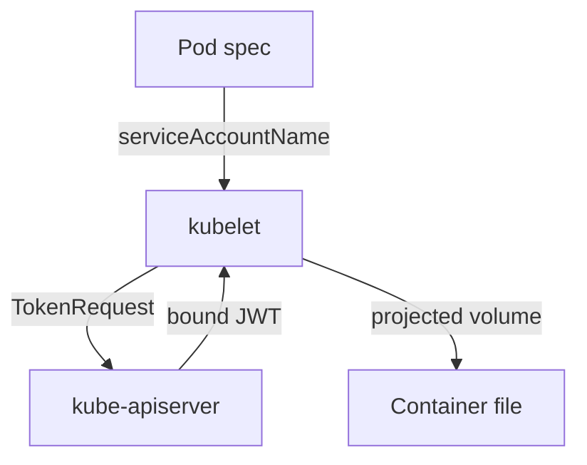

# ServiceAccount Tokens And Automounting

A workload that calls the Kubernetes API, for example a controller that lists pods, needs an identity too. Certificates are made for people. For workloads Kubernetes uses a ServiceAccount, which is a namespaced object that represents a workload, and a signed JSON Web Token (JWT) that proves the identity. This part follows how a pod receives its token, how to request a token yourself and how to stop a pod from receiving one.

## One name, one namespace

A ServiceAccount is a namespaced object. Its username is `system:serviceaccount:<namespace>:<name>`, and it belongs to the groups `system:serviceaccounts` and `system:serviceaccounts:<namespace>`. The `shuttle` ServiceAccount in `starfleet` is therefore a different identity from a ServiceAccount called `shuttle` in `outpost`. Every namespace also gets a ServiceAccount named `default`, which a pod uses when its spec names no other.

A new ServiceAccount has no permissions, apart from the small set that every authenticated caller receives. RBAC bindings grant the rest. The check below proves that a pod identity starts without access:

<!-- astrona:playground:renew -->

```sh
kubectl auth can-i list pods -n starfleet --as=system:serviceaccount:starfleet:shuttle
```

The answer is `no`.

## How a pod receives its token

Since Kubernetes 1.24 the control plane does not create long-lived token Secrets for ServiceAccounts. A pod gets a **projected volume** instead. The kubelet, the agent on the node, asks the API server for a token through the TokenRequest API, and mounts it into the pod at `/var/run/secrets/kubernetes.io/serviceaccount/token`. The same directory holds the cluster CA bundle in `ca.crt` and the pod namespace in `namespace`.

This token is **bound** to the pod. It has an audience, an expiry time, and it stops working when the pod is deleted. The kubelet refreshes the file before the token expires, so a client library that reads the file again keeps working. A copy of the token that you save somewhere else works only until its expiry time or until the pod is gone.



The kubelet, not the pod, asks for the token. The API server signs it, and the container reads it from a file.

Prove that the token works from inside the `shuttle` pod. The command sends a request to the API server with the mounted token and prints the response body. It uses the in-cluster address `kubernetes.default.svc`:

```sh
kubectl -n starfleet exec deploy/shuttle -- sh -c 'curl -s --cacert /var/run/secrets/kubernetes.io/serviceaccount/ca.crt -H "Authorization: Bearer $(cat /var/run/secrets/kubernetes.io/serviceaccount/token)" https://kubernetes.default.svc/api/v1/namespaces/starfleet/pods'
```

The body is a `Forbidden` status. Read the message: it names the user `system:serviceaccount:starfleet:shuttle`. The API server accepted the token and still refused the request, because no role grants this identity anything.

## Request a token yourself

An administrator can ask for a token without any pod. `kubectl create token` calls the TokenRequest API for a ServiceAccount and prints a JWT. The flag `--duration` requests a lifetime, and the server may return a token with a longer or shorter lifetime. The flag `--audience` sets who the token is meant for. Run it:

```sh
kubectl create token shuttle -n starfleet --duration=10m
```

The output is one long token string. Treat it as a password for the next ten minutes: anyone who holds it acts as `shuttle`. A token like this belongs in a short job, such as a script that needs one API call, and not in a file that lives for months. If you must give a token a lifetime tied to an object, `--bound-object-kind` and `--bound-object-name` bind it to a Pod, Secret or Node, and the token stops working when that object is deleted.

Some old guides create a Secret of type `kubernetes.io/service-account-token` with the annotation `kubernetes.io/service-account.name`. That makes a token with no expiry. It still works in current clusters, but it is the least safe option, so use `kubectl create token` or a projected volume instead.

## Switch the token off

Most pods never call the API server, yet by default every pod gets a token. If an attacker runs code in such a pod, the token is there to use. The field `automountServiceAccountToken: false` stops the mount. You can set it on the ServiceAccount, and you can set it on the pod spec. If both are set, the **pod setting wins**.

The `probe` ServiceAccount in `starfleet` already has the field set to `false` on the account. Save this as `pod-probe.yaml`:

```yaml
apiVersion: v1
kind: Pod
metadata:
  name: probe
  namespace: starfleet
spec:
  serviceAccountName: probe
  containers:
    - name: probe
      image: curlimages/curl:8.22.0
      command: ["sleep", "86400"]
```

Apply it:

```sh
kubectl apply -f pod-probe.yaml
```

Then check the result:

```sh
kubectl -n starfleet wait --for=condition=Ready pod/probe --timeout=60s
kubectl -n starfleet exec probe -- ls /var/run/secrets/kubernetes.io/serviceaccount
```

The `ls` command fails with a message that the directory does not exist, so the pod has no token. To see the pod setting win, add `automountServiceAccountToken: true` under `spec` in the same file, delete the pod and apply the file again. The directory now exists, even though the ServiceAccount says `false`.

Turning the mount off removes the credential and keeps the identity. The pod still runs as `system:serviceaccount:starfleet:probe`, but it has no way to prove it to the API server. A change to the ServiceAccount does not alter running pods: it applies to pods created afterwards, so restart a Deployment to apply it.

You can now say where an identity comes from for a person and for a workload. A certificate carries a name and a group, and a token carries a bound ServiceAccount. In both cases, RBAC still decides what the identity may do.

## Common pitfalls

> [!WARNING]
> A ServiceAccount token copied out of a pod is a working credential until it expires. Never paste a token into a ticket or commit it. Changing `automountServiceAccountToken` on a ServiceAccount does not change pods that already run. The pod setting overrides the ServiceAccount setting, so check both when a token appears or is missing. A pod that needs the API must keep its token, so switch the mount off only for workloads that never call it.
