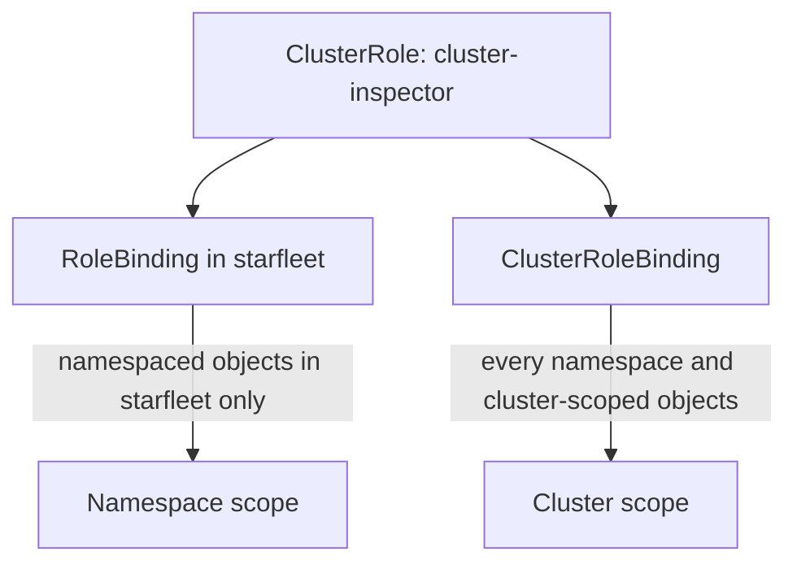

# ClusterRoles And ClusterRoleBindings

The `scout` ServiceAccount in `starfleet` must read the nodes and the PersistentVolumes of the cluster, for example to report capacity. A Role cannot grant that, because a node does not belong to any namespace. This part shows the cluster-scoped resource types, the two ways to use a ClusterRole and the reason why the kind of binding, not the kind of role, decides the reach of a grant.

## Which resources have no namespace

Most resources belong to a namespace, and a namespaced Role can name them. A smaller group of resources belongs to the cluster as a whole. Ask the API server for the list:

<!-- astrona:playground:renew -->

```sh
kubectl api-resources --namespaced=false
```

The list includes `nodes`, `persistentvolumes`, `namespaces`, `storageclasses`, `customresourcedefinitions` and the RBAC kinds `clusterroles` and `clusterrolebindings`. The column `NAMESPACED` reads `false` for all of them. A rule for one of these resources has an effect only when the binding is cluster-wide.

## A ClusterRole has no reach of its own

A **ClusterRole** is a cluster-scoped object that holds a list of rules, just as a Role does. It has no namespace field. It can do four jobs: it can grant access to cluster-scoped resources, it can grant access to non-resource URLs, it can grant a namespaced resource in every namespace at once, and it can be a shared rule list that many RoleBindings reuse, one per namespace. Which job it does depends on the binding that points at it.

Save this as `clusterrole-cluster-inspector.yaml`:

```yaml
apiVersion: rbac.authorization.k8s.io/v1
kind: ClusterRole
metadata:
  name: cluster-inspector
rules:
  - apiGroups: [""]
    resources: ["nodes", "persistentvolumes"]
    verbs: ["get", "list", "watch"]
```

Apply it:

```sh
kubectl apply -f clusterrole-cluster-inspector.yaml
```

Nothing changes yet for `scout`, because a ClusterRole by itself grants nothing. Only a binding connects it to an identity.

## The binding sets the reach

Bind the ClusterRole with a **RoleBinding** in `starfleet` first. A RoleBinding that points at a ClusterRole gives the rules only inside the namespace of the binding. Create it and ask for a cluster-scoped resource:

```sh
kubectl create rolebinding scout-inspector -n starfleet --clusterrole=cluster-inspector --serviceaccount=starfleet:scout
kubectl auth can-i list nodes --as=system:serviceaccount:starfleet:scout
```

The answer is `no`. The rule is in the ClusterRole, and the RoleBinding exists, yet a node is not inside the namespace `starfleet`. The authorizer looks for a binding at cluster scope and finds none.

Now bind the ClusterRole with a **ClusterRoleBinding**, which gives the rules in the whole cluster:

```sh
kubectl create clusterrolebinding scout-inspector --clusterrole=cluster-inspector --serviceaccount=starfleet:scout
kubectl auth can-i list nodes --as=system:serviceaccount:starfleet:scout
```

The answer is now `yes`. Remove the earlier RoleBinding, because it no longer adds anything:

```sh
kubectl delete rolebinding scout-inspector -n starfleet
```



The same ClusterRole reaches a different set of objects depending on the binding that points at it.

## The same ClusterRole in all namespaces

If a ClusterRole holds a namespaced resource, such as `pods`, a ClusterRoleBinding grants it in every namespace, including namespaces created later. A RoleBinding grants it in one namespace. This is why the built-in roles `view`, `edit` and `admin` are ClusterRoles: one definition is reused by a RoleBinding in each namespace that needs it.

A ClusterRole used with a ClusterRoleBinding is the widest grant for its rules. Treat every ClusterRoleBinding as a decision about the entire cluster, and ask whether a RoleBinding in a few namespaces would do.

## Check what the grant allows and what it does not

The ServiceAccount should read nodes and PersistentVolumes and nothing else. Check one allowed and several denied requests:

```sh
kubectl auth can-i list persistentvolumes --as=system:serviceaccount:starfleet:scout
kubectl auth can-i delete nodes --as=system:serviceaccount:starfleet:scout
kubectl auth can-i list pods --all-namespaces --as=system:serviceaccount:starfleet:scout
```

The first answer is `yes`. The second and third are `no`: the rule has no `delete` verb and does not name pods. A real request confirms that the API server agrees with the check:

```sh
kubectl get nodes --as=system:serviceaccount:starfleet:scout
```

The command lists the node of the playground cluster. If it had printed a `Forbidden` error, the binding or the subject would be wrong.

## Name the subject exactly

A ClusterRoleBinding subject of kind `ServiceAccount` needs both a `name` and a `namespace`, because the same name can exist in many namespaces. The command above wrote `--serviceaccount=starfleet:scout`, which is the `namespace:name` form. A binding to `scout` in the wrong namespace creates no error and grants nothing to the intended account.

You can now grant cluster-scoped access and say why a namespaced binding cannot. A ClusterRole can also describe requests that are not about stored objects at all, and the cluster already ships with roles for the common jobs. Both come next.

## Common pitfalls

> [!WARNING]
> A RoleBinding to a ClusterRole never grants cluster-scoped resources such as nodes, whatever the ClusterRole says. A ClusterRoleBinding to a ClusterRole that names a namespaced resource grants it in every namespace. A binding subject of kind `ServiceAccount` without the right `namespace` matches nobody. Check the answer with `kubectl auth can-i --as`, not only the YAML.
