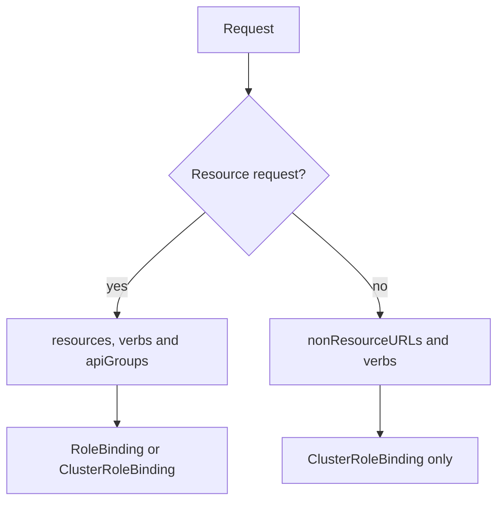

# Non-Resource URLs And Built-In Roles

Not every request to the API server is about a stored object. Monitoring tools fetch `/metrics`, load balancers call `/healthz` and clients ask for `/version`. These paths are **non-resource URLs**: the API server answers them, yet they are not Kubernetes resources and have no namespace, no API group and no object name. This part shows how RBAC covers them, which paths every caller can already read and which built-in roles the cluster ships with.

## Two kinds of request

The API server sorts each request into one of two kinds. A resource request has an API group, a resource such as `pods`, a verb such as `list` and sometimes a name or a namespace. A non-resource request has only a path and an HTTP method. The authorizer maps the HTTP method to a verb: `GET` becomes `get`, and `POST` becomes `post`.

A rule that covers a resource request uses `resources`. A rule that covers a non-resource request uses `nonResourceURLs`, and it has no `apiGroups`. A rule can hold one list or the other. A ClusterRole holds these rules, and a ClusterRoleBinding must bind it: a non-resource rule in a Role, or in a RoleBinding, has no effect.

## What every caller can already read

A new ServiceAccount is not completely powerless. The cluster ships with default roles for groups of callers. The ClusterRole `system:public-info-viewer` is bound to every authenticated and every unauthenticated caller, and it allows read-only access to non-sensitive information about the cluster. That covers the basic health and version endpoints. The ClusterRole `system:discovery` lets authenticated callers read the discovery paths that `kubectl` uses to learn the resource types. Check the state of a fresh ServiceAccount:

<!-- astrona:playground:renew -->

```sh
kubectl auth can-i --list --as=system:serviceaccount:starfleet:scout
```

The output has four columns: `Resources`, `Non-Resource URLs`, `Resource Names` and `Verbs`. Read the rows that have a path in the second column: they come from the default roles. You will also see rows for `selfsubjectreviews` and similar objects, which let a caller ask about itself. No row names `/metrics`.

## Grant one path

The `/metrics` page shows detailed internal data about the API server, so it is not public. The ClusterRole `system:monitoring` grants it, together with the health paths, to the group `system:monitoring`. A single account that only needs `/metrics` should receive less than that. First confirm that the path is denied:

```sh
kubectl auth can-i get /metrics --as=system:serviceaccount:starfleet:scout
```

The answer is `no`. Save this as `clusterrole-metrics-reader.yaml`:

```yaml
apiVersion: rbac.authorization.k8s.io/v1
kind: ClusterRole
metadata:
  name: metrics-reader
rules:
  - nonResourceURLs: ["/metrics"]
    verbs: ["get"]
```

Apply it:

```sh
kubectl apply -f clusterrole-metrics-reader.yaml
```

The ClusterRole alone grants nothing. Create the binding, then check the result:

```sh
kubectl create clusterrolebinding scout-metrics --clusterrole=metrics-reader --serviceaccount=starfleet:scout
kubectl auth can-i get /metrics --as=system:serviceaccount:starfleet:scout
```

The answer is `yes`. A real request proves it, and its large output goes to the null device here, so only the exit status matters:

```sh
kubectl get --raw /metrics --as=system:serviceaccount:starfleet:scout > /dev/null && echo allowed
```

## The wildcard and the suffix rule

In `nonResourceURLs`, the character `*` works only as a suffix. The entry `/healthz/*` matches every path below `/healthz`, but an entry such as `/*/metrics` is not a pattern. A path such as `/healthz` itself needs its own entry, which is why the cluster's health rule lists both `/healthz` and `/healthz/*`. A rule with `nonResourceURLs: ["*"]` and `verbs: ["*"]` allows every path on the API server, and it is part of what `cluster-admin` holds.



A non-resource rule takes effect only through a ClusterRoleBinding, because a path has no namespace.

## The built-in roles

The cluster creates ClusterRoles that start with `system:` for its own components. It also creates four general roles that are meant to be used in bindings:

- `cluster-admin` allows every action on every resource in every namespace and every non-resource URL. Bound by a ClusterRoleBinding it is full control of the cluster. Bound by a RoleBinding it is full control over every resource in that namespace, including the namespace itself.
- `admin` is meant to be given with a RoleBinding. It allows most actions inside a namespace, including creating Roles and RoleBindings there.
- `edit` allows reading and changing most objects in a namespace, but not Roles or RoleBindings.
- `view` allows read-only access to most objects in a namespace. It does not include Secrets.

List the real rules before you bind one:

```sh
kubectl describe clusterrole view
```

Read the output rather than trusting the name. The names are a good start, and each role has exceptions. Secrets are a clear example: `edit` and `admin` can read them, and `view` cannot.

The prefix `system:` is reserved for Kubernetes. Do not name your own users, groups or roles with it, because a name such as `system:masters` already carries cluster-admin power through a default binding.

You can now allow one path for one account and tell what a built-in role would hand out. The remaining question is who may create such grants at all, and what stops a user from giving away more than the user holds.

## Common pitfalls

> [!WARNING]
> A `nonResourceURLs` rule in a Role or a RoleBinding does nothing: use a ClusterRole with a ClusterRoleBinding. The `*` in a path works only at the end. Do not bind `system:monitoring` or `cluster-admin` to get one path, because both grant far more. Read the rules of a built-in role with `kubectl describe clusterrole` before you bind it.
