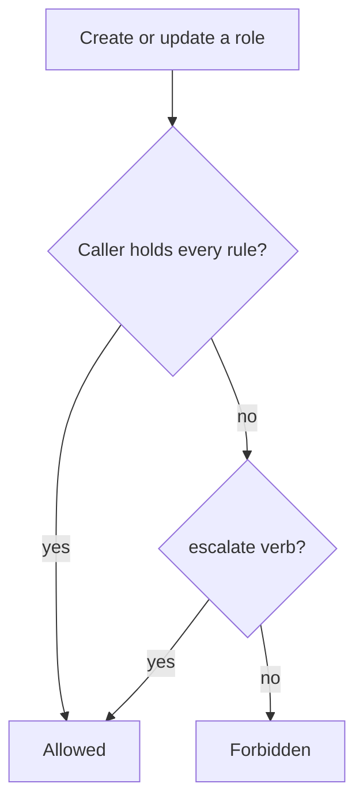

# Escalation Prevention And Sensitive Verbs

If anyone who can create a Role could write any rules into it, then the right to create Roles would be the right to do everything. The RBAC API blocks that. It checks every change to a Role, a ClusterRole or a binding against what the caller already holds. This part shows the check at work, the two verbs that bypass it on purpose, `escalate` and `bind`, the verb `impersonate` and a short list of grants that look harmless and are not.

## The rule

The API server enforces a rule on writes to roles and bindings. A user may create or update a Role or ClusterRole only if the user already holds every permission that the rules contain, in the same scope, or if the user has the `escalate` verb on `roles` or `clusterroles` in the `rbac.authorization.k8s.io` group. A user may create a binding only if the user already holds all the permissions of the referenced role, or if the user has the `bind` verb on that role.

The check does not depend on which authorizer approved the request, because it lives in the API itself. It prevents a person with a limited right to edit RBAC objects from raising their own access or somebody else's.

## See the rule refuse a request

The `rolemaker` ServiceAccount in `starfleet` has a Role that lets it `get`, `list` and `create` Roles and RoleBindings there, and `get` and `list` ConfigMaps. It has no right to read Secrets. Ask it to create a Role that grants Secret reads:

<!-- astrona:playground:renew -->

```sh
kubectl create role secret-peek -n starfleet --verb=get --resource=secrets --as=system:serviceaccount:starfleet:rolemaker
```

The command fails. The error says that the user is attempting to grant RBAC permissions not currently held, and it lists the rule that rolemaker lacks. The right to create Roles was not enough, because rolemaker does not hold the Secret permission itself. Now ask for a Role that grants only what rolemaker already holds:

```sh
kubectl create role config-peek -n starfleet --verb=get,list --resource=configmaps --as=system:serviceaccount:starfleet:rolemaker
```

This succeeds. A holder of a permission may delegate that same permission, and nothing more.



The API server compares the new rules with the caller's own permissions before it stores the role.

## Binding a role: the bind verb

The same check applies to a binding. Ask rolemaker to give the `scout` ServiceAccount the built-in `edit` role in `starfleet`:

```sh
kubectl create rolebinding scout-edit -n starfleet --clusterrole=edit --serviceaccount=starfleet:scout --as=system:serviceaccount:starfleet:rolemaker
```

This fails for the same reason: rolemaker does not hold all the permissions that `edit` contains. The remedy is to give it the `bind` verb, limited to the roles it may hand out. Save this as `clusterrole-role-grantor.yaml`:

```yaml
apiVersion: rbac.authorization.k8s.io/v1
kind: ClusterRole
metadata:
  name: role-grantor
rules:
  - apiGroups: ["rbac.authorization.k8s.io"]
    resources: ["clusterroles"]
    verbs: ["bind"]
    resourceNames: ["view"]
```

Apply it and bind it to rolemaker:

```sh
kubectl apply -f clusterrole-role-grantor.yaml
kubectl create clusterrolebinding rolemaker-role-grantor --clusterrole=role-grantor --serviceaccount=starfleet:rolemaker
```

Then check the result. Binding `view` is now allowed, and binding `edit` is still refused:

```sh
kubectl create rolebinding scout-view -n starfleet --clusterrole=view --serviceaccount=starfleet:scout --as=system:serviceaccount:starfleet:rolemaker
kubectl create rolebinding scout-edit -n starfleet --clusterrole=edit --serviceaccount=starfleet:scout --as=system:serviceaccount:starfleet:rolemaker
```

The `resourceNames` list is what keeps the grant narrow. Without it, `bind` on `clusterroles` lets the holder bind any ClusterRole, including `cluster-admin`. Remove the test binding when you finish, so that `scout` does not keep read access: `kubectl delete rolebinding scout-view -n starfleet`.

## Impersonation

The `impersonate` verb lets a caller act as another user, group or ServiceAccount. It applies to the resources `users`, `groups`, `serviceaccounts` and `userextras`. Every `--as` flag in this module works because the cluster administrator holds this permission. A caller who may impersonate `system:masters` can act as a cluster administrator, so give `impersonate` only with `resourceNames` that list the exact identities.

## Grants that are more powerful than they look

Escalation prevention guards RBAC objects only. Several other grants lead to the same result by another route:

- `get` or `list` on `secrets` reveals every credential in the namespace, including ServiceAccount token Secrets that older clusters created. A `list` call returns the secret data as well.
- `create` on `pods` lets a caller run a pod as any ServiceAccount in the namespace and read that account's token from inside, unless admission controls stop it.
- `create` on `serviceaccounts/token` lets a caller request a token for any ServiceAccount it names.
- `*` in `verbs`, `resources` or `apiGroups` matches future resources as well, including those that a CustomResourceDefinition adds later.
- `get` on `nodes/proxy` can reach the kubelet API on every node.

Review each of these when you review a role. The verb list looks short and can still allow a long chain.

You can now state who may write RBAC objects, what limits them and which grants reach the same result by another route. When you review a role, read each rule and ask what chain of actions it allows.

## Common pitfalls

> [!WARNING]
> `bind` without `resourceNames` lets the holder bind any ClusterRole, which is the same as holding `cluster-admin`. `escalate` removes the safety check for roles, so grant it almost never. The right to create RoleBindings alone does not let a user hand out roles it does not hold. Remove the test bindings you create while practising, because RBAC grants stay until deleted.
