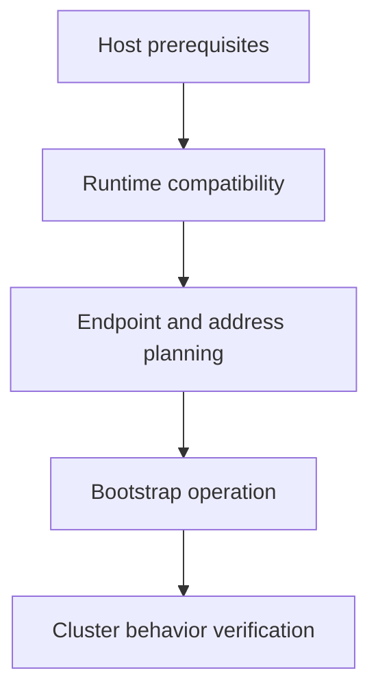

# Preparing Hosts, Runtime And Network Infrastructure

The installer starts, but nodes cannot reach the advertised API endpoint. Installation depends on a supported host, runtime and network contract before application objects can become useful.

## Learning objectives

- Identify host identity and capacity prerequisites.
- Explain kubelet runtime compatibility.
- Plan non-overlapping network address ranges.

## Before you start

This chapter is standalone reading material; no running cluster or installed tools are required. A Pod is the Kubernetes unit for running one or more containers, and a namespace groups namespaced objects. Treat the worked configurations as teaching examples rather than recorded observations from a provisioned environment.

## Responsible components and behavior

A Kubernetes node is a host on which the kubelet and a compatible container runtime support workload execution. Preparing a cluster requires more than installing the kubeadm executable. Host identity, runtime compatibility, resource capacity and network reachability must satisfy the chosen cluster design before bootstrap can produce a usable system.

## Identify The Intended Topology

A control-plane node runs components that manage desired state, while a worker node normally provides workload capacity. The chosen topology determines which endpoints and processes must be reachable. Distinct machine names and identities avoid registration ambiguity; the host's reachable addresses must also agree with the addresses advertised to other participants.

An application programming interface (API) endpoint provides access to the API server. For a highly available design, the stable control-plane endpoint normally points through suitable load-balancing infrastructure to several API servers. Choosing one temporary machine address during initial bootstrap can create a later mismatch between certificates, clients and the intended resilient endpoint.

Host resources must support both system components and expected workloads. A small machine that can start a kubelet may still lack capacity for control-plane processes and application Pods. Disk availability is important for images, logs and state, and reliable time supports certificate validation and consistent observations.

## Connect Kubelet And Runtime

The Container Runtime Interface (CRI) is the supported interface between the kubelet and the runtime service. A runtime must expose a compatible CRI endpoint. An installed image-building tool is not automatically the runtime service expected by the kubelet, and a running daemon at the wrong socket does not satisfy that connection.

Linux control groups organize and account for process resource use. The kubelet and runtime need compatible control-group driver settings for their environment. Mismatched settings can lead to node or workload failures even when both programs are installed. The correct choice follows the supported operating system and component versions rather than a copied setting from an unrelated host.

Swap handling is also configuration and version dependent. The kubelet's configured swap policy and the host's actual memory arrangement must agree with the supported design. Avoid claiming that one remembered setting is universally correct for every future Kubernetes release or workload type.

## Plan Addresses And Required Reachability

The host network, Pod address range and Service address range have different purposes. Overlapping those ranges with each other or with connected infrastructure can create confusing routes. Decide them with the network implementation's requirements before initialization rather than discovering the conflict after workloads appear.

A Container Network Interface (CNI) implementation establishes supported Pod networking. Kubeadm does not universally install the chosen network plugin for the administrator. The plugin can require specific kernel features, routes or firewall allowances. Installing its resource definitions is only one part of making its node agents and data path work.

Ports should be opened according to actual component responsibilities: API access, node-agent communication, datastore peer traffic and any required networking paths. Broadly disabling every firewall is not a substitute for understanding which participants need each connection. The precise supported port and protocol requirements belong to the chosen topology and implementations.

## Prepare Versions And Trust

Kubeadm, kubelet, client and control-plane versions must follow their supported compatibility rules. Package repositories and installation methods can change, so an administrator should identify the intended release and source before installing components. An arbitrary latest package on one host can make the cluster an unsupported version mixture.

Image retrieval requires access to the relevant registries or a designed local source. Certificates and credentials require protected storage and suitable permissions. Bootstrap tokens are sensitive join credentials, not values to publish in shared teaching output. Reading-only examples can describe their purpose without exposing real credentials.

Preparation succeeds when the selected hosts, runtime endpoints, identity, addresses and connectivity form a consistent design. Bootstrap then has the prerequisites to create the intended control plane. When it fails, distinguish an unmet infrastructure requirement from an error in the cluster's generated resources.

## Work through the decision

Separate the local prerequisites from cluster topology. The host needs compatible kernel and runtime behavior, supported control-group configuration and the required software versions. Nodes need endpoint reachability, suitable name resolution and coherent address ranges. The exact settings follow the chosen release and distribution.

Installing a bootstrap tool does not provision every external dependency. A load balancer, network plugin or storage integration can require its own configuration and credentials. Before initialization, state which component supplies each responsibility. Afterward, verify node reporting and representative Pod connectivity rather than treating the bootstrap command's success as a complete operating-cluster check.

Installation succeeds as a system only when host assumptions and independently supplied infrastructure agree.

Installation succeeds as a system only when host assumptions and independently supplied infrastructure agree.

## Common pitfalls

> [!WARNING]
> Installing kubeadm alone does not create Pod networking or guarantee runtime compatibility. Check host identity, non-overlapping address ranges, runtime settings and component reachability before interpreting bootstrap failure.
