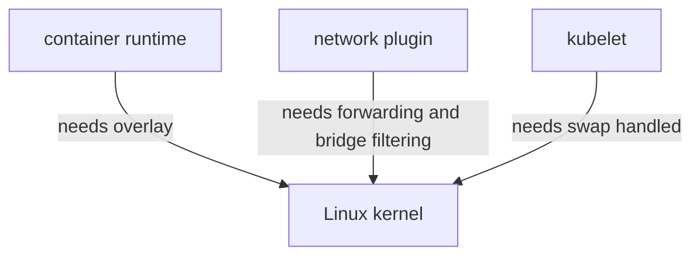
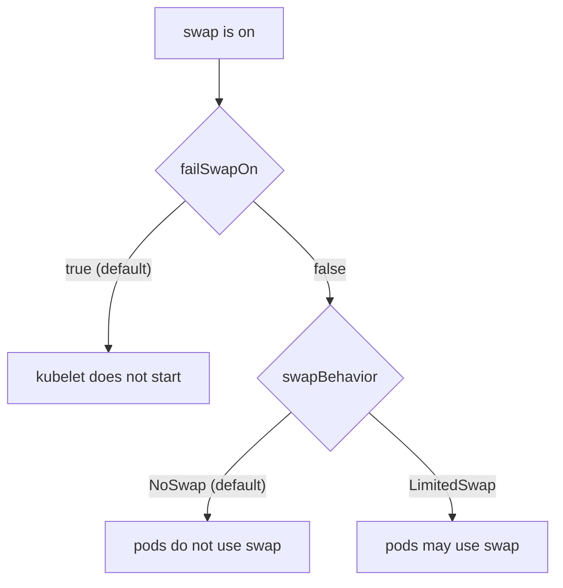

# Kernel Modules, sysctl And Swap

Kubernetes does not run on its own. Every container is a Linux process, and the Linux kernel decides how that process uses the network, the file system and memory. If the kernel is not set up the way the cluster expects, kubeadm stops at its first checks or the cluster starts and then fails in ways that look like application problems. This part explains the three kernel-level topics a node needs before installation: kernel modules, sysctl settings and swap.

## The kernel is part of the cluster

A **kernel module** is a piece of kernel code that you can load and unload while the system runs. A **sysctl** setting is a named kernel parameter, such as `net.ipv4.ip_forward`, that you can read and change through the `sysctl` command or through files below `/proc/sys`. Both change how the kernel behaves for every process on the host, including every container.

Three programs on a node depend on these settings. The container runtime (containerd or CRI-O) needs a layered file system to build container root file systems. The network plugin (the Container Network Interface, or CNI, implementation) needs the kernel to forward and filter packets. The kubelet, the node agent that starts pods, needs a memory layout it can account for. Each program reads the host state at its own start, and none of them can fix the kernel for the others.



The diagram shows that three separate programs read the same kernel, so one wrong kernel setting can break all three.

## Kernel modules for containers and bridges

Two modules appear in almost every Kubernetes installation guide. The `overlay` module provides the overlay file system. Container runtimes stack the read-only layers of an image and add one writable layer on top, and the overlay file system is the kernel feature that presents those layers as one directory.

The `br_netfilter` module makes traffic that crosses a Linux bridge visible to the packet filter (iptables or nftables). Many network plugins connect pods through a Linux bridge, and Service routing relies on packet filter rules. Without the module, the rules do not see bridged traffic and Service addresses can stop working for pods on the same node. Whether a node needs the module depends on the network plugin and on the kube-proxy mode, so read the plugin's own requirements as well.

On a host, you check and load a module like this:

```sh
lsmod | grep -E 'overlay|br_netfilter'
sudo modprobe overlay
sudo modprobe br_netfilter
```

The first command lists the loaded modules that match. The two `modprobe` commands load the modules now. This change lasts only until the next reboot.

To load the modules at every boot, a file in `/etc/modules-load.d/` lists one module name per line. The service `systemd-modules-load` reads these files at boot. A typical file is `/etc/modules-load.d/k8s.conf` with two lines, `overlay` and `br_netfilter`. Writing the file does not load anything by itself; it only declares what the next boot loads, so you run `modprobe` once as well.

## sysctl settings for routing and bridges

By default the Linux kernel does not route IPv4 packets between network interfaces. A pod network needs that routing, because a packet from a pod on one node leaves through a host interface toward another node. The setting is `net.ipv4.ip_forward`, and the value `1` turns routing on. Most network plugins change it when they need it, but some expect the administrator to set it first. The kubeadm preflight phase checks it as well.

Two related settings, `net.bridge.bridge-nf-call-iptables` and `net.bridge.bridge-nf-call-ip6tables`, tell the kernel to pass bridged IPv4 and IPv6 traffic through the packet filter. These two settings exist only after `br_netfilter` is loaded, which is why the module must be loaded first.

Save the settings in a file that `sysctl --system` reads at boot and on demand:

```sh
sudo tee /etc/sysctl.d/k8s.conf <<'CONF'
net.ipv4.ip_forward = 1
net.bridge.bridge-nf-call-iptables = 1
net.bridge.bridge-nf-call-ip6tables = 1
CONF
sudo sysctl --system
sysctl net.ipv4.ip_forward
```

The last command prints the current value, and it must print `net.ipv4.ip_forward = 1`. If you only run `sysctl -w` the value is lost at the next boot, and the node comes back with a setting that nobody can find in a file.

## Look at the playground node

The playground node is a container, so the kernel it uses belongs to the machine that runs the container engine, and the node reports that kernel through the API. Run this from your own terminal.

<!-- astrona:playground:renew -->

```sh
kubectl get nodes -o wide
kubectl get nodes -o jsonpath='{.items[0].status.nodeInfo.kernelVersion}{"\n"}'
```

The first command lists the node with its kernel version, operating system image and container runtime. The second command prints only the kernel version, which comes from `status.nodeInfo`. The kubelet fills this block and refreshes it, so the API always shows what the node itself reported.

You can read a sysctl value inside the node container too. With Docker the command is shown here; with Podman replace `docker` with `podman`.

```sh
docker exec astro-ats-025-playground-020-02-control-plane sysctl net.ipv4.ip_forward
```

It prints the value that the kernel of the container engine host holds for the node. A value of `1` is what kubeadm requires.

## Why the kubelet refuses swap

**Swap** is disk space that the kernel uses as an extension of memory. When memory runs low, the kernel moves pages of memory to disk. A container memory limit is a promise about physical memory, and the kernel counts pages on disk differently from pages in memory. A process can exceed its limit without being stopped, and a pod that should be killed for using too much memory only becomes slow.

For this reason the kubelet fails to start on a node where swap is on. The kubelet configuration field is `failSwapOn`, and its default is `true`. kubeadm also reports swap in its preflight checks as an error, which stops `kubeadm init` before it changes the host.

You have two ways out. To disable swap, run `sudo swapoff -a`, which lasts until reboot, and remove or comment the swap line in `/etc/fstab` (or the systemd swap unit) so it stays off. To tolerate swap instead, set `failSwapOn: false` in the kubelet configuration. In that case pods still do not use swap, because the `memorySwap.swapBehavior` field defaults to `NoSwap`. The value `LimitedSwap` is what allows Kubernetes workloads to use swap, and you should choose it deliberately.



The diagram shows that swap alone does not decide the outcome: the kubelet configuration decides whether the node starts and whether pods may use swap.

You can read swap capacity from the node status. The field exists only when the kubelet reports it, so an empty result is possible.

```sh
kubectl get nodes -o go-template='{{range .items}}{{.metadata.name}}: {{if .status.nodeInfo.swap.capacity}}{{.status.nodeInfo.swap.capacity}}{{else}}<unknown>{{end}}{{"\n"}}{{end}}'
```

On a real host you use `swapon --show` or `free -h` to see the swap areas directly.

## What you can conclude

You now know that a node depends on kernel modules, on sysctl values and on a swap decision, and that each of them needs a file to survive a reboot. You also know that the API shows the kernel version and, when reported, the swap capacity of each node, so you can audit a node without a shell on it. The open question is the fourth shared fact: the kubelet and the container runtime both create control groups, and they must agree on how. The next part covers that.

## Common pitfalls

> [!WARNING]
> A value set with `sysctl -w` or a module loaded with `modprobe` is lost at reboot; write `/etc/sysctl.d/` and `/etc/modules-load.d/` files too. The bridge settings do not exist until `br_netfilter` is loaded, so load the module before you apply the settings. Disabling swap with `swapoff -a` alone returns after a reboot if `/etc/fstab` still mounts it. Setting `failSwapOn: false` stops the kubelet from failing, but it does not give pods swap.
