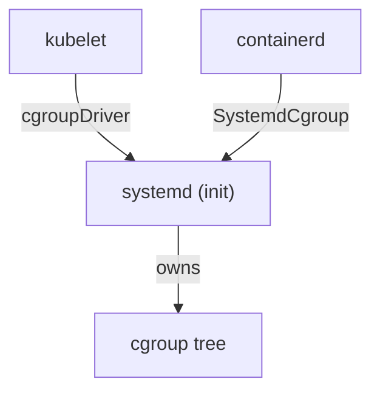

# The cgroup Driver And kubelet Configuration

Two programs on every node create and manage the resource limits of containers: the kubelet and the container runtime. If they use different methods, the node can show strange memory behavior or pods that fail to start, even though both programs are healthy on their own. This part explains control groups, the two drivers that manage them, the setting on each side that must match, and the place where kubeadm stores the kubelet configuration so you can read it.

## What a control group is

A **control group** (cgroup) is a Linux kernel feature that puts processes into a group and limits or counts what the group uses: memory, processor time and more. A container memory limit such as `limits.memory: 128Mi` becomes a value in the cgroup of that container. The kernel then enforces it, and it stops a process that goes over.

Cgroups form a tree. The kubelet creates a branch for each pod and a leaf for each container, and the runtime fills in the container's own settings. Both programs write into the same tree, so they must follow one set of rules about who creates and owns each entry.

The kernel offers two versions of this feature. Version 1 has a separate tree for each resource. Version 2, also called the unified hierarchy, has one tree for all resources. Recent distributions use version 2 by default, and some Kubernetes features, such as the swap settings that limit pod use, depend on it.

## Two drivers: cgroupfs and systemd

A **cgroup driver** is the method a program uses to create and change cgroups. There are two.

- The `cgroupfs` driver writes directly into the cgroup file system that the kernel exposes, usually below `/sys/fs/cgroup`.
- The `systemd` driver asks the init system, systemd, to create the cgroups. systemd is the first process on most Linux distributions and it already owns the cgroup tree on those hosts.

If systemd is the init system and the kubelet also writes into the tree with `cgroupfs`, two programs manage the same tree through two different methods. The Kubernetes documentation does not recommend `cgroupfs` when systemd is the init system, and on cgroup version 2 you should use `systemd`. The kubelet and the runtime must use the same driver. The kubelet cannot detect the driver of the runtime in the version this course uses, so you set both sides yourself.



The diagram shows both programs asking systemd to manage the tree when each side is set to the `systemd` driver.

## Set the driver on both sides

On the kubelet side, the setting is the `cgroupDriver` field of the `KubeletConfiguration`, an object of kind `KubeletConfiguration` in the API group `kubelet.config.k8s.io/v1beta1`. With kubeadm you can pass this object in the same file as the cluster configuration.

On the runtime side, containerd reads `/etc/containerd/config.toml`. The setting is `SystemdCgroup = true` in the options of the `runc` runtime. In containerd 1.x the table is `plugins."io.containerd.grpc.v1.cri".containerd.runtimes.runc.options`. In containerd 2.x the table is `plugins.'io.containerd.cri.v1.runtime'.containerd.runtimes.runc.options`. After you change the file you restart containerd. Also make sure `cri` is not in the `disabled_plugins` list of that file, because the kubelet talks to containerd through its CRI plugin.

If you use CRI-O instead, it has its own cgroup manager setting, and you must set it to the same driver as the kubelet.

Changing the driver on a node that already joined a cluster is risky, because the existing pods hold cgroups that the other driver created. The safer approach is to replace the node with a new one that has the right driver from the start.

## Where kubeadm keeps the kubelet configuration

kubeadm builds one cluster-wide `KubeletConfiguration`. It stores it in two places. The first is the ConfigMap `kubelet-config` in the `kube-system` namespace, which every node can read when it joins. The second is a file on each node, `/var/lib/kubelet/config.yaml`, which the kubelet reads at start. Related files on the node are `/var/lib/kubelet/kubeadm-flags.env`, which holds flags that kubeadm passes to the kubelet (including dynamic values), and `/etc/kubernetes/kubelet.conf`, which holds the kubeconfig that the kubelet uses to talk to the API server.

Because the ConfigMap is in the API, you can audit the setting of the whole cluster without a shell on a node.

<!-- astrona:playground:renew -->

```sh
kubectl -n kube-system get configmap kubelet-config -o jsonpath='{.data.kubelet}'
```

The command prints the stored `KubeletConfiguration` as YAML text. Find the lines `cgroupDriver` and `failSwapOn` in it. If a field is not in the text, the kubelet uses its own default: for `failSwapOn` the default is `true`.

To print only the driver line:

```sh
kubectl -n kube-system get configmap kubelet-config -o jsonpath='{.data.kubelet}' | grep -E '^(cgroupDriver|failSwapOn)'
```

A node that already runs carries a copy of this object in `/var/lib/kubelet/config.yaml`. Editing the ConfigMap does not change a running kubelet. A node picks up a changed ConfigMap only when kubeadm writes it again, for example during a join or an upgrade.

## Read the node's own report

The kubelet also writes facts about its node into the node status, in the block `status.nodeInfo`. It holds, among others, `kernelVersion`, `osImage`, `containerRuntimeVersion` and `kubeletVersion`. These are facts the node itself measured, which makes them the right source when you audit a host through the API.

```sh
kubectl get nodes -o jsonpath='{range .items[*]}{.metadata.name}{"\n"}{.status.nodeInfo.containerRuntimeVersion}{"\n"}{.status.nodeInfo.kubeletVersion}{"\n"}{.status.nodeInfo.kernelVersion}{"\n"}{.status.nodeInfo.osImage}{"\n"}{end}'
```

The command prints one block of five lines for each node: its name, the runtime and its version, the kubelet version, the kernel version and the operating system image. The runtime value starts with the runtime name, for example `containerd://` followed by a version number.

## Record the facts

Write a readiness record that holds what you read. The playground starts with the ConfigMap `host-readiness` in `starfleet` and every value set to `unset`. Replace each placeholder with the value that your own cluster reported.

Save this as `configmap-host-readiness.yaml`:

```yaml
apiVersion: v1
kind: ConfigMap
metadata:
  name: host-readiness
  namespace: starfleet
data:
  cgroupDriver: <DRIVER>
  failSwapOn: <TRUE-OR-FALSE>
  containerRuntimeVersion: <RUNTIME>
  kubeletVersion: <KUBELET>
  kernelVersion: <KERNEL>
  osImage: <OS>
```

Replace the six placeholders with the values you read above, then apply it:

```sh
kubectl apply -f configmap-host-readiness.yaml
```

Then check the result:

```sh
kubectl -n starfleet get configmap host-readiness -o yaml
```

The output lists the six keys with your values. The record is a snapshot: after a node upgrade or an operating system change, read the values again.

## What you can conclude

You now know that control groups carry the resource limits of containers, that two drivers create them, and that the kubelet and the runtime must use the same one. You also know where kubeadm stores the kubelet configuration and where a node reports its own versions. This closes the host settings that kernel, runtime and kubelet share, and the next step in preparation is to install the right packages and to check the ports and identity of the hosts.

## Common pitfalls

> [!WARNING]
> Setting `cgroupDriver: systemd` in the kubelet and leaving containerd on the `cgroupfs` driver (`SystemdCgroup = false`) is the most common mismatch. Check both sides after every change. Editing the `kubelet-config` ConfigMap does not change a node that already runs, and the value you see there may differ from `/var/lib/kubelet/config.yaml` on an older node. A field that is absent from the ConfigMap is not an empty value: the kubelet applies its own default.
