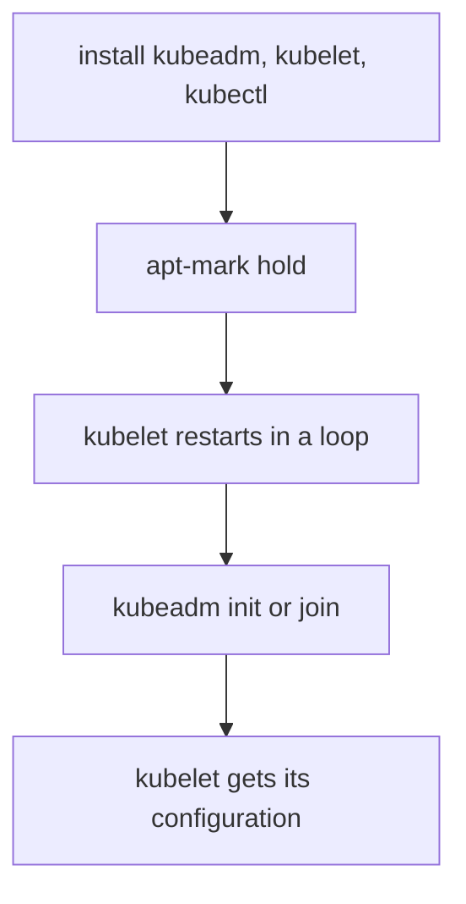

# Packages And Host Identity

A machine that joins a cluster must have the cluster software in a supported version, and the cluster must be able to tell the machine apart from every other one. Both conditions are checked early, and both are cheap to prepare. This part explains the three packages, how to install and hold them, what happens to the kubelet before the cluster exists, and why hostname, MAC address and `product_uuid` must be unique.

## Three packages with three jobs

A kubeadm installation uses three programs, and each has a different job.

- **kubeadm** is the command that creates a cluster (`kubeadm init`) or adds a node to it (`kubeadm join`). It runs once to set up the node and then stays on disk for upgrades and certificate work.
- **kubelet** is the agent that runs on every node. It reads pod definitions, asks the container runtime to start containers and reports node and pod status to the API server. It runs as a system service all the time.
- **kubectl** is the command-line client of the API. It needs a kubeconfig file with the address and credentials of a cluster. A node does not need it to work, but an administrator needs it to see the cluster.

The three come as separate packages, and their versions follow the support rules of Kubernetes. kubeadm and the kubelet on a node must fit the control plane version it joins: the kubelet may be older than the API server by the allowed skew, but it must never be newer. kubeadm itself warns or fails when the versions are out of range, and the preflight checks include this comparison.

## Install from the repository of one minor version

The Kubernetes project publishes packages for Debian-based and Red Hat-based systems at `pkgs.k8s.io`. There is one repository for each minor version, and the version is part of the repository address: `https://pkgs.k8s.io/core:/stable:/v<MINOR>/deb/` for Debian-based systems and `https://pkgs.k8s.io/core:/stable:/v<MINOR>/rpm/` for Red Hat-based systems. To install Kubernetes 1.35 you use the `v1.35` repository. A host that points at the repository of another minor version installs that version.

On a Debian-based host you add the signing key and the repository line, and then install and hold the packages:

```sh
sudo apt-get update
sudo apt-get install -y kubelet kubeadm kubectl
sudo apt-mark hold kubelet kubeadm kubectl
```

`apt-mark hold` marks the three packages so that `apt-get upgrade` and automatic updates do not change them. A cluster upgrade is a planned procedure in which kubeadm, then the control plane and then each kubelet move one step. An unattended package update that moves one kubelet on its own breaks that order, so you hold the packages and unhold them only for a planned upgrade.

Optionally you enable the kubelet service before kubeadm runs:

```sh
sudo systemctl enable --now kubelet
```

After this command the kubelet restarts every few seconds. That is expected: the kubelet waits in a loop for kubeadm to give it a configuration, and `kubeadm init` or `kubeadm join` provides it. Do not try to fix this crash loop by editing kubelet files before you run kubeadm.



The diagram shows the order on a new node: the kubelet only runs steadily after kubeadm writes its configuration.

## Machine requirements

The kubeadm documentation lists the minimum for each machine: a compatible Linux host, 2 GB or more of memory, 2 or more processors for a control plane machine, and full network connectivity between all machines of the cluster. kubeadm programs are dynamically linked and expect the `glibc` library, so a distribution that uses another C library may need a compatibility layer. The user who runs `kubeadm init` must be root, and a preflight check enforces that.

These values are minimums for the control plane processes alone. Application pods need more. Plan the real size from the workload, and leave disk space for images and logs.

## Identity: hostname, MAC address and product_uuid

Kubernetes identifies a node by its name, which by default is the hostname of the machine. Two machines with the same hostname try to register the same Node object, and the second one overwrites or conflicts with the first. The hostname must also be a valid DNS subdomain name: lowercase letters, digits, dashes and dots. A preflight check treats an invalid hostname as an error and treats a hostname that cannot be resolved through the network as a warning.

The MAC address and the `product_uuid` are two more identifiers that the installation relies on. Machines created by cloning one virtual machine image can carry identical values, and Kubernetes uses these values to identify nodes, so duplicates can make the installation fail. You compare them on every host:

```sh
ip link
sudo cat /sys/class/dmi/id/product_uuid
hostname
```

`ip link` lists the network interfaces and their MAC addresses. The second command prints the `product_uuid` from the firmware tables of the machine. The third prints the hostname. The three values must differ between all the nodes of the cluster.

## Read the identity facts from the API

When the nodes already run, you do not need a shell to compare their identities. The node status holds the machine identifiers that the kubelet read.

<!-- astrona:playground:renew -->

```sh
kubectl get nodes
kubectl get nodes -o jsonpath='{range .items[*]}{.metadata.name}{"\t"}{.status.nodeInfo.systemUUID}{"\t"}{.status.nodeInfo.machineID}{"\n"}{end}'
```

The first command lists the nodes by name with their versions. The second prints one line per node with its name, `systemUUID` and `machineID`. On a multi-node cluster you would look for repeated values in a column. The playground has one node, so every value is unique by definition; the command is the audit you would run on a real cluster.

You can also read the kubelet version in the same status block. Compare it with the control plane version to check the skew.

```sh
kubectl get nodes -o jsonpath='{range .items[*]}{.metadata.name}{"\t"}{.status.nodeInfo.kubeletVersion}{"\n"}{end}'
kubectl version
```

The last command prints the client version and the server version. The kubelet version of each node must not be newer than the server version.

## What you can conclude

You now know what each of the three packages does, how to install them from the repository of one minor version, why you hold them, and why the kubelet restarts until kubeadm runs. You also know that every node needs a unique hostname, MAC address and `product_uuid`, and that the API shows the identifiers a node reports. The next question is network access: which ports must be open, and what kubeadm checks before it starts.

## Common pitfalls

> [!WARNING]
> Pointing the package repository at the wrong minor version installs the wrong version without any error. Forgetting `apt-mark hold` lets a routine update upgrade one kubelet ahead of the control plane. A restarting kubelet before `kubeadm init` is normal, so do not fix it by hand. Virtual machines cloned from one image often share the `product_uuid` or MAC address, so check every clone and give each machine its own hostname.
