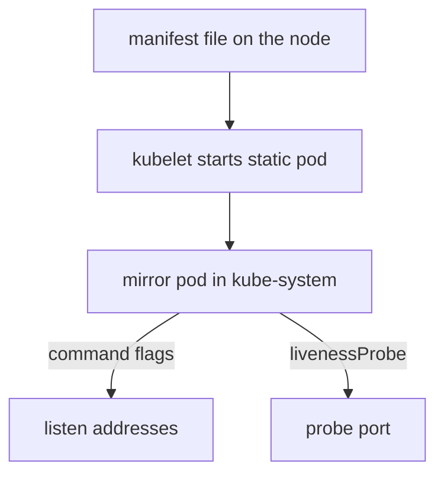

# Ports And Preflight Checks

Components of a cluster talk to each other over the network, and a firewall that blocks one of those connections breaks the cluster in a way that is hard to trace. Before it changes anything, kubeadm also runs a set of preflight checks on the host. This part lists the ports that each kind of node needs, shows how to read the real ports from the control plane of a running cluster, and explains the preflight phase and the option that skips its errors.

## Ports on a control plane node

A **port** is a number that, together with an address and a protocol, identifies one listening service on a machine. A control plane node runs several services, and each of them needs inbound access from specific callers. The documented defaults are:

| Port | Protocol | Used by | Purpose |
| --- | --- | --- | --- |
| 6443 | TCP | all | Kubernetes API server |
| 2379-2380 | TCP | kube-apiserver and etcd | etcd server client API and peer traffic |
| 10250 | TCP | the node itself and the control plane | kubelet API |
| 10259 | TCP | the node itself | kube-scheduler |
| 10257 | TCP | the node itself | kube-controller-manager |

The API server port 6443 is the entry point for every client, every kubelet and every other control plane component, so it must be reachable from all of them. etcd is the key-value database that stores all cluster state. Its client port is 2379 and its peer port is 2380. The peer port is used between etcd members, so with a single etcd member you open it only for that member's own needs. The scheduler and the controller manager listen for secure requests, such as health and metrics requests, and the table marks them as used by the node itself.

You can host etcd outside the control plane nodes, on your own machines and ports. All default port numbers can be changed, and when you use a custom port, that port must be open instead of the default.

## Ports on a worker node

Worker nodes run fewer services. They need:

| Port | Protocol | Used by | Purpose |
| --- | --- | --- | --- |
| 10250 | TCP | the node itself and the control plane | kubelet API |
| 10256 | TCP | the node itself and load balancers | kube-proxy |
| 30000-32767 | TCP and UDP | all | NodePort Services, default range |

The kubelet API on port 10250 is how the control plane reaches a node for logs, exec and port forwarding. kube-proxy is the node component that programs Service routing, and port 10256 is its health endpoint. A **NodePort** Service opens one port from a range on every node, and the default range is 30000 to 32767. You open that range only if you use NodePort Services, and you can narrow it with the API server flag `--service-node-port-range`.

Open the ports a topology needs, between the machines that need them. Turning the firewall off on all hosts hides the question instead of answering it, and it exposes the kubelet API to every machine on the network.

## The declaration of a port is in the cluster

A control plane component in a kubeadm cluster runs as a **static pod**: a pod that the kubelet starts from a manifest file in `/etc/kubernetes/manifests` on the node, without the API server. The kubelet also creates a read-only copy of each static pod in the API, called a mirror pod. The mirror pods live in `kube-system`, their names end with the node name, and kubeadm labels them with `component` and `tier=control-plane`.

The port of a component is in that definition: in the command line flags, or in the probe that the kubelet uses to check the component. You can read both through the API, which is the audit you run on a cluster you cannot log in to.

<!-- astrona:playground:renew -->

```sh
kubectl -n kube-system get pods -l tier=control-plane
kubectl -n kube-system get pod -l component=kube-apiserver -o jsonpath='{range .items[0].spec.containers[0].command[*]}{@}{"\n"}{end}'
```

The first command lists the control plane pods. The second prints the command line of the API server, one argument per line. Look for flags that name a port or an address, for example `--secure-port`, and for the service address range flag.

The health probes of kubeadm static pods declare the port directly. For the API server, the scheduler and the controller manager, print the probe port:

```sh
kubectl -n kube-system get pod -l component=kube-apiserver -o jsonpath='{.items[0].spec.containers[0].livenessProbe.httpGet.port}{"\n"}'
kubectl -n kube-system get pod -l component=kube-scheduler -o jsonpath='{.items[0].spec.containers[0].livenessProbe.httpGet.port}{"\n"}'
kubectl -n kube-system get pod -l component=kube-controller-manager -o jsonpath='{.items[0].spec.containers[0].livenessProbe.httpGet.port}{"\n"}'
```

Each command prints one number, and it should match a documented default unless the installation changed it. etcd declares its client and peer addresses as flags:

```sh
kubectl -n kube-system get pod -l component=etcd -o jsonpath='{range .items[0].spec.containers[0].command[*]}{@}{"\n"}{end}' | grep -E 'listen-(client|peer)-urls'
```

The output lists the two address flags. The number after the last colon of each address is the port.

The kubelet port is in the node status, not in a pod:

```sh
kubectl get nodes -o jsonpath='{.items[0].status.daemonEndpoints.kubeletEndpoint.Port}{"\n"}'
```



The diagram shows that the files on the node and the pods in the API describe the same component, so the API is a safe place to read the port from.

## Record the ports

Write the ports of your cluster in the ConfigMap `control-plane-ports`. The playground starts with every value set to `unset`. Replace each placeholder with the number you read.

Save this as `configmap-control-plane-ports.yaml`:

```yaml
apiVersion: v1
kind: ConfigMap
metadata:
  name: control-plane-ports
  namespace: starfleet
data:
  apiserver: "<PORT>"
  etcdClient: "<PORT>"
  etcdPeer: "<PORT>"
  scheduler: "<PORT>"
  controllerManager: "<PORT>"
  kubelet: "<PORT>"
```

Replace the six placeholders, then apply it:

```sh
kubectl apply -f configmap-control-plane-ports.yaml
```

Then check the result:

```sh
kubectl -n starfleet get configmap control-plane-ports -o yaml
```

## What kubeadm checks first

The command `kubeadm init` starts with the phase `preflight`, which validates the state of the system before it makes any change. You can run only this phase:

```sh
sudo kubeadm init phase preflight
```

The phase accepts the same options that matter for host preparation: `--config` for a kubeadm configuration file, `--cri-socket` to name the runtime socket when kubeadm cannot detect it (it auto-detects the socket when the flag is empty), `--image-repository` (default `registry.k8s.io`), `--dry-run` and `--ignore-preflight-errors`.

Each check ends in an error or a warning. An error stops kubeadm until you fix the cause or skip it on purpose. Among the documented checks are these:

- An error if the kernel is older than the required minimum or if the required control group subsystems are not set up.
- An error if the container runtime endpoint does not answer.
- An error if the user is not root.
- An error if the hostname is not a valid DNS subdomain, and a warning if the hostname cannot be looked up through the network.
- An error if the kubelet version is lower than the minimum that kubeadm supports, or at least one minor version higher than the control plane version.
- A warning if the kubelet service does not exist or is disabled, and a warning if `firewalld` is active.
- An error if the API server port or the kubelet port is in use.
- An error if the directory `/etc/kubernetes/manifests` already exists and is not empty.
- An error if swap is on.
- An error if the commands `ip`, `iptables`, `mount` or `nsenter` are missing, and a warning if `ethtool`, `tc` or `touch` are missing.

## Ignore an error on purpose

The option `--ignore-preflight-errors` takes a comma-separated list of check names and turns their errors into warnings. For example, `--ignore-preflight-errors=Swap` allows installation on a node with swap on. The value `all` ignores every check.

Ignoring is right when you understand the condition and have accepted it: swap is on and the kubelet configuration sets `failSwapOn: false`, or a port is in use by a service that you have decided to keep. Ignoring is wrong as a way to get past a message. Each ignored check tells you something about the host that would otherwise surface later as a failure of the cluster. Use `--dry-run` to see what kubeadm would do without changing the host, and never use `all` on a production node.

## What you can conclude

You now know the default ports of the control plane and the worker nodes, how to read the real ports from the static pods and the node status, which checks kubeadm runs before it starts, and when it is acceptable to skip one. The module has covered the last host preparation steps: packages, identity, ports and preflight checks. Together with the kernel, swap and cgroup settings, they decide whether `kubeadm init` can start.

## Common pitfalls

> [!WARNING]
> Old guides name the scheduler and controller manager ports 10251 and 10252 and the kubelet read-only port 10255; current clusters use 10259, 10257 and 10250. Opening only port 6443 is not enough: the kubelet port 10250 must be open between the control plane and every node, or logs and exec fail. `--ignore-preflight-errors=all` hides every problem, not only the one you meant to skip. A check that passes on one host does not prove the next host is ready, so run it on every node.
