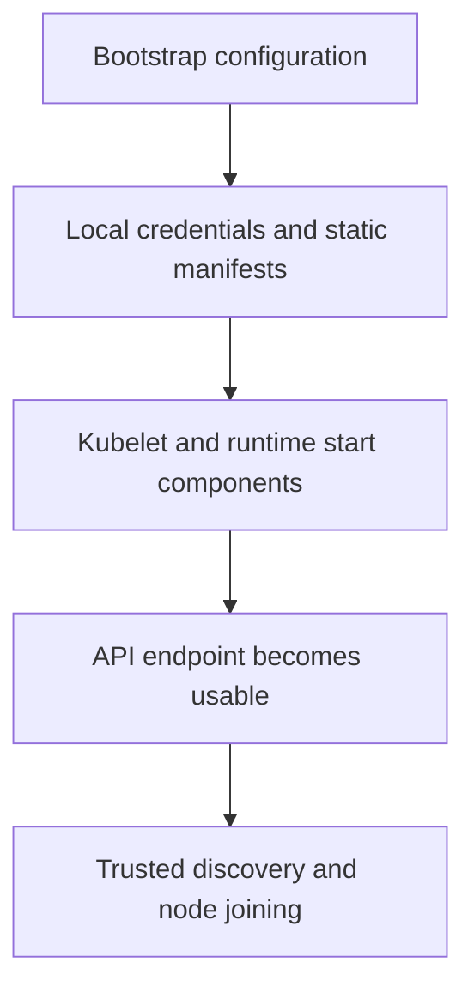
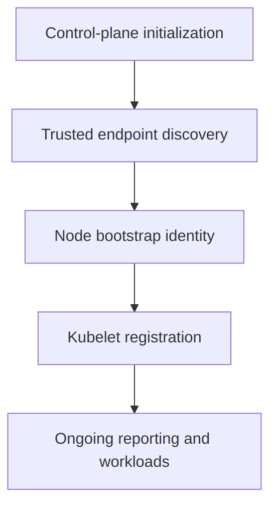

# Understanding kubeadm Initialization And Node Joining

A worker joins using bootstrap discovery, but later cannot report through the API. Joining and continued authenticated operation are different stages of the node lifecycle.

## Learning objectives

- Distinguish initialization from worker or control-plane joining.
- Explain static manifests and runtime bootstrap.
- Evaluate discovery trust and temporary credentials.

## Before you start

This chapter is standalone reading material; no running cluster or installed tools are required. A Pod is the Kubernetes unit for running one or more containers, and a namespace groups namespaced objects. Treat the worked configurations as teaching examples rather than recorded observations from a provisioned environment.

## Responsible components and behavior

Kubeadm is a tool that bootstraps and manages selected lifecycle operations for Kubernetes clusters. Initialization establishes an initial control plane using the chosen configuration. Joining adds a machine to that existing cluster through discovery, trust establishment and node setup. These operations have different inputs and should not be treated as interchangeable ways to repair any cluster failure.

## Read The Initialization Contract

Initialization needs an intended Kubernetes version, endpoint and node configuration. Cluster-wide settings and initial-node settings are distinct. The stable control-plane endpoint is especially important when later API servers will join behind a shared access address. The API server's advertised address identifies its own reachable instance, which is not necessarily the same role as the stable frontend endpoint.

Kubeadm can generate certificates, kubeconfig files and static Pod manifests for core components. A kubeconfig contains access configuration for an identity and target cluster. A static Pod is managed directly by the kubelet from a local manifest source, rather than created initially through a workload controller API request.

The kubelet reads the relevant local manifests and asks the runtime to start the control-plane containers. This explains why the runtime, filesystem permissions and kubelet condition matter before ordinary API-based inspection is available. An error in local preparation can prevent the API server from starting at all.

## Discovery And Bootstrap Trust

A joining node needs to find the intended API endpoint and verify it is joining the expected cluster. Token-based discovery commonly combines a bootstrap credential with a certificate-authority public-key hash used to establish the expected trust. A certificate authority (CA) signs certificates trusted for the relevant cluster relationship.

Bypassing discovery verification weakens that trust decision. The proper conceptual requirement is to authenticate the intended cluster rather than accept any endpoint that responds at a supplied address. Protect bootstrap credentials and limit their lifetime and scope according to the supported joining workflow.

The node can then establish the credentials used for its kubelet communication under the bootstrap process. Expired or unsuitable tokens, inaccessible endpoints and trust mismatches produce different failure causes. Recreating a token cannot repair a firewall that blocks the endpoint, while opening a port cannot repair a certificate naming or trust defect.

## Complete The Network And Node Role

After initial bootstrap, the chosen network implementation must provide Pod networking. Until that infrastructure is healthy, nodes or system workloads can remain unready. A successful initialization message is therefore not the same as a fully usable workload cluster.

Joining a worker adds workload capacity but does not automatically make it another API server or datastore member. Joining an additional control-plane node requires the control-plane workflow and its certificate and topology requirements. The role selected during joining determines which local components the machine must run.

Control-plane taints normally influence whether ordinary workloads schedule there. Removing or tolerating a taint changes workload eligibility, not the role of the API server or the safety of datastore replication. A compact learning cluster and a resilient production topology can therefore have different placement choices.

## Diagnose The Bootstrap Stage

If the runtime cannot start a control-plane container, examine the runtime connection and local manifest conditions. If the API server starts but another node cannot discover it, examine the endpoint and network path. If a node joins but remains unready, examine kubelet, runtime and networking observations.

Reset behavior removes selected local kubeadm-managed state, but it is not a universal reversal of every network, external datastore or host change. A reset should not be proposed casually as a substitute for locating the failed stage. Understand what state is being removed and which dependencies remain.

A successful join should be connected to the node's registered identity, readiness and intended role. The cluster's working network and component health then support ordinary workloads. Those observations explain completion more clearly than treating the existence of a copied join line as proof that the machine is ready.

## Dependency Flow

## Work through the decision

kubeadm prepares supported control-plane and node bootstrap configuration. Initialization establishes an initial control plane and its trust material under the selected topology. Joining uses endpoint discovery and bootstrap credentials to establish the node's supported relationship with that control plane.

Protect bootstrap authority and verify the intended endpoint. A joining node still needs a working runtime, compatible host settings and the installed Pod network. A Ready node reports useful agent state; it does not establish every application dependency. A failed later certificate or endpoint relationship should be diagnosed at that boundary rather than repeatedly treating the machine as though it had never joined.

Bootstrap establishes a trust and configuration relationship that still needs continuing runtime and network support.

Bootstrap establishes a trust and configuration relationship that still needs continuing runtime and network support.

## Common pitfalls

> [!WARNING]
> Initialization, discovery, credential bootstrap and Pod networking are separate stages. Protect join trust and credentials, and do not assume that a worker join creates a highly available control plane.
