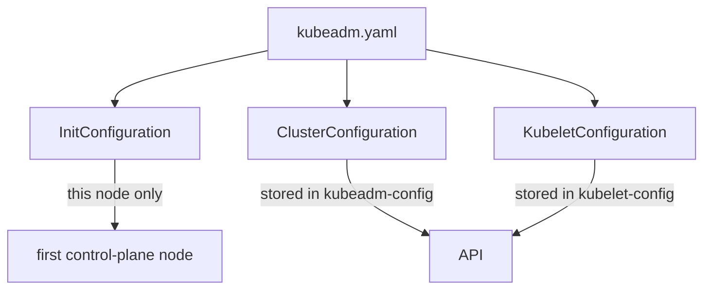

# Configuration Kinds And Fields

Every `kubeadm init` run answers the same questions. Which Kubernetes version should the control plane run? Which address range do pods and Services use? What is the stable address of the API server? You can answer them with flags, but a long command line is easy to mistype and impossible to review later. A kubeadm configuration file holds the same answers in a form you can read, store and run again. This part explains what the file contains and which setting goes where.

## One file, several kinds

**kubeadm** is the command-line tool that creates a Kubernetes control plane and joins nodes to it. It reads its configuration from a YAML file passed with `--config`. The file is a stream of documents separated by `---`. Each document has an `apiVersion` and a `kind`, in the same way as a Kubernetes object, but the documents are not stored as API objects. kubeadm reads them, uses them and discards the file.

The API version for Kubernetes 1.35 is `kubeadm.k8s.io/v1beta4`. The kinds that matter are these:

| Kind | Used by | What it holds |
| --- | --- | --- |
| `InitConfiguration` | `kubeadm init` | Settings of the first node only: bootstrap tokens, node name, container runtime socket, the address the API server advertises |
| `ClusterConfiguration` | `kubeadm init` | Settings of the whole cluster: Kubernetes version, cluster name, control plane endpoint, networking, certificate directory, etcd, image repository |
| `JoinConfiguration` | `kubeadm join` | Settings of one joining node: how to find and trust the API server, node name, and control-plane details when the node becomes a control-plane node |
| `KubeletConfiguration` | `kubeadm init` and `kubeadm join` | Settings for the kubelet, the agent that runs on every node and starts the containers |

Two of these kinds describe one machine and two describe the cluster. This split matters later. A node that joins never sends its own `ClusterConfiguration`. It reads the cluster-wide copy that `kubeadm init` stored in the cluster.



The diagram shows one file feeding three documents, where the node-specific document stays on the first node and the cluster-wide documents are copied into the API.

## Print the defaults

The fastest way to learn the field names is to ask kubeadm for its defaults. The command `kubeadm config print init-defaults` prints an `InitConfiguration` and a `ClusterConfiguration` with default values. The option `--component-configs KubeletConfiguration` adds the kubelet document. The command does not need a running cluster and does not change anything.

The playground node already has kubeadm installed, because kind builds its nodes with it. Run the command inside the control-plane node container. With Podman, use `podman exec` instead of `docker exec`.

<!-- astrona:playground:renew -->

```sh
docker exec astro-ats-025-playground-030-02-control-plane kubeadm config print init-defaults
```

The output lists two documents. Find `bootstrapTokens`, `localAPIEndpoint`, `nodeRegistration` and the `kubernetesVersion`, `networking` and `etcd` blocks. The default token in the output is a placeholder, not a real credential. The default `serviceSubnet` is `10.96.0.0/12`, and `podSubnet` is not set, which means kubeadm does not tell the cluster which range pods use unless you do.

Now add the kubelet document:

```sh
docker exec astro-ats-025-playground-030-02-control-plane kubeadm config print init-defaults --component-configs KubeletConfiguration
```

The extra document has `kind: KubeletConfiguration` and its own API group, `kubelet.config.k8s.io/v1beta1`. It is a component configuration: kubeadm copies it to the kubelet on each node, and it does not belong to the `kubeadm.k8s.io` group.

## Fields of ClusterConfiguration

`ClusterConfiguration` holds the decisions that are the same for every node. These fields are the ones the exam and real clusters touch most often:

- `kubernetesVersion` sets the version of the control-plane components, for example `v1.35.0`. kubeadm pulls the images for exactly this version.
- `clusterName` sets the name written into the generated kubeconfig files.
- `controlPlaneEndpoint` is a stable address and port for the API server, such as a DNS name or load balancer. Set it when you plan more than one control-plane node. Every node and every kubeconfig then uses this address, not the address of a single machine.
- `networking.podSubnet` is the address range for pod IP addresses. The Pod network add-on and the controller manager both use it.
- `networking.serviceSubnet` is the address range for Service virtual IP addresses.
- `networking.dnsDomain` is the cluster DNS suffix, `cluster.local` by default.
- `certificatesDir` is where the certificates live, `/etc/kubernetes/pki` by default.
- `imageRepository` is the registry for control-plane images, `registry.k8s.io` by default.
- `apiServer.certSANs` adds extra names and addresses to the API server certificate.
- `certificateValidityPeriod` and `caCertificateValidityPeriod` set certificate lifetimes. The defaults are one year for leaf certificates and ten years for the certificate authority.

The nesting is part of the meaning. `podSubnet` and `serviceSubnet` belong under `networking`. A `podSubnet` written at the top level of the document is an unknown field, and kubeadm rejects unknown fields when it validates the file.

The two address ranges must not overlap each other, and they must not overlap the addresses of the nodes or of any network the pods need to reach. kubeadm does not detect every overlap for you.

## Fields of InitConfiguration

`InitConfiguration` describes the first control-plane node. `bootstrapTokens` lists the tokens kubeadm creates, with a `ttl` that defaults to 24 hours. `nodeRegistration` sets the node `name`, the container runtime socket `criSocket`, the `taints` placed on the node and extra kubelet arguments. `localAPIEndpoint` holds the `advertiseAddress` and `bindPort` of this API server instance. `skipPhases` lists phases that kubeadm must not run.

The difference between `controlPlaneEndpoint` and `localAPIEndpoint.advertiseAddress` is a common exam question. The first is the shared front address for the whole cluster. The second is the address of this one API server, and other components use it to reach it directly.

Here is a small file that sets the points above. Save this as `kubeadm-sample.yaml`:

```yaml
apiVersion: kubeadm.k8s.io/v1beta4
kind: InitConfiguration
nodeRegistration:
  name: scout-cp-1
localAPIEndpoint:
  advertiseAddress: 192.0.2.10
  bindPort: 6443
---
apiVersion: kubeadm.k8s.io/v1beta4
kind: ClusterConfiguration
clusterName: scout
kubernetesVersion: v1.35.0
controlPlaneEndpoint: scout-api.example.test:6443
networking:
  podSubnet: 10.200.0.0/16
  serviceSubnet: 10.201.0.0/16
```

This file would create a cluster named `scout`. You do not apply it to the playground, because the playground cluster already exists. The file only shows the shape you will write yourself later. To check a real file before use, run `kubeadm config validate --config kubeadm-sample.yaml` on a machine that has kubeadm. The command exits with status 0 when the file is valid and prints the first error when it is not.

## Flags and files

Most `kubeadm init` flags have a field in the file. For example `--pod-network-cidr` sets `networking.podSubnet`, `--service-cidr` sets `networking.serviceSubnet` and `--control-plane-endpoint` sets `controlPlaneEndpoint`. kubeadm does not accept every flag together with `--config`. Some flags are ignored or rejected when you pass a file, so put every setting in the file.

When a file uses an older API version such as `v1beta3`, run `kubeadm config migrate --old-config old.yaml --new-config new.yaml`. The command reads the old version and writes `v1beta4`. One change from the older version is that `extraArgs` and `kubeletExtraArgs` became lists of `name` and `value` pairs.

You now know which kind holds which setting and how to print the defaults. The open question is what happens to these settings after `kubeadm init` runs. The next part follows the phases of `init` and finds the stored copy in the cluster.

## Common pitfalls

> [!WARNING]
> Do not put `podSubnet` or `serviceSubnet` at the top level of `ClusterConfiguration`; they belong under `networking`. Do not mix `v1beta3` and `v1beta4` documents in one file. Do not confuse `controlPlaneEndpoint` (the shared address of the cluster) with `localAPIEndpoint.advertiseAddress` (one API server). Do not choose pod and Service ranges that overlap each other or the node network.
