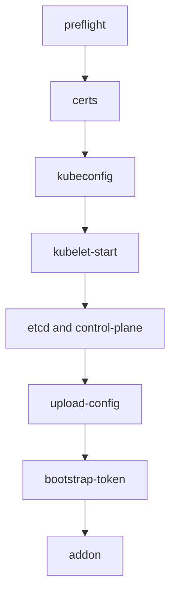

# Init Phases And The Stored Configuration

`kubeadm init` looks like one command, but it is a fixed list of steps called phases. Each phase does one job and leaves something behind: a certificate, a kubeconfig file, a static pod manifest, an object in the API. Knowing the list lets you read an init log, repair a half-finished init and run a single phase on its own. This part walks through the phases in order and then reads the objects that the last phases store in the cluster.

## The phases in order

A **phase** is a named step of `kubeadm init`. You can list them with `kubeadm init --help`, run one with `kubeadm init phase <name>` and skip one with `--skip-phases` or `skipPhases` in the file. The reference lists these phases:

| Phase | What it does |
| --- | --- |
| `preflight` | Checks the machine before it changes anything: container runtime reachable, required ports free, swap off, enough memory and CPU. Errors stop kubeadm; warnings do not |
| `certs` | Creates the certificate authorities and the certificates and keys for the API server, kubelet client, front proxy, etcd and service account signing |
| `kubeconfig` | Writes kubeconfig files for the administrator, the kubelet, the controller manager and the scheduler, each with its own identity |
| `kubelet-start` | Writes the kubelet settings and starts or restarts the kubelet |
| `etcd` | Writes the static pod manifest for a local etcd, unless the file points to an external etcd |
| `control-plane` | Writes static pod manifests for the API server, the controller manager and the scheduler |
| `wait-control-plane` | Waits until the API server answers and the static pods run |
| `upload-config` | Stores the cluster configuration and the kubelet configuration in ConfigMaps |
| `upload-certs` | Optional. Stores encrypted control-plane certificates in a Secret so more control-plane nodes can join |
| `mark-control-plane` | Adds the control-plane label and the `NoSchedule` taint to the node |
| `bootstrap-token` | Creates the first bootstrap token and the RBAC rules that let joining nodes use it |
| `kubelet-finalize` | Turns on client certificate rotation for the kubelet after the TLS bootstrap |
| `addon` | Installs CoreDNS and kube-proxy |



The diagram shows the main order: files and certificates are written first, the control plane starts from those files, and only then does kubeadm store objects in the API.

## Why the order matters

The first six phases work only on the local disk. At that point no API server exists, so kubeadm cannot create any Kubernetes object. A **static pod** is a pod that the kubelet runs directly from a manifest file in a local directory, `/etc/kubernetes/manifests`, without asking the API server. This is how the API server itself can start. The kubelet reads the manifest, asks the container runtime to start the container, and later creates a read-only copy of the pod in the API called a mirror pod.

After the API server runs, kubeadm switches to API calls. The `upload-config`, `mark-control-plane`, `bootstrap-token` and `addon` phases all create objects. If `wait-control-plane` times out, none of those later phases ran, and the cluster has no `kubeadm-config` ConfigMap. This is why an init that fails early leaves files on disk but nothing in the API.

You can see the local result of the early phases in the playground. The static pod manifests live in the control-plane node container. List them there. With Podman, use `podman exec`.

<!-- astrona:playground:renew -->

```sh
docker exec astro-ats-025-playground-030-02-control-plane ls /etc/kubernetes/manifests
```

The output lists one file for each static pod: `etcd.yaml`, `kube-apiserver.yaml`, `kube-controller-manager.yaml` and `kube-scheduler.yaml`. The same four pods appear in the API as mirror pods, and their names end with the node name:

```sh
kubectl -n kube-system get pods -o wide
```

Find `etcd`, `kube-apiserver`, `kube-controller-manager` and `kube-scheduler` with the control-plane node name as a suffix. CoreDNS and kube-proxy have different names, because they come from the `addon` phase and run as a Deployment and a DaemonSet.

## The configuration kubeadm stores

The `upload-config` phase writes two ConfigMaps in `kube-system`. The ConfigMap `kubeadm-config` holds the `ClusterConfiguration` under the key `ClusterConfiguration`. The ConfigMap `kubelet-config` holds the `KubeletConfiguration` under the key `kubelet`. Every later `kubeadm join`, `kubeadm upgrade` and `kubeadm reset` reads them. A node that joins therefore gets the cluster-wide settings from the cluster, not from a file on the new machine.

Read the stored cluster configuration:

```sh
kubectl -n kube-system get configmap kubeadm-config -o jsonpath='{.data.ClusterConfiguration}'
```

The output is a YAML document with `apiVersion: kubeadm.k8s.io/v1beta4` and `kind: ClusterConfiguration`. Find `kubernetesVersion`, `clusterName`, and the `networking` block with `podSubnet`, `serviceSubnet` and `dnsDomain`. These are the values that kubeadm used. They are the first place to look when a join or an upgrade behaves unexpectedly, because they show what the cluster believes about itself.

Now read the kubelet document:

```sh
kubectl -n kube-system get configmap kubelet-config -o jsonpath='{.data.kubelet}'
```

The output is a `KubeletConfiguration` document. Look for `clusterDNS`, `clusterDomain` and `cgroupDriver`. Every kubelet that joins the cluster receives these values, so all nodes agree on the DNS address and the cgroup driver.

## Control-plane marks and the discovery ConfigMap

The `mark-control-plane` phase labels the node `node-role.kubernetes.io/control-plane`. List the nodes that carry the label:

```sh
kubectl get nodes -l node-role.kubernetes.io/control-plane
```

The output lists the control-plane node only. In a cluster that has workers, the phase also adds the taint `node-role.kubernetes.io/control-plane:NoSchedule`, which keeps ordinary workloads off the control plane unless a pod tolerates the taint.

The `bootstrap-token` phase writes one more object that matters for joining. The ConfigMap `cluster-info` in the `kube-public` namespace holds a minimal kubeconfig with the API server address and the cluster certificate authority. Any client, even an unauthenticated one, can read it. A joining node reads it first to learn where the API server is and which certificate authority it should trust.

```sh
kubectl -n kube-public get configmap cluster-info -o jsonpath='{.data.kubeconfig}'
```

The output shows a `server:` line and a `certificate-authority-data:` field. The server line holds the address that joining nodes use, which is the control plane endpoint of the cluster.

## Running one phase

Because phases are separate commands, you can repeat one. `kubeadm init phase upload-config kubeadm --config kubeadm.yaml` writes the `kubeadm-config` ConfigMap again from a file. `kubeadm init phase certs all` creates missing certificates and reuses existing files. This is how administrators repair a partly broken control plane without a full reset. The commands act on the machine where you run them and need the matching configuration file, so use them with care on a working cluster.

You now know what each phase writes and where the cluster-wide settings are stored. The settings in `kubeadm-config` are also the correct source when you plan a second cluster or a join, so read them before you write any new file.

## Common pitfalls

> [!WARNING]
> Do not read an empty `kubeadm-config` as "the cluster has no configuration": it appears only after `upload-config` ran, so a failed early phase leaves none. Do not edit the `kubeadm-config` ConfigMap by hand to change a running cluster; the values describe what kubeadm did, and changing them does not change the running components. Do not assume that every flag still works when you pass `--config`. Do not expect a worker node to run static pods for the control plane.
