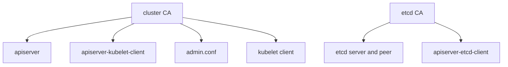

# PKI Files And Certificate Lifetimes

When the `certs` and `kubeconfig` phases of `kubeadm init` finish, the control-plane machine holds a directory of certificates and a set of kubeconfig files. Everything that talks to the API server, to etcd or to a kubelet uses one of them. A cluster that runs fine for a year can then stop answering because one of these certificates expired. This part names the files, explains who signs what, and shows how to check expiry and renew.

## The certificate authorities

A **certificate authority (CA)** is a key pair and a certificate whose job is to sign other certificates. A client that trusts the CA certificate trusts every certificate the CA signed. kubeadm creates three separate CAs, so that a leak in one area does not give access to another:

- The cluster CA, `ca.crt` and `ca.key`, signs the API server certificate, the kubelet client certificates and the client certificates in the kubeconfig files.
- The etcd CA, `etcd/ca.crt` and `etcd/ca.key`, signs the certificates that etcd servers, etcd peers and etcd clients use.
- The front proxy CA, `front-proxy-ca.crt` and `front-proxy-ca.key`, signs the client certificate that the API server uses to call extension API servers.

All of them live in `/etc/kubernetes/pki` on a control-plane node, the directory set by `certificatesDir`. The CA certificate is valid for ten years by default. Leaf certificates, the ones signed by a CA, are valid for one year.



The diagram shows the cluster CA signing the API server, the kubelet client and the kubeconfig identities, while a separate etcd CA signs the etcd certificates.

## The files and who uses them

The most important files in `/etc/kubernetes/pki` are these:

| File | Used by |
| --- | --- |
| `ca.crt`, `ca.key` | Cluster CA. The API server checks client certificates against it. The controller manager signs with the key |
| `apiserver.crt`, `apiserver.key` | The API server presents this serving certificate to every client |
| `apiserver-kubelet-client.crt` | The API server presents this client certificate when it calls a kubelet |
| `apiserver-etcd-client.crt` | The API server presents this client certificate to etcd |
| `etcd/ca.crt`, `etcd/server.crt`, `etcd/peer.crt` | etcd, for client traffic and for traffic between etcd members |
| `front-proxy-ca.crt`, `front-proxy-client.crt` | The API server aggregation layer |
| `sa.key`, `sa.pub` | Not a certificate. The key pair that signs and verifies service account tokens |

The kubeconfig files sit in `/etc/kubernetes`. `admin.conf` holds the client certificate of the cluster administrator. `controller-manager.conf` and `scheduler.conf` hold the identities of those two components. `kubelet.conf` holds the identity of the kubelet on that node, which is `system:node:<node name>`. A kubeconfig file embeds the CA certificate of the cluster and the client certificate and key of one identity.

See the files in the playground. Run the command inside the control-plane node container. With Podman, use `podman exec` instead of `docker exec`.

<!-- astrona:playground:renew -->

```sh
docker exec astro-ats-025-playground-030-03-control-plane ls /etc/kubernetes /etc/kubernetes/pki
```

The output lists the kubeconfig files, the `manifests` and `pki` directories, and the certificate files from the table. A node that is not a control-plane node has far fewer files: it holds `kubelet.conf` and a CA file, and no private keys of the cluster CA.

## Check expiry

kubeadm can report the expiry date of every certificate it manages. The command also reads the certificates embedded in `admin.conf`, `controller-manager.conf` and `scheduler.conf`:

```sh
docker exec astro-ats-025-playground-030-03-control-plane kubeadm certs check-expiration
```

The output is a table. The columns include `EXPIRES`, `RESIDUAL TIME` and `CERTIFICATE AUTHORITY`. The first block lists the leaf certificates and the second block lists the CAs. In a fresh cluster the leaf certificates show about one year left and the CAs about ten years. Read the table by looking for the smallest residual time.

The command does not list the kubelet client certificate. The kubelet manages that one itself, as the next section explains.

## Renew certificates

The command `kubeadm certs renew all` renews every certificate that kubeadm manages. It runs without checking whether the old certificate is close to expiry. `kubeadm certs renew apiserver` renews one certificate, and the other names include `apiserver-kubelet-client`, `apiserver-etcd-client`, `front-proxy-client`, `etcd-server`, `etcd-peer`, `etcd-healthcheck-client`, `admin.conf`, `controller-manager.conf` and `scheduler.conf`. The new certificate keeps the names and addresses of the old one, and the CA signs it.

A renewal writes new files, but a running component keeps the old certificate in memory. The static pods of the control plane must restart to load the new files. After renewing `admin.conf`, copy it to the place where `kubectl` reads its configuration. A common restart method is to move the manifests out of `/etc/kubernetes/manifests`, wait for the pods to stop, and move them back.

The upgrade command `kubeadm upgrade apply` renews the control-plane certificates by default. A cluster that is upgraded at least once a year therefore does not meet the expiry date. A cluster that is never upgraded does.

You do not renew the playground certificates here, because the cluster would briefly stop answering. The checks above show everything you need.

## Kubelet certificates and rotation

A kubelet has two certificate roles. As a client, it presents a certificate to the API server, which is stored under `/var/lib/kubelet/pki` and referenced by `kubelet.conf`. As a server, it presents a serving certificate to the API server when you run `kubectl logs` or `kubectl exec`.

The kubelet renews its client certificate itself when client certificate rotation is on. kubeadm turns it on in the `kubelet-finalize` phase. Because the kubelet handles it, `kubeadm certs renew` has no name for it. If rotation is off or fails, the node's client certificate expires and the node can no longer report to the API. This is the situation where the node joined correctly and later stops reporting.

## The CA certificate in the API

Every namespace holds a ConfigMap called `kube-root-ca.crt`. It contains the public certificate of the cluster CA under the key `ca.crt`. Pods use it to verify the API server through the service account mount. The same certificate is what a joining node must trust. Read its subject and expiry with `openssl` on your own machine:

```sh
kubectl -n kube-system get configmap kube-root-ca.crt -o jsonpath='{.data.ca\.crt}' | openssl x509 -noout -subject -enddate
```

The output has a `subject` line for the CA and a `notAfter` line with the expiry date. The format of the subject line differs between OpenSSL versions, but the common name of a kubeadm cluster is `kubernetes`. The public key inside this certificate is the thing the join command pins, which the next part explains.

You now know where the identities live, which tool renews them and which ones the kubelet handles. The remaining question is how a brand-new node decides to trust this CA before it has any certificate at all.

## Common pitfalls

> [!WARNING]
> Do not forget to restart the control-plane static pods after a renewal; the old certificate stays in use until they restart. Do not look for the kubelet client certificate in `kubeadm certs check-expiration`; the kubelet rotates it. Do not copy the CA private key, `ca.key`, to worker nodes. Do not read the one-year leaf lifetime as the lifetime of the CA; the CA lasts ten years by default.
