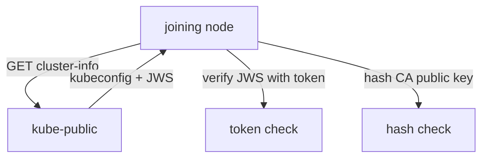

# Bootstrap Tokens And The CA Public-Key Hash

A new machine that wants to join a cluster has a problem with trust in two directions. It must prove to the API server that it may join, and it must check that the API server it reaches is the real one and not an impostor. A brand-new node has no certificate yet, so neither check can use the normal certificate machinery. kubeadm solves this with a short-lived **bootstrap token** for the first direction and a **CA public-key hash** for the second. This part shows where both live and how to compute them.

## What a bootstrap token is

A bootstrap token is a shared secret with a fixed format: six lowercase letters or digits, a dot, and sixteen more, such as `abcdef.0123456789abcdef`. The first part is the **token ID**. It is public and names the token. The second part is the **token secret**. It proves the holder knows the token.

The API server stores each token as a Secret of type `bootstrap.kubernetes.io/token` in the `kube-system` namespace. The Secret is named `bootstrap-token-<token ID>`. List the tokens in the playground, selecting by Secret type:

<!-- astrona:playground:renew -->

```sh
kubectl -n kube-system get secrets --field-selector type=bootstrap.kubernetes.io/token
```

The output has one row for each token, and no row when none exists. The first token of a kubeadm cluster expires after 24 hours, so an old cluster often has none left. In that case you create one in the next step.

The data of the Secret has these fields:

| Field | Meaning |
| --- | --- |
| `token-id` | The public six-character part |
| `token-secret` | The sixteen-character secret part |
| `expiration` | The time after which the API server ignores and deletes the token |
| `usage-bootstrap-authentication` | When `true`, the token may authenticate to the API server |
| `usage-bootstrap-signing` | When `true`, the token is used to sign the `cluster-info` ConfigMap |
| `auth-extra-groups` | Groups the token holder joins, normally `system:bootstrappers:kubeadm:default-node-token` |

A client that sends the full token as a bearer token authenticates as the user `system:bootstrap:<token ID>`. The group `system:bootstrappers` gives it only the few rights needed to join: to read the `cluster-info` ConfigMap and to create a certificate signing request. A token cannot read Secrets or create pods.

## Create, list and delete a token

`kubeadm token create` writes a new token Secret. Run it inside the control-plane node container of the playground, where kubeadm and `admin.conf` exist. With Podman, use `podman exec` instead of `docker exec`.

```sh
docker exec astro-ats-025-playground-030-03-control-plane kubeadm token create --ttl 30m --print-join-command
```

The output is one line: a `kubeadm join` command with the API server address, the new token and a `--discovery-token-ca-cert-hash` value. `--ttl` sets the lifetime; the default is 24 hours, and `0` means the token never expires, which you should avoid. List the tokens with their remaining lifetime:

```sh
docker exec astro-ats-025-playground-030-03-control-plane kubeadm token list
```

The columns are `TOKEN`, `TTL`, `EXPIRES`, `USAGES` and `EXTRA GROUPS`. Delete a token before it expires with `kubeadm token delete <token ID>`. Deleting removes the Secret, and a node that has not yet joined can no longer use it.

## The cluster-info ConfigMap

How does the new node find the CA certificate before it trusts anything? kubeadm publishes a ConfigMap named `cluster-info` in the `kube-public` namespace. It holds a small kubeconfig with the API server address and the CA certificate, and no credentials. The RBAC rules allow anonymous users to read this one ConfigMap, so a node without any identity can fetch it:

```sh
kubectl -n kube-public get configmap cluster-info -o jsonpath='{.data.kubeconfig}'
```

The output is a kubeconfig. It has a `clusters` entry with `certificate-authority-data` (the CA certificate in base64) and a `server:` line. The ConfigMap also has keys named `jws-kubeconfig-<token ID>`, one for each signing token. The `bootstrap-signer` controller in the controller manager computes each of them: a JSON Web Signature (JWS) over the kubeconfig, made with the token secret as the key.

That signature is how the first direction of trust works. A joining node that knows the token can verify the signature on the kubeconfig. Someone who does not know the token secret cannot produce a valid signature, so they cannot hand the node a forged kubeconfig. The signature proves that the ConfigMap came from someone who holds the token.

## Why the hash is still needed

The signature has a weakness: anyone who holds a valid token can compute a valid signature. A token is shared with every node that joins, and it may leak. An attacker with the token who can intercept the connection could serve a fake `cluster-info` with the attacker's own CA, signed with the real token. The node would accept it.

The **discovery token CA certificate hash** closes this gap. It is a SHA-256 hash of the public key in the cluster CA certificate. The administrator gives it to the node out of band, on the command line of `kubeadm join`. After the node fetches `cluster-info`, it hashes the CA public key in the kubeconfig and compares the result with the pinned value. A fake CA has a different key, so the hashes differ and the join stops.



The diagram shows the node doing two separate checks on the same ConfigMap: the signature check uses the token, and the hash check uses the pinned value.

## Compute the hash yourself

The hash covers the DER encoding of the Subject Public Key Info (SPKI) of the CA certificate. DER is a binary encoding of the key. Take the CA certificate from the `kube-root-ca.crt` ConfigMap and compute the value on your own machine, which needs `openssl`:

```sh
kubectl -n kube-system get configmap kube-root-ca.crt -o jsonpath='{.data.ca\.crt}' \
  | openssl x509 -pubkey -noout \
  | openssl pkey -pubin -outform der \
  | openssl dgst -sha256 -hex
```

The output is a line that ends with 64 hexadecimal characters. In a `kubeadm join` command, write the value as `sha256:` followed by those 64 characters. Compare it with the hash in the line from `kubeadm token create --print-join-command`: they are the same value, because kubeadm computes the hash the same way from `/etc/kubernetes/pki/ca.crt`. The kubeadm documentation uses `openssl rsa -pubin` in this pipeline; `openssl pkey` does the same for RSA keys and also works when the CA uses an elliptic-curve key.

The hash identifies a public key, not a whole certificate. When the CA certificate is renewed with the same key, the hash does not change, so existing join commands stay valid.

## Skipping the hash and other discovery methods

`--discovery-token-unsafe-skip-ca-verification` makes the node accept whatever CA the `cluster-info` ConfigMap contains. The signature check remains, so only a holder of the token can fake the ConfigMap, but the token is a weak protection on its own. Use the option only in a test environment.

A second discovery method uses a kubeconfig file: `kubeadm join --discovery-file <path or URL>`. The file carries the CA, so no token is needed for discovery. The node still needs a token or a client credential for the TLS bootstrap that follows. A file served over plain HTTP gives no protection, so it must come from HTTPS or a trusted path.

You now know the two values a join command carries and what each protects. The remaining question is what the node does with them once the checks pass.

## Common pitfalls

> [!WARNING]
> Do not treat the token as a secret that is safe to keep for a year; it grants the right to request a node certificate, so give it a short `--ttl`. Do not confuse the token ID with the full token: the ID is public, the full token is not. Do not hash the whole certificate file; hash the public key. Do not use `--discovery-token-unsafe-skip-ca-verification` on a network you do not control. Do not expect the old token to work after its `expiration`; create a new one.
