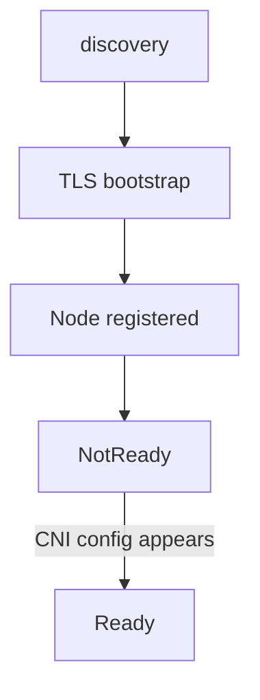

# Joining A Node, Network Add-Ons And kubeadm Reset

After the discovery checks pass, a joining node still has no identity of its own. It must obtain a client certificate that the API server accepts and then register a Node object. This part follows that sequence step by step, explains why the node then sits in the `NotReady` state until a network add-on runs, and shows what `kubeadm reset` removes when you take a machine out of a cluster.

## The order of a worker join

`kubeadm join` first runs discovery: it fetches `cluster-info` from the API server and applies the token and the CA hash. Then it runs a list of phases. The names are what you see in its output and what you pass to `--skip-phases`:

1. `preflight` runs the host checks, such as the container runtime socket, swap and open ports.
2. `kubelet-start` runs the TLS bootstrap that the next section describes and starts the kubelet.

A control-plane join adds phases for the control-plane files, the etcd member and the static pod manifests. A worker join stops after the kubelet starts and the Node object exists.



The diagram shows the order: discovery, then the certificate request, then the Node object, then readiness once a network add-on writes its configuration.

## TLS bootstrap: how the kubelet gets a certificate

In the `kubelet-start` phase, kubeadm writes a file called `bootstrap-kubelet.conf`. It holds the CA certificate and the bootstrap token as the credential. The kubelet starts with that file. Because the file is the only credential, the kubelet uses it for one purpose: to submit a **CertificateSigningRequest (CSR)** for a client certificate.

A CSR is an API object that asks a signer for a certificate. The kubelet creates one with the signer name `kubernetes.io/kube-apiserver-client-kubelet` and the subject `system:node:<node name>` in the group `system:nodes`. The requestor shows as `system:bootstrap:<token ID>`. List the CSRs in the playground:

<!-- astrona:playground:renew -->

```sh
kubectl get csr
```

The columns include `SIGNERNAME`, `REQUESTOR` and `CONDITION`. Requests from the nodes of the playground cluster show the signer name above and the condition `Approved,Issued`. If the playground has no CSR left, the cluster-creating tool removed them or they expired; the mechanism below is unchanged.

Nobody approves these requests by hand. kubeadm creates two ClusterRoleBindings that make approval automatic: `kubeadm:kubelet-bootstrap` lets the bootstrap group create CSRs, and `kubeadm:node-autoapprove-bootstrap` lets the CSR approving controller in the controller manager approve a node client CSR from that group. The controller manager then signs the approved CSR with the cluster CA key. Read the binding:

```sh
kubectl get clusterrolebinding kubeadm:node-autoapprove-bootstrap -o yaml
```

The output shows the subject `system:bootstrappers:kubeadm:default-node-token` bound to the ClusterRole `system:certificates.k8s.io:certificatesigningrequests:nodeclient`.

The kubelet downloads the signed certificate, stores it as `/var/lib/kubelet/pki/kubelet-client-current.pem` and writes a new `kubelet.conf` that uses it. From then on, the kubelet authenticates as `system:node:<node name>`. The bootstrap token plays no further role, and the bootstrap file is deleted.

## Why the node is NotReady

Once the kubelet authenticates, it creates the Node object. The node shows in `kubectl get nodes` right away, and its `STATUS` is `NotReady`. Read the reason in the conditions:

```sh
kubectl get nodes -o jsonpath='{range .items[*]}{.metadata.name}{"\t"}{range .status.conditions[?(@.type=="Ready")]}{.status}{"\t"}{.reason}{end}{"\n"}{end}'
```

For a node that is Ready, the status is `True`. For a node without a network add-on, the Ready condition is `False` with a message that the container runtime network is not ready and that no CNI configuration file was found in `/etc/cni/net.d`.

The kubelet reports readiness from the container runtime. The runtime stays not ready until a **Container Network Interface (CNI)** configuration file exists in `/etc/cni/net.d`. That file does not come from kubeadm. A network add-on writes it, normally from a DaemonSet that runs on every node. The DaemonSet pod needs no pod network itself, because it runs with `hostNetwork: true`. When the file appears, the runtime reports the network ready, the kubelet sets the Ready condition to `True`, and the scheduler starts placing ordinary pods on the node.

This is why a fresh `kubeadm init` ends with an instruction to install a network add-on, and why the CoreDNS pods stay `Pending` until one is present. The playground cluster already has a CNI add-on, so every node is Ready. You can see its DaemonSet:

```sh
kubectl -n kube-system get daemonset
```

The list has one DaemonSet for the CNI add-on and one for `kube-proxy`, and each runs one pod on every node.

## Resetting a node

`kubeadm reset` undoes what `kubeadm init` or `kubeadm join` did on the local machine. It stops the kubelet, deletes the files in `/etc/kubernetes` that kubeadm wrote, removes the contents of `/var/lib/kubelet` and, on a control-plane node, removes the etcd data directory in `/var/lib/etcd`. On a stacked control-plane node, it also removes the node's etcd member from the cluster through the API.

It does not clean everything. It leaves behind the CNI configuration in `/etc/cni/net.d`, iptables and IPVS rules, and kubeconfig files such as `$HOME/.kube/config`. Remove them yourself if you reuse the machine.

The right order to remove a worker is to drain it first, so that its pods move elsewhere, then delete the Node object, then reset the machine:

```sh
kubectl drain <NODE> --ignore-daemonsets --delete-emptydir-data
kubectl delete node <NODE>
```

Run `kubeadm reset` on the node after these two commands. If you reset first and never delete the Node object, the API still lists a node that no longer exists, and its pods stay assigned to it until the node controller evicts them. Do not run `kubeadm reset` in the playground; it would destroy the node you are reading.

## What you can conclude

A join is two trust checks followed by a certificate request. The token and the pinned hash protect discovery, the auto-approved CSR gives the kubelet its own identity, and the node stays `NotReady` until a network add-on writes a CNI configuration. When a join fails, find out which of these three stages stopped: discovery, the CSR, or the network.

## Common pitfalls

> [!WARNING]
> Do not wait for a node to become Ready before you install a network add-on; it never will. Do not reset a node before you drain it and delete its Node object. Do not expect `kubeadm reset` to clean up CNI files or iptables rules. Do not approve unknown CSRs from the `system:bootstrappers` group without checking who requested them. Do not use a token from a failed join again if its lifetime has passed; create a new one.
