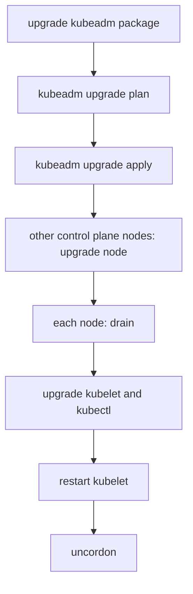

# The kubeadm Upgrade Workflow

A cluster built with kubeadm does not upgrade itself. An administrator installs a newer kubeadm package, asks it what is possible, applies the upgrade on the first control plane node and then repeats a shorter procedure on every other node. Each step changes a different set of files and processes. This part explains what each step does, which component does the work and why the order matters.

## One minor version at a time

Kubernetes versions have three numbers: `v1.35.2` is major 1, minor 35, patch 2. A patch release fixes bugs and keeps the same behavior. A minor release adds features and can remove old API versions. kubeadm supports an upgrade from one minor version to the next minor version, and between patch versions of the same minor. It does not support jumping from `v1.33` to `v1.35` in one `kubeadm upgrade apply`. You upgrade to `v1.34` first, and then to `v1.35`.

You can skip patch versions. Going from `v1.35.0` straight to `v1.35.4` is allowed, because patch releases only contain fixes.

The rule exists because each minor release migrates stored data and configuration from the previous minor release only. The code that migrates from two minors back is not tested and is not kept.

The control plane is the set of components that decide the state of the cluster: the kube-apiserver (the API server, which accepts every request), the kube-controller-manager, the kube-scheduler and etcd (the key-value datastore). On a kubeadm cluster, these run as static pods. A **static pod** is a pod that the kubelet starts from a manifest file in `/etc/kubernetes/manifests` on the node, without asking the API server first.

## Where the upgrade reads its configuration

kubeadm stores the cluster-wide configuration in the API. The ConfigMap `kubeadm-config` in the `kube-system` namespace holds the `ClusterConfiguration`, which contains `kubernetesVersion`, the image repository, the pod subnet and the settings of each control plane component. The ConfigMap `kubelet-config` holds the `KubeletConfiguration` that every kubelet uses as its base. Both are the input of an upgrade.

<!-- astrona:playground:renew -->

Read the stored configuration from the playground:

```sh
kubectl -n kube-system get configmap kubeadm-config -o jsonpath='{.data.ClusterConfiguration}'
```

The command prints a YAML text. Find the line `kubernetesVersion`. This value is the version that kubeadm believes the control plane has. After a successful upgrade, `kubeadm upgrade apply` writes the new version here.

The control plane static pods also appear in the API as mirror pods. A mirror pod is a read-only copy that the kubelet creates in the API so that you can see a static pod. Check where a pod comes from:

```sh
kubectl -n kube-system get pod -l component=kube-apiserver -o jsonpath='{.items[0].metadata.annotations.kubernetes\.io/config\.source}{"\n"}'
```

The command prints `file`. The pod comes from a manifest file, so deleting the pod through the API does not change the file, and the kubelet recreates the mirror pod.

## The three kubeadm upgrade commands

Three commands do the work. They run on the node itself, as root, with the kubeadm binary that matches the target version.

`kubeadm upgrade plan` is read-only. It reads the `ClusterConfiguration` and the versions of the running components, asks the release channel for newer versions and prints a table with the current version, the target version and the components that would change. It also reports whether a configuration file needs manual changes. It does not change the cluster.

`kubeadm upgrade apply v1.36.0` runs on the first control plane node only. It checks that the cluster is healthy, that the target is allowed, and that the kubeadm version is not older than the target. Then it does the following:

- It backs up the static pod manifests and the etcd data into a directory below `/etc/kubernetes/tmp`.
- It writes new manifests for the API server, the controller manager and the scheduler with the new image tag. The kubelet notices each changed file and restarts that static pod.
- It upgrades the etcd manifest when the target release uses a newer etcd version.
- It updates the `kubeadm-config` ConfigMap and the `kubelet-config` ConfigMap, and it upgrades the CoreDNS and kube-proxy add-ons.
- It renews the certificates that kubeadm manages, unless you pass `--certificate-renewal=false`.

`kubeadm upgrade node` runs on every other node. On another control plane node it upgrades the local static pod manifests, using the configuration that `apply` already stored. On a worker it only downloads the new kubelet configuration, because a worker has no control plane pods.

## The order of the whole procedure

The order matters because the API server must be the newest component. If a kubelet is upgraded before the API server, it can be newer than the API server, which is not supported.



The diagram shows the order on one node: first the kubeadm command changes the manifests, then you drain the node, upgrade the kubelet package, restart the kubelet and make the node schedulable again.

The commands for a Debian-based node look like this. They run on the node, not in the playground. The version is an example.

```sh
sudo apt-mark unhold kubeadm
sudo apt-get update && sudo apt-get install -y kubeadm='1.36.0-*'
sudo apt-mark hold kubeadm
sudo kubeadm upgrade plan
sudo kubeadm upgrade apply v1.36.0
```

The package source of each minor version is a separate repository, so before the first install you change the repository line to the new minor version. The `apt-mark hold` command stops a routine system update from upgrading Kubernetes packages by accident.

## What the kubelet upgrade is

`kubeadm upgrade` does not upgrade the kubelet. The kubelet is a system service installed from a package, and kubeadm only rewrites its configuration. You upgrade the kubelet in three steps. First, you drain the node from a machine with `kubectl`, which moves the pods away. Second, you install the new `kubelet` and `kubectl` packages on the node. Third, you run `sudo systemctl daemon-reload` and `sudo systemctl restart kubelet`, and you run `kubectl uncordon` on the node.

You can see the effect in the API. The node reports the version of its kubelet in `status.nodeInfo.kubeletVersion`:

```sh
kubectl get nodes -o jsonpath='{.items[0].status.nodeInfo.kubeletVersion}{"\n"}'
```

The value changes only after the kubelet restarts with the new binary. This is why `kubeadm upgrade apply` can finish while the node still reports the old kubelet version.

## A worked example

A cluster has one control plane node `bridge-cp` and one worker `bridge-w1`, all at `v1.35.0`. The target is `v1.36.1`.

The administrator upgrades the kubeadm package on `bridge-cp` to `1.36.1`, runs `kubeadm upgrade plan`, and then `kubeadm upgrade apply v1.36.1`. The API server, the controller manager and the scheduler are now `v1.36.1`, and `kubernetesVersion` in `kubeadm-config` says `v1.36.1`. The node `bridge-cp` still reports kubelet `v1.35.0`.

Next, the administrator drains `bridge-cp`, upgrades the kubelet package, restarts the kubelet and uncordons. Then the same drain, `kubeadm upgrade node`, package upgrade, restart and uncordon run on `bridge-w1`. At the end, both nodes report `v1.36.1`.

During the time between the two steps, the kubelets are one minor version older than the API server. That state is supported, and it is the reason the order is always control plane first.

## Failure cases

If `kubeadm upgrade apply` fails before it writes manifests, nothing changed and you can run it again. If it fails after it wrote a manifest, the kubelet may already run the new component. kubeadm tries to restore the backed-up manifests when a component does not become healthy, and the backup directory exists so that you can restore them yourself.

A common failure is an upgrade that starts but cannot finish because a control plane pod cannot pull its image. Another is the preflight check that reports an older kubeadm than the target. Another is running `apply` on a second control plane node, which is wrong: use `upgrade node` there.

## What you can conclude

You now know that kubeadm upgrades the control plane in place by rewriting static pod manifests, that the stored `ClusterConfiguration` is its input, that a separate step upgrades each kubelet and that one minor version at a time is the supported path. The open question is how far apart the versions of the components may be during the procedure, and after it. The next part answers it.

## Common pitfalls

> [!WARNING]
> Do not run `kubeadm upgrade apply` on more than the first control plane node. Do not skip a minor version. Do not assume that a finished `kubeadm upgrade apply` upgraded the kubelet: the node still reports the old kubelet version until you restart the kubelet. Do not forget to hold the Kubernetes packages after an upgrade, because a routine system update can move them to a version that skips a minor release.
