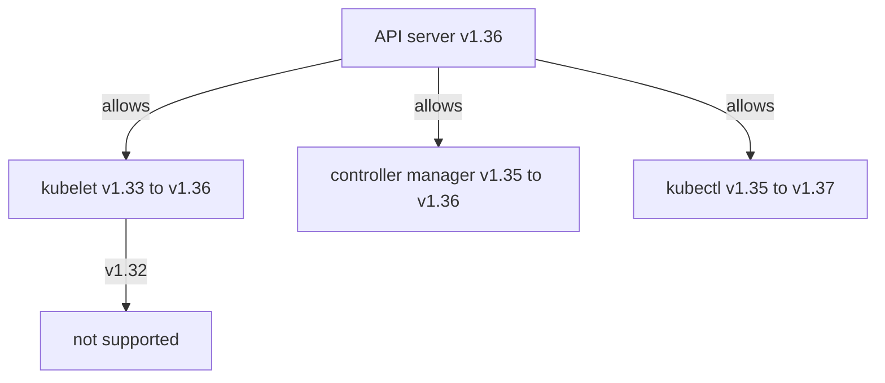

# Version Skew Policy And Reading Versions

Kubernetes components talk to each other through the API, and they were tested only against a limited range of versions of each other. The **version skew policy** states how far apart the versions of two components may be. An upgrade passes through states where components have different versions, so you must know the limits before you start and be able to read the real versions from the cluster.

## The policy in one table

The kube-apiserver is the reference. Its minor version is called N. Every other component is described by its distance from N. The numbers below are for Kubernetes 1.35.

| Component | Allowed versions | Rule |
| --- | --- | --- |
| kube-apiserver | N, and N-1 when several instances run | Instances of a highly available API server may differ by one minor version |
| kube-controller-manager | N-1 to N | Never newer than the API server |
| kube-scheduler | N-1 to N | Never newer than the API server |
| cloud-controller-manager | N-1 to N | Never newer than the API server |
| kubelet | N-3 to N | Never newer than the API server |
| kube-proxy | N-3 to N | Never newer than the API server |
| kubectl | N-1 to N+1 | May be one minor newer or older |

For example, with an API server at `v1.35.0`, a kubelet at `v1.32.5` is still supported, and a kubelet at `v1.31.0` is not. A kubelet at `v1.36.0` is not supported, because the API server must be the newest component.

The kubelet range is three minor versions since Kubernetes 1.28. Older releases allowed only two. The range gives you time to upgrade worker nodes later than the control plane, and it also lets you upgrade the control plane twice in a row while the workers stay on the old version.

Two rules follow. The first is that nothing, except kubectl, may be newer than the API server. The second is that the controller manager and the scheduler may be at most one minor behind. Because the control plane components are upgraded by one command, they normally have the same version in a kubeadm cluster.

## Why the skew rule exists

Each component is a client of the API server. When the API server adds a field, an older client ignores it, and the API server keeps accepting the requests of older clients for a limited number of releases. A newer client can send a request or rely on a field that an older API server does not know. For that reason the API server must be upgraded first, and a newer component than the API server is never supported.

The three-version range for the kubelet comes from how long the API server keeps behavior that older kubelets need. After that range, a kubelet may fail to register, to report its status or to run a pod that uses a new field.

A highly available control plane has several API server instances, each on its own node. During an upgrade, one instance is at N+1 while the others are at N. Clients that talk to the load balancer can reach either one. That is why the API server instances may differ by one minor version, and why the controller manager and the scheduler may be one version behind the newest instance: they may connect to either.

## Reading the versions from the cluster

You can read each version without logging in to a node. The static pod images carry the version as the image tag, the node object carries the kubelet version and the stored configuration carries the target of the last upgrade.

<!-- astrona:playground:renew -->

Print the image of the API server, the controller manager and the scheduler:

```sh
kubectl -n kube-system get pod -l component=kube-apiserver -o jsonpath='{.items[0].spec.containers[0].image}{"\n"}'
kubectl -n kube-system get pod -l component=kube-controller-manager -o jsonpath='{.items[0].spec.containers[0].image}{"\n"}'
kubectl -n kube-system get pod -l component=kube-scheduler -o jsonpath='{.items[0].spec.containers[0].image}{"\n"}'
```

Each line has the form `registry.k8s.io/<component>:<version>`. The part after the last colon is the version. In the playground, all three have the same tag, and it is the Kubernetes version of the cluster.

The kube-proxy runs as a DaemonSet, not as a static pod, so its image comes from the DaemonSet:

```sh
kubectl -n kube-system get daemonset kube-proxy -o jsonpath='{.spec.template.spec.containers[0].image}{"\n"}'
```

Now print the kubelet version that the node reports, and the version of your `kubectl` and of the API server:

```sh
kubectl get nodes -o jsonpath='{range .items[*]}{.metadata.name}{"  "}{.status.nodeInfo.kubeletVersion}{"\n"}{end}'
kubectl version
```

The first command prints one line for each node. The second prints the client version and the server version. The server version is the API server version, and it is the N of the policy.

## Compute the allowed range

Take the API server version from the image tag, for example `v1.35.0`. The minor number is 35. The lowest supported kubelet and kube-proxy minor is 35 - 3 = 32, so `v1.32.x`. The highest is 35. The controller manager and the scheduler must be 34 or 35. The next upgrade target is minor 36, because kubeadm moves one minor at a time.

After the control plane reaches `v1.36.0`, the range moves: kubelets at `v1.33` to `v1.36` are supported. A kubelet at `v1.32` is now outside the range. The upgrade of the control plane therefore creates a deadline for old workers: they must be upgraded before the next control plane upgrade.



The diagram shows the ranges after the control plane moves to `v1.36`: the kubelet range moves up by one, and a kubelet at `v1.32` falls out of it.

## A worked example with a violation

A cluster has an API server at `v1.34.3`, a controller manager and a scheduler at `v1.34.3`, one worker at `v1.31.8` and one worker at `v1.34.3`. The administrator wants to move to `v1.35.0`.

The worker at `v1.31.8` is three minor versions behind, which is the limit, so the cluster is supported today. If the control plane moves to `v1.35.0`, the old worker is four minors behind and falls outside the policy. The correct plan is to upgrade that worker to at least `v1.32` first, drain it and move it, and then upgrade the control plane. The other order is not wrong in the sense that it fails at once, but it leaves a cluster in an unsupported state, and the kubelet can stop working with the new API server.

A second example. An administrator upgrades the kubelet on a worker to `v1.35.0` before the control plane, which is at `v1.34.3`. The kubelet is newer than the API server. This is unsupported even if the node seems to work, and the cure is to upgrade the control plane next, or to downgrade the kubelet.

## Reading the stored target

The ConfigMap `kubeadm-config` keeps `kubernetesVersion`, which `kubeadm upgrade apply` updates. The value is not the same as the version of a running pod: it is the version kubeadm last recorded for the control plane. If the two differ, an earlier upgrade stopped half way, or someone edited a manifest by hand.

```sh
kubectl -n kube-system get configmap kubeadm-config -o jsonpath='{.data.ClusterConfiguration}' | grep kubernetesVersion
```

The command prints the line with the stored version. Compare it with the image tag of the API server. A cluster that is in the middle of an upgrade can show a difference, and a healthy cluster shows the same version.

## What you can conclude

You now know the rule that decides what an upgrade may leave behind: the API server is newest, the control plane components are at most one minor behind, kubelets and kube-proxy at most three minor behind, and kubectl one minor either way. You can read each version from an image tag, a node status or a stored ConfigMap, and you can compute the next step. The remaining question for an operator is what to do when an upgrade goes wrong and the stored state of the cluster itself must be recovered. That is the job of the etcd backup.

## Common pitfalls

> [!WARNING]
> Do not read the version of a component from the package on one node and assume it is the version of the running process: read it from the image tag or from the node status. Do not forget that kube-proxy has its own version and has its own three-version limit. Do not count the skew with patch numbers: the policy counts minor versions only. Do not treat kubectl as bound by the same limit as the kubelet: it may be one minor newer than the API server, but it may not be three minors older.
