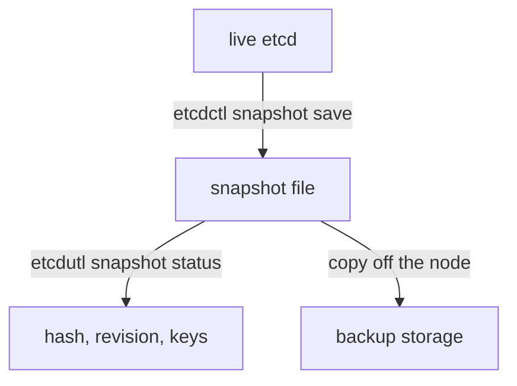

# Taking And Checking An etcd Snapshot

etcd is the key-value datastore of Kubernetes. Only the API server talks to it, and it keeps every object: Namespaces, Deployments, Secrets and the rest. A snapshot is a single file that holds a consistent copy of that data at one moment. This part explains how kubeadm runs etcd, how to connect to it with the right credentials, how to take a snapshot and how to prove that the file is usable.

## How kubeadm runs etcd

On a kubeadm cluster, etcd runs as a static pod on the control plane node. The kubelet starts it from `/etc/kubernetes/manifests/etcd.yaml`. The pod uses the host network, so etcd listens on the node itself. It stores its data in `/var/lib/etcd`, which the manifest mounts from the node with a `hostPath` volume named `etcd-data`. The certificates come from `/etc/kubernetes/pki/etcd`, mounted with a volume named `etcd-certs`.

etcd accepts only clients that present a certificate signed by the etcd certificate authority. This is the flag `--client-cert-auth=true` together with `--trusted-ca-file`. The API server is such a client. A person who wants to take a snapshot must present a certificate as well.

<!-- astrona:playground:renew -->

Read the flags that matter from the etcd pod. The pod runs one container whose command line holds all of them:

```sh
kubectl -n kube-system get pod -l component=etcd -o jsonpath='{range .items[0].spec.containers[0].command[*]}{@}{"\n"}{end}'
```

The command prints one flag on each line. Find `--data-dir`, `--listen-client-urls`, `--cert-file`, `--key-file`, `--trusted-ca-file` and `--client-cert-auth`. The command does not print secrets: the flags hold file paths, not the content of the files.

Read the volumes in the same way:

```sh
kubectl -n kube-system get pod -l component=etcd -o jsonpath='{range .items[0].spec.volumes[*]}{.name}{"  "}{.hostPath.path}{"\n"}{end}'
```

You should see `etcd-certs` with a path below `/etc/kubernetes/pki` and `etcd-data` with `/var/lib/etcd`. These two host paths are what a recovery works with.

## Which tool does what

Two command-line programs ship with etcd. `etcdctl` talks to a running etcd over the network: it reads and writes keys, lists members and takes a snapshot of a live server. `etcdutl` works on files and does not need a server: it checks a snapshot file and restores a snapshot into a data directory. Older guides use `etcdctl snapshot status` and `etcdctl snapshot restore`. Those commands are deprecated, and `etcdutl` is the supported tool for them.

The etcd image that kubeadm uses includes both programs, so you can run them with `kubectl exec` in the etcd pod. The image has no shell, so you call the program directly after the `--`.

## Take a snapshot

`etcdctl snapshot save` connects to a live member and streams a consistent copy of its data into a file. It needs three connection options: the endpoint, the certificate authority file that signed the server certificate and a client certificate with its key. kubeadm creates a client certificate for health checks, and you can use it.

Save the snapshot inside the pod, in `/tmp`:

```sh
kubectl -n kube-system exec "$(kubectl -n kube-system get pod -l component=etcd -o jsonpath='{.items[0].metadata.name}')" -- etcdctl --endpoints=https://127.0.0.1:2379 --cacert=/etc/kubernetes/pki/etcd/ca.crt --cert=/etc/kubernetes/pki/etcd/healthcheck-client.crt --key=/etc/kubernetes/pki/etcd/healthcheck-client.key snapshot save /tmp/playground-snapshot.db
```

The command prints progress lines and a final line that says the snapshot was saved to the path. The file is in the container file system of the etcd pod. It disappears when the container restarts, so on a real cluster you copy the file off the node at once.

If you leave out the certificate options, the command fails with a connection or authentication error, because etcd refuses a client without a certificate. If you use the wrong endpoint, the command fails because nothing listens there. Both are checks that the command makes before it writes anything.

## Check the snapshot

A file that exists is not the same as a file that works. `etcdutl snapshot status` reads the file and prints its hash, the revision, the number of keys and the size. It does not need a running etcd.

```sh
kubectl -n kube-system exec "$(kubectl -n kube-system get pod -l component=etcd -o jsonpath='{.items[0].metadata.name}')" -- etcdutl snapshot status /tmp/playground-snapshot.db --write-out=table
```

The table has four columns: `HASH`, `REVISION`, `TOTAL KEYS` and `TOTAL SIZE`. The values depend on your cluster, so this page does not show them.

The **revision** is a counter that etcd increases with every change to the data. A higher revision means a later state. Two snapshots of the same cluster can be compared by revision to learn which is newer. The **total keys** value counts all keys, including the ones that Kubernetes uses internally. A snapshot with zero keys, or a revision of zero, is not usable.

The hash is a checksum of the content. If the file is damaged in transfer, the status command fails or prints a different hash. For this reason, record the hash when you take the snapshot and check it again after you copy the file.



The diagram shows that `etcdctl` needs the live server to write the file, and `etcdutl` only needs the file to check it.

## A worked example

The `starfleet` namespace has a Deployment `probe`. At 10:00 the administrator takes a snapshot. At 10:05 someone deletes the Deployment. The snapshot still contains the Deployment, because it is a copy of 10:00.

The administrator checks the file: the revision is 4210 and there are 812 keys. These numbers are examples. A restore from this file brings the cluster back to the state of 10:00, so every change between 10:00 and the restore is lost. The time between the snapshot and the failure is the loss window, and its length is the backup interval you choose.

## What a snapshot does not contain

A snapshot holds objects, not the files that the objects point to. It does not hold the data of PersistentVolumes, the container images, the certificate authority files in `/etc/kubernetes/pki` or the kubeadm configuration files on the node. A recovery on a new node needs the certificates too: the API server certificates, the etcd certificates and the service account key pair must be the same as the ones that the objects expect. For this reason a backup plan copies `/etc/kubernetes/pki` with the snapshot.

A snapshot can hold Secrets, and etcd stores them without encryption unless encryption at rest is configured. Treat the file as a credential and restrict who can read it.

## What you can conclude

You now know how etcd runs on a kubeadm node, how to connect to it with a client certificate, how to take a snapshot, and how to prove with `etcdutl snapshot status` that the file has content. You also know the limits: a snapshot is a point in time and it does not contain certificates or volume data. The open question is what happens when you need to use the file. The next part covers the restore.

## Common pitfalls

> [!WARNING]
> Do not leave the snapshot only inside the etcd container or on the control plane node that may fail. Do not skip the check with `etcdutl snapshot status`: a file that exists can be empty or damaged. Do not use the old `etcdctl snapshot status` command in new procedures. Do not store snapshots in a place that other users can read, because they can contain Secrets.
