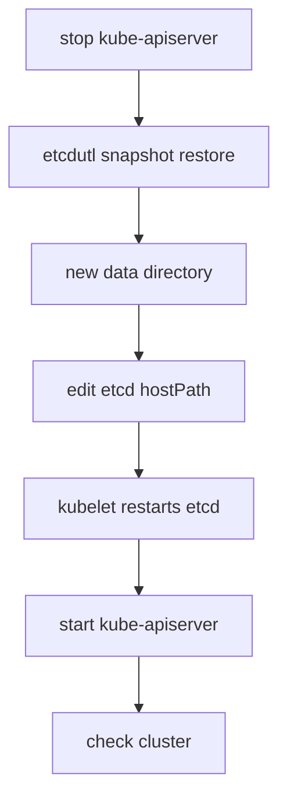

# Restoring A Snapshot And Recovering The Control Plane

A restore is the step that turns a snapshot file back into a running cluster. It is rare, it happens under pressure and a wrong step can destroy the data that is left. This part explains what the restore command creates, how the kubeadm control plane starts using the new data and how to check that the cluster is healthy afterwards.

## What a restore creates

`etcdutl snapshot restore` reads a snapshot file and writes a new data directory. It does not talk to a running etcd and it does not change the live data directory. The target directory must not exist, or the command refuses to run. This protects you from overwriting data that you still need.

The restored directory holds a new cluster identity. etcd gives the restored cluster a new cluster ID and new member IDs, so that a leftover member of the old cluster cannot join the restored cluster by accident. For a single-member cluster this changes nothing you can see. For a cluster with three members, every member must be restored from the same snapshot, each with its own name and peer address, and all of them are started together.

You can practise the command in the playground without any risk. The restore writes to a scratch directory in the pod, and the live etcd keeps using `/var/lib/etcd`.

<!-- astrona:playground:renew -->

Take a snapshot first, if you do not have one in the pod:

```sh
kubectl -n kube-system exec "$(kubectl -n kube-system get pod -l component=etcd -o jsonpath='{.items[0].metadata.name}')" -- etcdctl --endpoints=https://127.0.0.1:2379 --cacert=/etc/kubernetes/pki/etcd/ca.crt --cert=/etc/kubernetes/pki/etcd/healthcheck-client.crt --key=/etc/kubernetes/pki/etcd/healthcheck-client.key snapshot save /tmp/playground-snapshot.db
```

Restore it into a new directory:

```sh
kubectl -n kube-system exec "$(kubectl -n kube-system get pod -l component=etcd -o jsonpath='{.items[0].metadata.name}')" -- etcdutl snapshot restore /tmp/playground-snapshot.db --data-dir /tmp/restored-etcd
```

The command prints a few log lines and ends without an error. It created `/tmp/restored-etcd` in the pod, with a `member` directory below it. If you run the same command a second time, it fails because the directory exists now. That failure is the safety check, and you can confirm it by running the command again.

## Options for a real restore

A restore on a real node usually sets more options, so that the new member knows its place in the cluster. The most common are `--name` for the member name, `--initial-cluster` for the list of all members and their peer URLs, `--initial-advertise-peer-urls` for the address that this member announces, and `--initial-cluster-token` for a new cluster token. For a single-member kubeadm cluster, the defaults can work, but copying the values from the old etcd flags is safer. The old values are in the pod flags: `--name`, `--initial-cluster` and `--initial-advertise-peer-urls`.

Recent etcd releases add two options for Kubernetes. With `--bump-revision` the restored revision is raised by a number you give, and with `--mark-compacted` the restored data is marked as compacted at that revision. Together they make clients that watch the API server notice that their cached state is out of date. Without them, a restored cluster that goes back to a lower revision can confuse controllers that remember a higher one. Check that your etcd version supports them before you rely on them.

## Pointing the control plane at the new data

The restore creates a directory, but etcd still reads `/var/lib/etcd` until the static pod manifest changes. There are two ways to switch, and both are done on the control plane node as root.

The first way is to change the `hostPath` of the volume `etcd-data` in `/etc/kubernetes/manifests/etcd.yaml` to the restored directory, for example `/var/lib/etcd-restored`. The kubelet sees that the file changed and recreates the etcd pod with the new mount. The `--data-dir` flag stays `/var/lib/etcd`, because it is the path inside the container.

The second way is to move the old `/var/lib/etcd` away and restore into `/var/lib/etcd`. You then do not change the manifest, but you must stop the control plane while you do it.

During the restore, the API server must not write to the old etcd. A safe procedure moves the manifests of the API server, the controller manager and the scheduler out of `/etc/kubernetes/manifests` so that the kubelet stops them, performs the restore, switches etcd and then moves the manifests back.



The diagram shows the order: the API server stops first so it cannot write, the restore builds the new directory, the manifest points etcd to it and the API server starts last.

## Checks after a restore

A running etcd pod does not prove a good recovery. Check three layers in order. First, check etcd itself: its pod must be ready, and `etcdctl endpoint health` with the connection options must report that the endpoint is healthy. Second, check the API server with `kubectl get --raw=/readyz`, which prints `ok`, and with `kubectl get nodes`. Third, check the objects: list the Namespaces, the Deployments and the Secrets you expect from the snapshot time.

Then look at what happens next. Controllers start reconciling the restored objects against the real world. A pod that existed at the snapshot time but was deleted later comes back. A Deployment created after the snapshot is gone, but its pods can still run on the nodes until the kubelet sees that the API no longer knows them and removes them. Persistent volumes that were created after the snapshot can exist in the storage system without an object in the cluster.

## A worked example

At 10:00 the snapshot says the `starfleet` namespace has the Deployment `probe` with two replicas. At 10:05 an administrator deletes the namespace. The administrator stops the API server, restores the snapshot into `/var/lib/etcd-restored`, changes the `etcd-data` hostPath to that path and moves the API server manifest back. After the kubelet restarts etcd, `kubectl get ns` shows `starfleet` and the `probe` Deployment, and the controller manager creates the missing pods.

Objects created between 10:00 and 10:05 are not there. The administrator tells the owners of those objects to create them again. This is the loss window in practice.

## Failure cases

If the restore command fails with an error about an existing directory, you pointed it at a directory that is in use, and you must pick a new one. If etcd does not start after the manifest change, read the pod logs on the node: a typical cause is a typing mistake in the path or a data directory with the wrong owner. If the API server starts but shows old data, the manifest still mounts the old directory. If a multi-member cluster starts with members from different snapshots, the members disagree and refuse to form a cluster.

## Restoring a cluster with several members

A highly available kubeadm cluster runs one etcd member on each control plane node. Each member keeps its own data directory, and they agree on the data through a majority vote. When the cluster has lost its majority, or all of its data, you restore from one snapshot file on every member.

Copy the same snapshot file to each control plane node. On each node, run `etcdutl snapshot restore` with that node's own `--name` and `--initial-advertise-peer-urls`, and with the same `--initial-cluster` list and `--initial-cluster-token` on all nodes. Then point each etcd manifest at its new directory. The members start together and form a new cluster with the snapshot data.

If only one member is lost and the others still have a majority, do not restore a snapshot. Remove the failed member with `etcdctl member remove` and add a new member, so that it copies the data from the healthy members. A snapshot restore is the tool for losing the majority, not for losing one member.

## The backup that kubeadm makes

`kubeadm upgrade apply` also copies the etcd data and the static pod manifests into a directory below `/etc/kubernetes/tmp` before it changes anything. That copy is a safety net for one upgrade. It is on the same disk as the data, so it does not replace a snapshot that you store somewhere else.

## What you can conclude

You now know that a restore builds a new directory and a new cluster identity, that the etcd static pod must be pointed at it and that the API server should stay stopped during the switch. You also know the checks to run, and that objects created after the snapshot are lost. What remains is practice: a restore that nobody rehearsed tends to fail at the first real use.

## Common pitfalls

> [!WARNING]
> Do not restore into a directory that holds live data. Do not leave the API server running while you switch the etcd data directory. Do not mix members restored from different snapshots. Do not call a restore finished when the etcd pod is ready: check the API and the objects as well. Do not forget that objects created after the snapshot are lost, and that the certificates on the node must match the restored objects.
