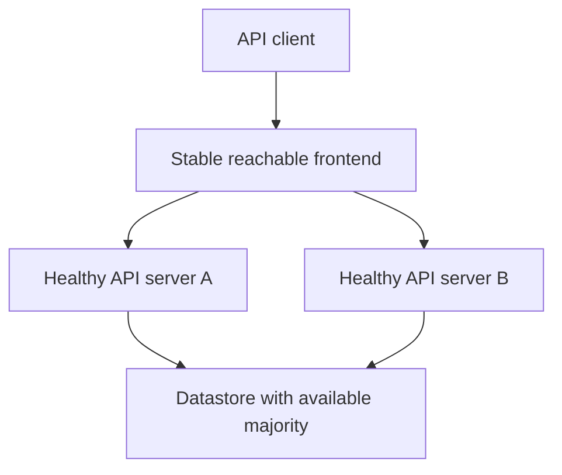
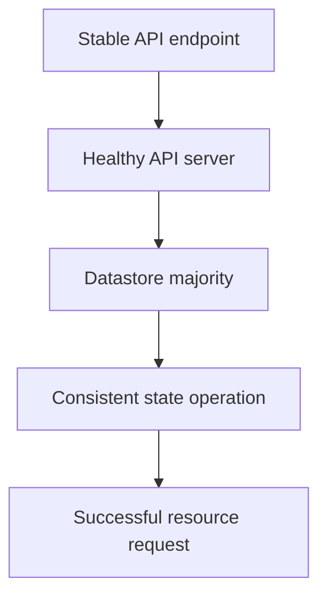

# Highly Available API Access And Datastore Quorum

Two datastore members in a three-member cluster can maintain quorum, but one cannot. Adding an API load balancer does not change that consensus requirement.

## Learning objectives

- Explain stable API access and backend health.
- Compare stacked and external datastore topology.
- Calculate majority quorum and failure tolerance.

## Before you start

This chapter is standalone reading material; no running cluster or installed tools are required. A Pod is the Kubernetes unit for running one or more containers, and a namespace groups namespaced objects. Treat the worked configurations as teaching examples rather than recorded observations from a provisioned environment.

## Responsible components and behavior

A highly available control plane is designed to keep management functions usable through specified failures. Multiple API servers, suitable endpoint infrastructure and a resilient datastore contribute different parts of that design. Adding a second control-plane label alone does not establish that every critical dependency can tolerate a machine failure.

## The Stable API Endpoint

Clients need a stable endpoint whose routing reaches healthy API server instances. A load balancer can provide that frontend under an appropriate health-check design. The endpoint must remain reachable when an individual backend fails, and certificates must cover the names used by clients.

An API server serves requests and uses the datastore for cluster state. Several servers can support request availability, but they still depend on valid access to that datastore. A healthy frontend listener cannot turn unavailable datastore operations into a healthy management plane.

A load balancer can itself be a failure dependency. A design claiming resilience to one machine loss must consider whether that machine also hosts the only frontend. Availability is measured against the stated failure scope, not inferred solely from the number of API server processes.

## Stacked And External Datastore Topologies

In a stacked topology, control-plane nodes also host datastore members. This can simplify machines and communication, but losing one machine affects both an API server and a datastore member. In an external datastore topology, datastore hosts are separate, which changes failure relationships and operational requirements.

Etcd is the distributed key-value datastore commonly used for Kubernetes state. It uses quorum for relevant consensus decisions. In a voting cluster, a majority of members is required. Three voting members require two for quorum and can tolerate one member loss while maintaining that majority.

Two voting members still require both for a majority, so adding a second member does not provide the one-member failure tolerance often assumed from the phrase redundant. Five members require three and can tolerate two member losses under that simplified model. More members also add communication and management considerations rather than unlimited free resilience.

## Other Control-Plane Responsibilities

Controllers and schedulers perform reconciliation and placement responsibilities. Multiple instances commonly coordinate active responsibility through leader election. Losing an active instance can cause a transition before another continues its work, even while API requests remain available.

The kubelet and runtime on each control-plane host must still keep the locally managed components operating. Certificate expiration, disk pressure and network partitions can affect several dependencies at once. Distributing failure domains can reduce common-cause exposure, but only when the infrastructure truly separates the intended risks.

Management-plane availability is also different from application availability. Existing containers can continue running for some period while management is impaired, but replacement, scheduling and configuration progress may be blocked. A workload's service behavior needs its own replicas, placement, dependencies and data design.

## Evaluate A Failure Scenario

Suppose one node of a three-member stacked control plane is lost. Two datastore members can retain quorum, and the API frontend should use remaining healthy servers. If both surviving servers are inaccessible through the only failed frontend, the theoretical datastore tolerance has not produced usable client access.

If two members are lost, one remaining API server cannot generally supply normal datastore-backed management despite its process still running. Restarting that server repeatedly does not recreate the missing majority. Recovery requires the supported datastore and topology procedure with protected state and identity.

A defensible availability explanation names the failure being tolerated, the remaining endpoint path, the remaining quorum and the continued responsibility of each component. It also states what the design cannot tolerate. That is more useful than assuming that every replicated component has identical availability semantics.

## Dependency Flow

## Work through the decision

A highly available API endpoint distributes or redirects client access to healthy API servers. Those servers still depend on datastore operation. etcd quorum requires a majority of voting members, so member count, placement and failure domains matter independently of frontend reachability.

For three voters, two form a majority. For five, three do. A partition can leave a reachable API frontend without the datastore access needed for ordinary operations. Membership changes and recovery require the supported procedure rather than creating unrelated stores with similar names. Check endpoint health and datastore-backed requests separately when evaluating resilience.

Frontend redundancy and datastore consensus protect different dependencies in one useful API operation.

Frontend redundancy and datastore consensus protect different dependencies in one useful API operation.

## Common pitfalls

> [!WARNING]
> API-server count, load-balancer availability and datastore quorum are separate requirements. Two voting datastore members do not tolerate losing one, and management-plane resilience does not automatically provide application resilience.
