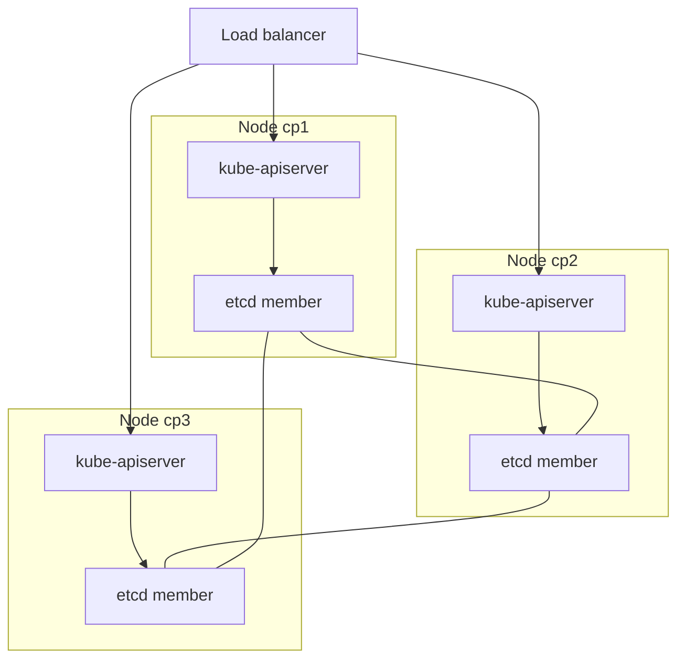

# Stacked And External etcd Topologies In kubeadm Clusters

A cluster with one control-plane node has one API server, one scheduler, one controller manager and one etcd member. If that node fails, nobody can change the cluster, and if its disk is lost, the cluster state is lost with it. kubeadm supports two ways to remove this single point of failure. This part explains both, shows where kubeadm records the choice, and explains why the API endpoint must be decided on the first day.

## The parts of a control plane

The control plane has four programs. The `kube-apiserver` answers every request and is the only program that talks to the datastore. etcd is the datastore: a distributed key-value store that holds all cluster objects. The `kube-scheduler` picks a node for each new pod. The `kube-controller-manager` runs the controllers that make the real state match the declared state.

kubeadm runs these four programs as static pods. A static pod is a pod that the kubelet starts from a manifest file on its own node, in the directory `/etc/kubernetes/manifests`, without asking the API server. The kubelet then creates a read-only copy of each static pod in the API, called a mirror pod, so `kubectl` can show it.

<!-- astrona:playground:renew -->

List the control plane pods and the node that runs them:

```sh
kubectl -n kube-system get pods -l tier=control-plane -o wide
```

The list shows `etcd`, `kube-apiserver`, `kube-controller-manager` and `kube-scheduler`, each with the node name as a suffix. The `NODE` column shows that all four run on the same node. That is the layout that a highly available cluster changes.

## The stacked topology

In a stacked topology, every control-plane node runs all four programs, including one etcd member. The etcd members find each other and form one etcd cluster. This is the default that kubeadm creates when you add control-plane nodes with `kubeadm join --control-plane`.

The stacked topology needs fewer machines and is simple to set up. Its weakness is that the API server and the etcd member share a node. When one node fails, the cluster loses one API server and one etcd member at the same time.



The diagram shows three stacked nodes: the load balancer sends requests to the three API servers, each API server talks to the etcd member on its own node, and the three etcd members talk to each other.

## The external topology

In an external topology, etcd runs on its own machines, and the control-plane nodes run only the other three programs. Each API server connects to the etcd members over the network with client certificates. kubeadm does not create or manage these etcd machines. You prepare them and give kubeadm their addresses.

The external topology separates two failure groups. Losing a control-plane node loses an API server but no etcd member. Losing an etcd machine loses a member but no API server. The price is the number of machines: a three-node control plane with a three-member external etcd needs six machines.

kubeadm reads the choice from its `ClusterConfiguration`. For an external etcd, the file has an `etcd.external` block with the member addresses and the certificate files. This file is for `kubeadm init` on a new host, so it is shown here to read, not to apply in the playground:

```yaml
apiVersion: kubeadm.k8s.io/v1beta4
kind: ClusterConfiguration
kubernetesVersion: v1.35.0
controlPlaneEndpoint: "api.starfleet.example:6443"
etcd:
  external:
    endpoints:
      - https://10.0.0.11:2379
      - https://10.0.0.12:2379
      - https://10.0.0.13:2379
    caFile: /etc/kubernetes/pki/etcd/ca.crt
    certFile: /etc/kubernetes/pki/apiserver-etcd-client.crt
    keyFile: /etc/kubernetes/pki/apiserver-etcd-client.key
```

For a stacked cluster, the block is `etcd.local` with a `dataDir`, or kubeadm fills in the default `/var/lib/etcd`.

## Reading the topology from a running cluster

kubeadm stores the `ClusterConfiguration` that created the cluster in the ConfigMap `kubeadm-config` in `kube-system`. Later `kubeadm join` and `kubeadm upgrade` commands read it. It is the first place to look when you meet an unknown cluster.

Read it:

```sh
kubectl -n kube-system get configmap kubeadm-config -o jsonpath='{.data.ClusterConfiguration}'
```

Look at two things in the output. The `etcd` block holds `local` for a stacked cluster or `external` for an external one. The line `controlPlaneEndpoint` holds the address that the cluster uses to reach the API servers.

Confirm the topology from the objects. Count the nodes that carry the control-plane label and the etcd pods:

```sh
kubectl get nodes -l node-role.kubernetes.io/control-plane
kubectl -n kube-system get pods -l component=etcd
```

In a stacked cluster, the two counts are equal, because every control-plane node runs one etcd pod. In an external cluster, the etcd pods do not exist in `kube-system`, because etcd does not run on the nodes of the cluster.

## The control plane endpoint

Every client of the API server needs one stable address: the kubelet of each node, `kube-proxy`, the scheduler, the controller manager and the administrator's `kubectl`. If that address is the name of one API server, the cluster depends on that server. The `controlPlaneEndpoint` setting holds a DNS name or an IP address of a load balancer that forwards to all API servers, and kubeadm writes it into every kubeconfig it creates.

You set it when you create the first node:

```sh
kubeadm init --control-plane-endpoint "api.starfleet.example:6443" --upload-certs
```

This command is shown for a real host and is not run in the playground. The flag `--upload-certs` stores the control plane certificates, encrypted, in a Secret named `kubeadm-certs`, so that the nodes that join later can fetch them. kubeadm deletes that Secret after two hours.

The endpoint must be set before the cluster grows. kubeadm does not support turning a cluster that was created without `--control-plane-endpoint` into a highly available cluster. The reason is that the kubeconfig files and the API server certificate already contain the old address. The certificate must also list the endpoint name as a subject alternative name, which kubeadm does when you pass the flag at the start.

## Worked example: lose one node

A team runs three stacked control-plane nodes behind a load balancer. One node loses power. The load balancer stops sending requests to the dead API server because its health check fails, and the two other API servers keep answering. The etcd cluster has two of three members, which is still a majority, so reads and writes keep working.

Now take the same team with an external topology and one etcd machine lost. All three API servers stay up. The remaining two etcd members still form a majority, so again nothing stops. Both layouts survive one failure. They differ in what else the failure takes with it: in the stacked layout, one failure removes both an API server and a member, so a second failure of any kind is far more serious.

With the single node in the playground, the same failure removes everything. That is why the playground reports a fault tolerance of 0.

## What you know now, and what is open

You can now name the four control plane programs, tell the stacked and external topologies apart, and read the choice from `kubeadm-config`. You know that the endpoint is decided when the cluster is created. The open question is how many etcd members a cluster needs and what happens when members are added or lost. The next part answers it with numbers.

## Common pitfalls

> [!WARNING]
> - Starting a cluster with `kubeadm init` and no `--control-plane-endpoint`. The cluster cannot become highly available later.
> - Believing that three control-plane nodes with a load balancer are highly available without checking etcd. The API servers need a datastore majority.
> - Expecting an external etcd to appear in `kube-system`. External etcd members run outside the cluster, so there are no etcd pods to list.
> - Putting all nodes of a stacked cluster in one rack, one zone or on one host. One shared failure then removes the whole majority.
