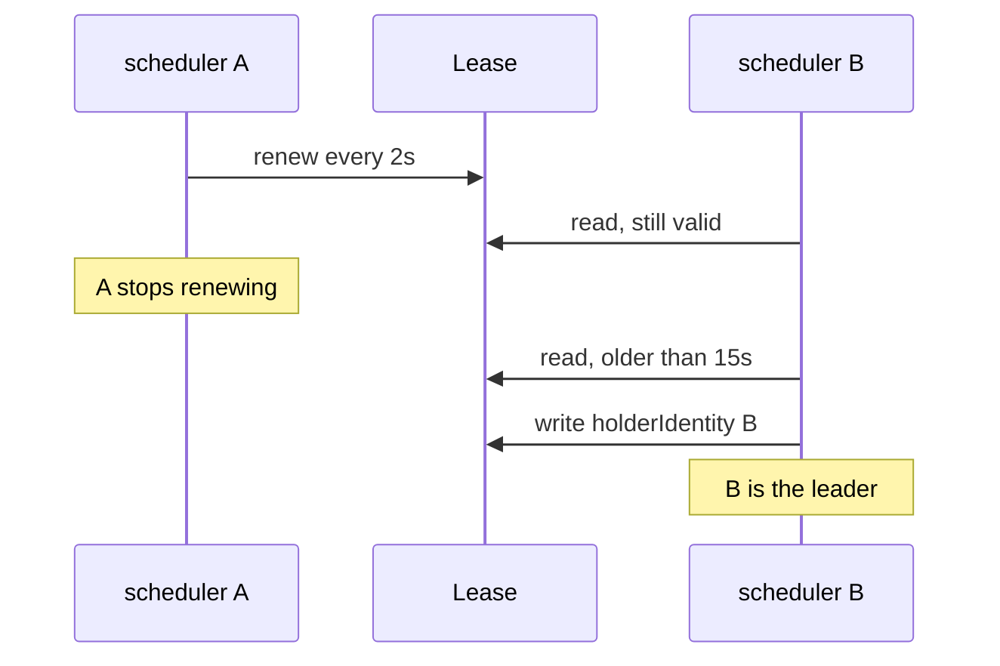

# Leader Election With Leases

Three schedulers that all place the same pod would bind it to three different nodes. Three controller managers that all react to the same Deployment would create three sets of pods. These programs must have exactly one active copy, and they must switch to another copy when the active one fails. Kubernetes does this with leader election through a Lease object in the API. This part shows the object, the timing rules, the permissions that a controller needs, and what a failover looks like from the outside.

## One active copy through a lease

A Lease is an API object in the group `coordination.k8s.io/v1`. It is a small record that says who holds a lock and until when. Each copy of the scheduler tries to write its name into the same Lease. The one that succeeds is the leader and runs the scheduling loop. The other copies keep running, but they only watch the Lease.

The leader must renew the Lease often. If it stops renewing, because it crashed or because it cannot reach the API server, another copy takes the Lease over and becomes the leader. The API server stores the Lease in etcd, so the lock depends on the datastore like every other object.

<!-- astrona:playground:renew -->

Read the two Leases of the control plane:

```sh
kubectl -n kube-system get lease kube-scheduler kube-controller-manager
kubectl -n kube-system get lease kube-scheduler -o yaml
```

The first command lists the Leases with the current holder and the age. The second shows the fields. The important fields of `spec` are:

| Field | Meaning |
| --- | --- |
| `holderIdentity` | The name of the current leader: the node name, an underscore and a unique suffix |
| `leaseDurationSeconds` | How long other copies must wait after the last renewal before they may take over |
| `acquireTime` | When the current leader took the Lease |
| `renewTime` | When the leader last renewed the Lease |
| `leaseTransitions` | How many times the holder has changed |

Read the holder with a single field and compare `renewTime` twice:

```sh
kubectl -n kube-system get lease kube-scheduler -o jsonpath='{.spec.holderIdentity}{"\n"}{.spec.renewTime}{"\n"}'
kubectl -n kube-system get lease kube-scheduler -o jsonpath='{.spec.renewTime}{"\n"}'
```

Run the second command a few seconds later. The `renewTime` has moved forward, which proves that the leader is alive and writing. The `leaseTransitions` value stays the same until a different copy takes over.

## The timing flags

The scheduler and the controller manager share the same flags. kubeadm sets `--leader-elect=true` in their static pod manifests, and the other values stay at their defaults:

| Flag | Default | Meaning |
| --- | --- | --- |
| `--leader-elect` | `true` | Turn leader election on |
| `--leader-elect-lease-duration` | 15 seconds | How long a lease is valid after the last renewal |
| `--leader-elect-renew-deadline` | 10 seconds | How long the leader keeps trying to renew before it gives up |
| `--leader-elect-retry-period` | 2 seconds | How often every copy tries to acquire or renew |
| `--leader-elect-resource-lock` | `leases` | The kind of object that holds the lock |

Read the flag from the running scheduler:

```sh
kubectl -n kube-system get pod -l component=kube-scheduler \
  -o jsonpath='{range .items[0].spec.containers[0].command[*]}{@}{"\n"}{end}' | grep leader-elect
```

Only the flags that kubeadm sets appear in the command. A missing flag means the default applies.

## What happens at a failover

The leader renews every retry period. If it fails to renew for longer than the renew deadline, it stops working as leader, and the process exits so that the kubelet restarts it. The other copies wait until the Lease is older than the lease duration, and then one of them writes its own name into the Lease.



The diagram shows the leader renewing, the second copy reading a valid Lease, and the second copy taking over after the Lease expired.

The worst-case gap with the defaults is about the lease duration, 15 seconds, plus one retry period. During that gap, no copy schedules pods. That is the cost of a safe lock: the new leader must wait until the old one cannot still be working.

## What stops while there is no leader

The effect depends on the program. While there is no scheduler leader, existing pods keep running, but new pods stay in `Pending`, because nobody binds them to a node. While there is no controller manager leader, a Deployment does not create replacement pods, nodes that fail are not marked and Jobs do not progress. The API server keeps answering reads and writes in both cases.

This is also why a single control-plane node is a risk for the scheduler and the controller manager. With one copy there is nothing to fail over to, so the pause lasts until the container is restarted.

## Leader election for your own controller

A controller that you run with several replicas needs the same mechanism. Libraries such as `client-go` implement it, but the controller's ServiceAccount must be allowed to use Leases. The needed permissions are `get`, `create` and `update` on `leases` in the group `coordination.k8s.io`, in the namespace where the Lease lives. No other verb is needed, and `delete` and `list` are not required.

First create the ServiceAccount. Save this as `serviceaccount-probe-controller.yaml`:

```yaml
apiVersion: v1
kind: ServiceAccount
metadata:
  name: probe-controller
  namespace: starfleet
```

Apply it:

```sh
kubectl apply -f serviceaccount-probe-controller.yaml
```

Then create the Role and the RoleBinding. Save this as `role-probe-leader-election.yaml`:

```yaml
apiVersion: rbac.authorization.k8s.io/v1
kind: Role
metadata:
  name: probe-leader-election
  namespace: starfleet
rules:
  - apiGroups: ["coordination.k8s.io"]
    resources: ["leases"]
    verbs: ["get", "create", "update"]
---
apiVersion: rbac.authorization.k8s.io/v1
kind: RoleBinding
metadata:
  name: probe-leader-election
  namespace: starfleet
subjects:
  - kind: ServiceAccount
    name: probe-controller
    namespace: starfleet
roleRef:
  apiGroup: rbac.authorization.k8s.io
  kind: Role
  name: probe-leader-election
```

Apply it:

```sh
kubectl apply -f role-probe-leader-election.yaml
```

Then check the result:

```sh
kubectl auth can-i update leases.coordination.k8s.io -n starfleet --as=system:serviceaccount:starfleet:probe-controller
kubectl auth can-i delete leases.coordination.k8s.io -n starfleet --as=system:serviceaccount:starfleet:probe-controller
kubectl auth can-i update leases.coordination.k8s.io -n kube-system --as=system:serviceaccount:starfleet:probe-controller
```

The first command prints `yes`. The second and third print `no`: the Role grants no delete, and a Role works only in its own namespace, so the controller cannot touch the Leases of the control plane.

## Limits of leader election

A Lease lock is not a perfect fence. A leader that pauses, for example during a long garbage collection, can wake up after another copy took over and still believe that it leads. The renew deadline makes this rare, and a controller should still make each of its actions safe to repeat. Clock differences between nodes can also shift the observed expiry, so the timing values leave margin.

## What you know now

You can read a Lease, name the current leader of the scheduler and the controller manager, explain the three timing flags and estimate a failover gap. You can give a controller the smallest permissions that leader election needs. You also know that these programs, unlike the API server, pause when no copy holds the Lease.

## Common pitfalls

> [!WARNING]
> - Turning leader election off with `--leader-elect=false` on several copies. All copies act at once and create duplicate work.
> - Giving a controller the `edit` or `admin` role just for its Lease. Grant `get`, `create` and `update` on `leases` only.
> - Using a ClusterRole binding for a namespace-scoped Lease. The Role in the controller's own namespace is enough and is safer.
> - Deleting the Lease of the scheduler to force a failover. Use it only on a test cluster, because the pause is real.
> - Setting the renew deadline equal to or above the lease duration. The leader could keep working after the others took over.
