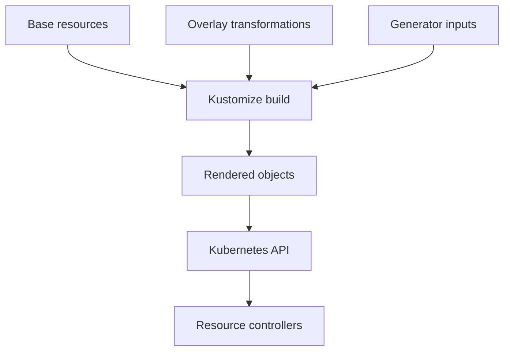

# Composing Resources With Kustomize

A development Deployment needs one replica while production needs several, but their container and Service definitions should stay consistent. Kustomize lets a shared base hold those common objects and lets each overlay express the intended difference.

## Learning objectives

- Explain chart values and rendered installation resources.
- Distinguish package release from application health.
- Review composition, references and resource transformations.

## Before you start

This chapter is standalone reading material; no running cluster or installed tools are required. A Pod is the Kubernetes unit for running one or more containers, and a namespace groups namespaced objects. Treat the worked configurations as teaching examples rather than recorded observations from a provisioned environment.

## Responsible components and behavior

Kustomize builds Kubernetes resource definitions from declared inputs and transformations. It can combine resource files, modify common fields and generate configuration objects without requiring a separate chart templating language. The output is ordinary Kubernetes objects whose behavior still depends on their schema and relationships.

## Read The Composition Boundary

A kustomization identifies resources that belong to one composition. Inputs can include object files and other kustomizations. A reusable base describes a common set of resources; an overlay customizes that set for a particular environment or purpose. The distinction is organizational and declarative, rather than a new Kubernetes controller kind.

For a `scout` application, a base might describe a Deployment and a Service. A development overlay can change replica count and configuration while retaining their common relationship. Duplicating whole manifests for every environment can make later corrections inconsistent; a base and focused transformations help express what is shared and what differs.

Relative file references are resolved under the composition's rules, and loading restrictions protect which input locations are accepted. A path that looks valid relative to the terminal's directory can still be wrong relative to the kustomization. Diagnose the input graph before investigating a cluster-side failure for output that was never built.

## Transform Names And Relationships Carefully

Name prefixes or suffixes can distinguish generated object names. Namespace transformations can place supported namespaced resources into the intended namespace. A name transformation does not create a namespace automatically unless a Namespace resource is included or another process creates it.

Built-in name-reference handling can update known relationships when a transformed name is referenced by another resource. Arbitrary fields in custom resource schemas should not be assumed to receive identical updates automatically. Authors must understand whether a reference is recognized or needs explicit configuration.

Label transformations also require care. A label on metadata, a Deployment selector, a Pod-template label and a Service selector have different behavioral roles. Adding a useful descriptive label is not a reason to change an immutable controller selector. Inspect the transformation options and rendered relationships rather than assuming every label operation has the same scope.

## Generate Configuration Objects

A ConfigMap generator can produce a ConfigMap from declared literal values or files. A Secret generator can produce a Secret through the supported inputs. Generating a Secret does not encrypt the source inputs, and checking confidential literals into a repository exposes them despite the generated resource kind.

Generated names commonly include a content-derived suffix. When configuration content changes, the name can change, and recognized workload references can be updated in the rendered output. A changed reference inside a Deployment template can therefore trigger a rollout when the resulting objects are applied. This differs from mutating one fixed-name ConfigMap without changing the template.

Suppressing the suffix changes that lifecycle relationship. The process consuming a mounted file or an environment variable must still handle updates appropriately. Treat the naming strategy and the application's configuration behavior as one explicit design decision.

## Inspect Output As A Contract

Before reasoning about deployment, examine which objects the composition produces, their final names and namespaces, and the links among them. An apparently small transform can change the routing pool if it alters selectors. A correct resource count does not establish correct references.

Rendering does not install controllers or guarantee API support. A generated object using an unserved version can still fail at the cluster. Likewise, a correctly generated Secret reference can point to a resource in the wrong namespace. Output review checks a useful layer, but runtime and authorization constraints remain distinct.

Track the Kustomize implementation and version used when a composition relies on specific features. A client-bundled implementation and a separate executable may differ. For the conceptual task, identify the intended resources and transformations first, then verify their effective output against the relevant schema.

## Work through the decision

Kustomize runs on the client before objects reach the Kubernetes application programming interface (API). It reads a kustomization, loads its resources and applies the declared transformations. It does not create a controller inside the cluster. Once the output is submitted, Kubernetes sees the resulting ordinary objects.

In the playground, the `probe` Deployment consumes the `probe-code` ConfigMap as a volume. A ConfigMap stores non-confidential configuration data. With a generator and a content-derived name, a changed ConfigMap can also change the Deployment's reference and therefore its Pod template. With the fixed name used by this fixture, editing the ConfigMap is not a template revision by itself. This is a lifecycle consequence of naming, not an automatic restart feature of all configuration objects.

Composition happens before submission; resource controllers act on the resulting objects.

You can now separate reusable inputs, rendered references and cluster behavior. Successful rendering answers whether composition worked, while API acceptance and application readiness require additional evidence.

## Common pitfalls

> [!WARNING]
> Generated output can still contain wrong selectors, unsupported APIs or unresolved custom references. Name hashing supports configuration identity, while Secret generation does not protect confidential source files by itself.
