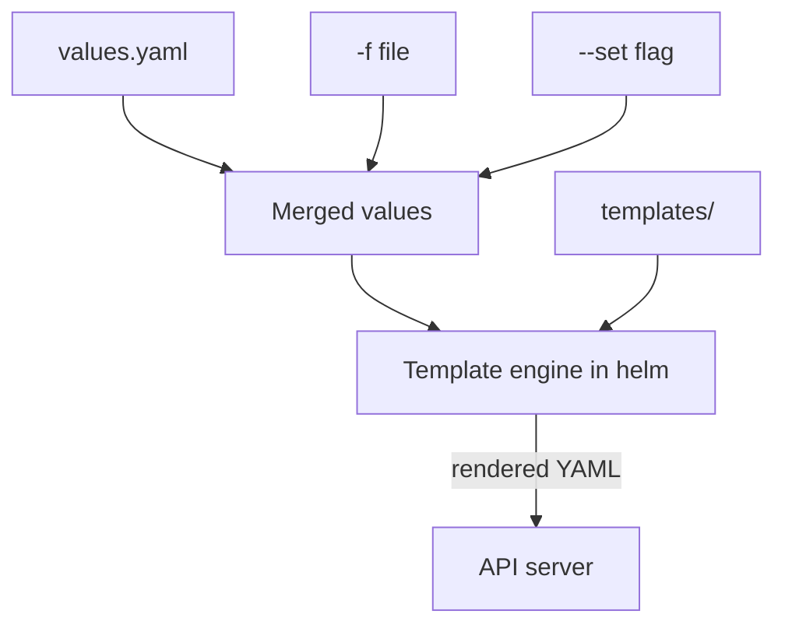

# Chart Anatomy And Rendering

The same application must run with different settings in different places: one replica on a test cluster, three on a production cluster, another image tag after a release. Copying and editing YAML for every case does not scale. A Helm chart solves this by turning the YAML into a template and moving the settings into a separate values file. This part opens a chart, shows which file does what, and renders it locally so you can see exactly what Helm would send to the cluster.

## What a chart contains

A chart is a directory. Its name is the name of the package, and its files follow fixed names that the `helm` command looks for.

| Path | What it does |
| --- | --- |
| `Chart.yaml` | The metadata of the chart: `apiVersion`, `name`, `version`, `appVersion`, `description`, `type` and optional `dependencies` |
| `values.yaml` | The default values that the templates read |
| `templates/` | The template files that produce Kubernetes objects |
| `templates/_helpers.tpl` | Named template snippets. A file whose name starts with an underscore produces no object |
| `templates/NOTES.txt` | Text that `helm install` prints after a successful install |
| `charts/` | Dependency charts, stored as packages or directories |
| `crds/` | CustomResourceDefinition files that Helm installs once and never changes afterwards |
| `values.schema.json` | An optional JSON Schema that checks the final values |

The `apiVersion: v2` in `Chart.yaml` marks a chart for Helm 3 and later. Two version fields are easy to mix up. The field `version` is the version of the chart package, and Helm uses it to tell chart packages apart. The field `appVersion` is only information about the application that the chart installs. It changes no image by itself, unless a template reads `.Chart.AppVersion` and uses it, as the example below does with a fallback.

## What the template engine sees

A template is a YAML file with expressions between double curly braces. Helm uses the Go template language and adds many functions of its own. When Helm renders a file, every expression sees one object, written as a dot. That object has these top-level fields, and they are the ones the exam expects you to know.

| Field | Content |
| --- | --- |
| `.Values` | The final merged values: chart defaults, files and `--set` flags |
| `.Release` | Facts about this installation: `.Release.Name`, `.Release.Namespace`, `.Release.Revision`, `.Release.IsInstall`, `.Release.IsUpgrade` |
| `.Chart` | The content of `Chart.yaml`, with capitalised names such as `.Chart.Name` and `.Chart.AppVersion` |
| `.Capabilities` | What the cluster supports, for example `.Capabilities.KubeVersion` |
| `.Files` | Access to non-template files in the chart |
| `.Template` | The name of the template that is being rendered |

The `helm` command on your machine does the rendering. The API server never sees a template. It only receives the finished objects, so it applies its normal checks to them: schema validation, admission and authorisation.



The diagram shows that all value sources are merged first, and only then does the template engine run once over every template.

## A worked chart

Create a chart for a workload named `shuttle`. It has a Deployment whose replica count, image and environment variables come from values.

<!-- astrona:playground:renew -->

Save this as `shuttle/Chart.yaml`:

```yaml
apiVersion: v2
name: shuttle
description: The shuttle workload
type: application
version: 0.1.0
appVersion: "1.0"
```

Save this as `shuttle/values.yaml`:

```yaml
replicaCount: 1
image:
  repository: docker.io/library/busybox
  tag: "1.37.0"
env:
  MODE: idle
resources: {}
```

Save this as `shuttle/templates/_helpers.tpl`. It defines a named template that builds a resource name from the release name:

```yaml
{{- define "shuttle.fullname" -}}
{{- printf "%s-shuttle" .Release.Name | trunc 63 | trimSuffix "-" -}}
{{- end -}}
```

Save this as `shuttle/templates/deployment.yaml`:

```yaml
apiVersion: apps/v1
kind: Deployment
metadata:
  name: {{ include "shuttle.fullname" . }}
  namespace: {{ .Release.Namespace }}
  labels:
    app: shuttle
    chart: {{ printf "%s-%s" .Chart.Name .Chart.Version }}
spec:
  replicas: {{ .Values.replicaCount }}
  selector:
    matchLabels:
      app: shuttle
      release: {{ .Release.Name }}
  template:
    metadata:
      labels:
        app: shuttle
        release: {{ .Release.Name }}
    spec:
      containers:
        - name: shuttle
          image: "{{ .Values.image.repository }}:{{ .Values.image.tag | default .Chart.AppVersion }}"
          command: ["sh", "-c", "sleep 3600"]
          env:
            {{- range $name, $value := .Values.env }}
            - name: {{ $name }}
              value: {{ $value | quote }}
            {{- end }}
          {{- with .Values.resources }}
          resources:
            {{- toYaml . | nindent 12 }}
          {{- end }}
```

The template uses these functions, and each one solves a common problem:

- `include` runs a named template and returns its text, so the same naming rule is written once.
- `default` gives a fallback when a value is empty. Here an empty `image.tag` falls back to the `appVersion` of the chart.
- `quote` puts double quotes around a value, so a value such as `idle` or `true` stays a string.
- `range` repeats a block for every entry of a map. Helm sorts map keys, so the output order is stable.
- `with` runs a block only when the value is not empty and moves the dot to that value. Because `resources` is `{}` by default, the whole `resources` block disappears.
- `toYaml` turns a value back into YAML text, and `nindent 12` starts a new line and indents every line by twelve spaces.

The dash in `{{-` removes the whitespace before the expression. This matters because YAML depends on indentation: a stray blank line or a wrong indent inside a template gives invalid YAML.

## Check and render the chart

Run the chart checker and render the chart for a release named `crew`. No cluster is needed for either command:

```sh
helm lint shuttle
helm template crew shuttle --namespace starfleet
```

`helm lint` looks for chart structure problems and template errors. `helm template` prints the YAML that an install would send. The Deployment name comes out as `crew-shuttle`, because the helper joins the release name and the word `shuttle`. The replica count is `1` and the image is `docker.io/library/busybox:1.37.0`, both from `values.yaml`. The `resources` block does not appear, because its value is empty.

Now change two values with `--set` and print only the Deployment:

```sh
helm template crew shuttle --namespace starfleet \
  --set replicaCount=3 \
  --set env.MODE=patrol \
  --set resources.limits.memory=64Mi \
  --show-only templates/deployment.yaml
```

The output shows `replicas: 3`, an environment variable `MODE` with the value `"patrol"` and a `resources` block with the limit `memory: 64Mi`. The key `env.MODE` reached the template because the template loops over `.Values.env`. A key that no template reads has no effect: try `--set replicas=3` and compare the output with the earlier one.

## When rendering helps and when it does not

Rendering shows the result of the templates. It does not prove that the cluster accepts the objects. `helm template` runs without a cluster, so `.Capabilities` holds default values and the API server does not check the result. The command `helm install --dry-run=server` goes further, because it asks the API server to validate the objects without storing them. Use rendering to review fields such as images, ports and permissions. Use the server-side dry run to find an unsupported API version or a rejected field before the real install.

A value only matters when a template reads it. A chart can also protect itself. The `required` function stops rendering with a message when a value is missing, and a `values.schema.json` file rejects values of the wrong type before any template runs. Without either, a typo such as `replicacount` is accepted and ignored, and the chart default stays in effect.

You now know what a chart contains and how a value becomes a field, without any cluster. What is still open is the installed result: the objects in the cluster, the record that Helm keeps and what happens when the values change later.

## Common pitfalls

> [!WARNING]
> Do not assume that a key in `values.yaml` has a meaning to Kubernetes: only a template that reads it makes it effective. Do not confuse `version` (the chart package) with `appVersion` (information about the application). Do not forget `quote` for values that must stay strings. Do not expect `helm template` to detect an API version that the cluster does not serve. Do not copy indentation by hand into a template; use `nindent` with `toYaml`.
