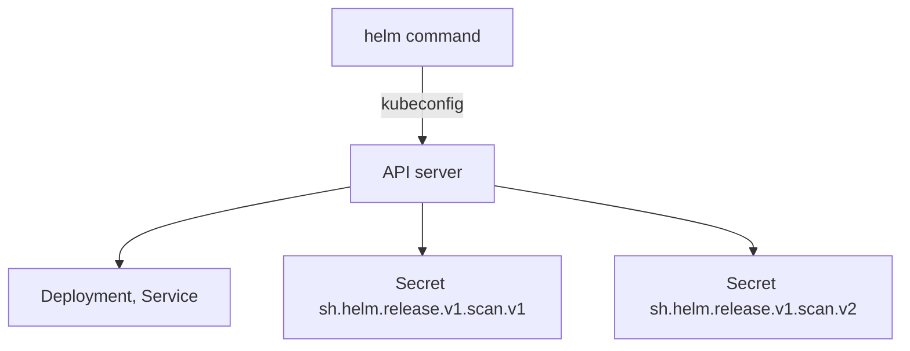

# Values And The Release Lifecycle

An installed chart is not a one-time action. Settings change, images move to new tags, and a change sometimes goes wrong and must be undone. Helm handles this with a release: a named installation with a numbered history. This part shows where values come from and which one wins, where Helm keeps the history, and what `helm upgrade`, `helm rollback` and `helm uninstall` do to the cluster.

## Where values come from and which one wins

Helm builds one merged set of values for every install and upgrade. The sources are applied in a fixed order, and a later source overrides an earlier one.

| Order | Source | Notes |
| --- | --- | --- |
| 1 | `values.yaml` in the chart | The defaults. Always loaded |
| 2 | `values.yaml` of a parent chart | Only for dependency charts |
| 3 | Files given with `-f` or `--values` | Several files are allowed. The last file wins |
| 4 | `--set`, `--set-string`, `--set-file` | Highest priority. The last flag wins |

Maps are merged key by key. If a chart default has `image.repository` and `image.tag`, and you set only `image.tag`, the repository stays. Lists are different: a list in a later source replaces the whole earlier list. Setting a key to `null` removes it from the merged values, which is useful to delete a default.

The `--set` syntax needs care. Dots make nested keys (`image.tag=1.38`), curly braces make a list (`hosts={a,b}`), and Helm converts `true`, `false`, `null` and whole numbers to booleans, null and numbers. When the value must stay a string, such as an image tag made only of digits, use `--set-string`. For anything longer than a few keys, a values file is easier to review.

## Where Helm keeps a release

Helm 3 has no server part in the cluster. The `helm` command reads your kubeconfig, talks to the API server like `kubectl` does, and stores each revision as a Secret in the namespace of the release. The Secret has the type `helm.sh/release.v1` and a name of the form `sh.helm.release.v1.<release>.v<revision>`. Labels on the Secret record the owner (`owner=helm`), the release name, the revision number and the status.



The diagram shows that the objects of the application and the revision records are ordinary API objects. Each Secret holds the chart, the user-supplied values, the rendered manifest and the status of one revision, compressed and encoded. This is why `helm history` works from any machine that can reach the cluster, and why deleting these Secrets makes Helm forget the release while the objects keep running.

## A worked release

Use a small chart named `probe`. Save this as `probe/Chart.yaml`:

<!-- astrona:playground:renew -->

```yaml
apiVersion: v2
name: probe
description: The probe workload
type: application
version: 0.1.0
appVersion: "1.0"
```

Save this as `probe/values.yaml`:

```yaml
replicaCount: 1
logLevel: info
image:
  repository: docker.io/library/busybox
  tag: "1.37.0"
```

Save this as `probe/templates/deployment.yaml`:

```yaml
apiVersion: apps/v1
kind: Deployment
metadata:
  name: {{ .Release.Name }}
  namespace: {{ .Release.Namespace }}
spec:
  replicas: {{ .Values.replicaCount }}
  selector:
    matchLabels:
      app: probe
  template:
    metadata:
      labels:
        app: probe
    spec:
      containers:
        - name: probe
          image: "{{ .Values.image.repository }}:{{ .Values.image.tag }}"
          command: ["sh", "-c", "echo level=$LOG_LEVEL; sleep 3600"]
          env:
            - name: LOG_LEVEL
              value: {{ .Values.logLevel | quote }}
```

Install it as a release named `scan` with two replicas. The flag `--wait` makes Helm wait until the Deployment is ready or the timeout ends:

```sh
helm install scan probe --namespace starfleet --set replicaCount=2 --wait --timeout 120s
helm list --namespace starfleet
kubectl -n starfleet get secrets -l owner=helm
```

`helm list` shows the release `scan`, revision `1` and the status `deployed`. The Secret `sh.helm.release.v1.scan.v1` is the record. Without `--wait`, Helm returns as soon as the API server accepts the objects. A status of `deployed` then means that the objects were created, not that the pods are ready.

## Upgrade, and why values can silently reset

Change the log level with an upgrade:

```sh
helm upgrade scan probe --namespace starfleet --set logLevel=debug --wait --timeout 120s
helm get values scan --namespace starfleet
kubectl -n starfleet get deployment scan
```

The upgrade creates revision 2 and marks revision 1 as `superseded`. The command `helm get values` prints only the values that you supplied, so it shows `logLevel: debug` and no `replicaCount`. The Deployment is back to one replica. By default, `helm upgrade` starts again from the chart defaults plus the values given in this command. The earlier `--set replicaCount=2` was not repeated, so it no longer applies.

Three habits prevent this surprise:

- Keep all values in a file and pass it with `-f` on every install and upgrade, so the file is the source of truth.
- Pass `--reuse-values` to start from the values of the last revision. It also keeps old values when the new chart version adds defaults, which can hide new settings.
- Use `--reset-then-reuse-values` (Helm 3.14 and later) to take new chart defaults and then apply the last supplied values.

Helm compares three things during an upgrade: the manifest of the previous revision, the live object in the cluster and the new manifest. The result is a patch to the live object. A field that someone changed by hand with `kubectl edit` is therefore handled, and a field that the chart never set is left alone.

## History and rollback

Every install, upgrade and rollback adds a revision. List them and roll back to the first one:

```sh
helm history scan --namespace starfleet
helm rollback scan 1 --namespace starfleet --wait --timeout 120s
helm history scan --namespace starfleet
```

After the rollback the Deployment has two replicas and `LOG_LEVEL` `info` again, because the stored manifest of revision 1 was applied. The history now has three revisions. Revision 3 has the description `Rollback to 1`: a rollback never rewinds the numbers, it adds a new revision with the old content. By default Helm keeps ten revisions per release, and the option `--history-max` on an upgrade changes that.

A rollback restores what Helm manages. It does not undo data that the application wrote, such as the content of a volume. Read what each revision recorded with `helm get values scan --revision 1`, `helm get manifest scan` and `helm status scan`.

## Uninstall and objects that outlive a release

Remove the release and check that its objects and records are gone:

```sh
helm uninstall scan --namespace starfleet
kubectl -n starfleet get deployment,secret
```

`helm uninstall` deletes the objects in the last manifest and all revision Secrets. With `--keep-history` it keeps the records so that `helm history` still works. Two cases leave objects behind on purpose. An object with the annotation `helm.sh/resource-policy: keep` is not deleted. CustomResourceDefinitions in the `crds/` directory of a chart are installed on first install, and Helm never upgrades or deletes them, because deleting a definition deletes every custom resource of that type.

## Failures to recognise

A failed install leaves a release with the status `failed`, and installing the same name again reports that the name is still in use. Use `helm upgrade --install` to make a command that works both for a first install and for later runs, or remove the failed release with `helm uninstall`. A template error stops before anything reaches the cluster. An API error, such as an invalid field, stops during the upload. A readiness timeout with `--wait` marks the release `failed` even though the objects exist, so read the pods and events before you change values.

An object that already exists and was not created by this release also blocks an install. Helm refuses to take over an object without its ownership label `app.kubernetes.io/managed-by: Helm` and the annotations `meta.helm.sh/release-name` and `meta.helm.sh/release-namespace`. The error mentions invalid ownership metadata. Adding that metadata to the existing object lets the install adopt it instead of recreating it.

You now know the full lifecycle of a release: render, install, upgrade, roll back and uninstall, with the history kept in Secrets. The open question is how to adjust rendered YAML without a template at all, which is the job of a tool that patches plain files.

## Common pitfalls

> [!WARNING]
> Do not run `helm upgrade` without repeating your values, a values file or `--reuse-values`; values you gave earlier are dropped. Do not read the status `deployed` as proof that the application is healthy; use `--wait` and check the pods. Do not delete the release Secrets by hand to clean up; the objects keep running and Helm forgets them. Do not expect `helm rollback` to reuse a revision number. Do not install over an object that already exists without adding the Helm ownership metadata.
