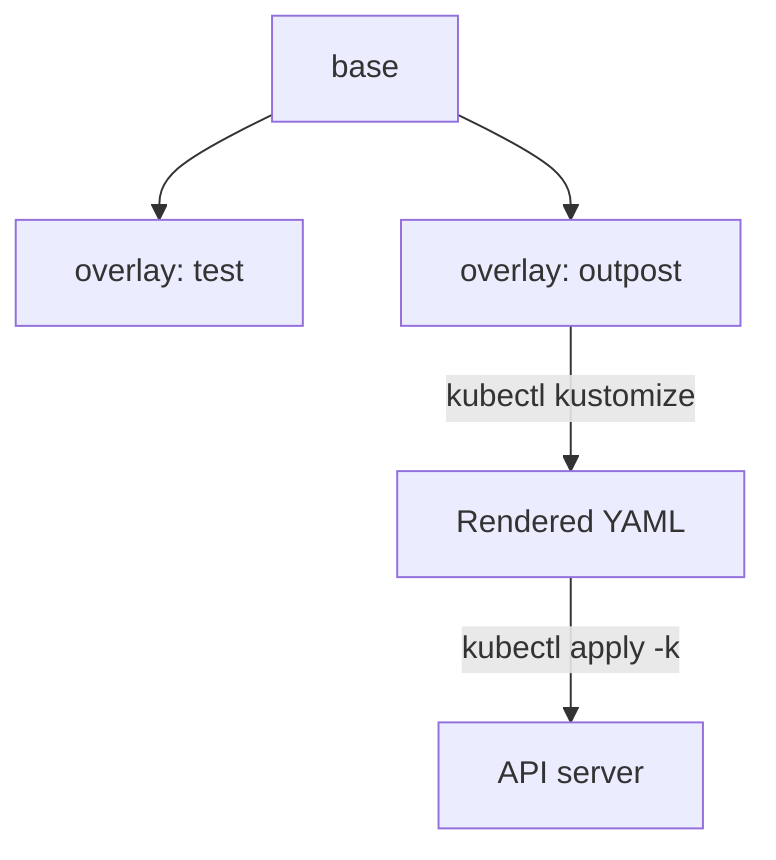

# Bases, Overlays And Transformers

A team runs the same application in a test namespace and in an outpost namespace, with different names, labels, images and replica counts. With plain YAML, someone copies the files and edits them, and the copies drift apart. Kustomize removes the copies. This part builds one base, adds an overlay for one environment and shows the built-in transformers that change many objects at once.

## How Kustomize works

A kustomization is a directory that holds a file named `kustomization.yaml`. The file lists inputs and transformations. The `kubectl kustomize <dir>` command builds the directory and prints the YAML. The command `kubectl apply -k <dir>` builds it and sends the result to the API server. The same `-k` flag works with `kubectl get`, `kubectl diff` and `kubectl delete`.

Everything happens on your machine. The API server receives ordinary objects and cannot tell that Kustomize produced them. There is no release record, no revision number and no rollback: the history is your version control system.

The directory layout follows a convention that is not enforced by the tool:

```text
probe/
  base/
    kustomization.yaml
    deployment.yaml
    service.yaml
  overlays/
    outpost/
      kustomization.yaml
```

A base is a kustomization that is complete on its own. An overlay is a kustomization that lists a base in its `resources` field and adds changes on top. An overlay can itself be the base of another overlay. The inputs in `resources` can be files, directories that contain a `kustomization.yaml`, or a remote repository address with a revision. A file outside the kustomization directory is refused by default, so a base is reached by naming its directory, such as `../../base`.



The diagram shows that several overlays share one base, and that rendering and applying are separate steps.

## A first base

Save this as `probe/base/deployment.yaml`:

<!-- astrona:playground:renew -->

```yaml
apiVersion: apps/v1
kind: Deployment
metadata:
  name: probe
spec:
  replicas: 1
  selector:
    matchLabels:
      app: probe
  template:
    metadata:
      labels:
        app: probe
    spec:
      containers:
        - name: probe
          image: probe
          command: ["sh", "-c", "sleep 3600"]
          ports:
            - name: http
              containerPort: 8080
```

The image `probe` is a placeholder. Overlays replace it. Save this as `probe/base/service.yaml`:

```yaml
apiVersion: v1
kind: Service
metadata:
  name: probe
spec:
  selector:
    app: probe
  ports:
    - name: http
      port: 80
      targetPort: http
```

Save this as `probe/base/kustomization.yaml`:

```yaml
apiVersion: kustomize.config.k8s.io/v1beta1
kind: Kustomization
resources:
  - deployment.yaml
  - service.yaml
```

Render the base. It prints the two objects in one stream, separated by `---`, and nothing reaches the cluster:

```sh
kubectl kustomize probe/base
```

The output is the same YAML as the two files. Kustomize may reorder the objects by kind, so do not depend on the order of your `resources` list.

## The transformers

A transformer is a field in `kustomization.yaml` that changes every matching object. These are the ones used most.

| Field | What it changes |
| --- | --- |
| `namespace` | Sets `metadata.namespace` on every namespaced object |
| `namePrefix`, `nameSuffix` | Adds text to the start or end of every object name |
| `labels` | Adds labels to objects. Option `includeSelectors` also adds them to selectors, and `includeTemplates` adds them to pod templates |
| `commonAnnotations` | Adds annotations to every object |
| `images` | Changes the name, tag or digest of a container image |
| `replicas` | Sets the replica count of a workload that you name. |

The older field `commonLabels` adds labels everywhere including selectors, and it is deprecated in favour of `labels`. A transformer also fixes references. When `namePrefix` renames a ConfigMap, Kustomize rewrites the Deployment fields that name it. When `namespace` is set, it also updates a subject namespace in a ClusterRoleBinding that points at a ServiceAccount.

## An overlay for the outpost namespace

Save this as `probe/overlays/outpost/kustomization.yaml`:

```yaml
apiVersion: kustomize.config.k8s.io/v1beta1
kind: Kustomization
resources:
  - ../../base
namespace: outpost
namePrefix: outpost-
labels:
  - pairs:
      environment: outpost
    includeSelectors: true
    includeTemplates: true
images:
  - name: probe
    newName: docker.io/library/busybox
    newTag: 1.37.0
```

Render it and read the result:

```sh
kubectl kustomize probe/overlays/outpost
```

You should see these changes compared with the base. Both objects are named `outpost-probe` and carry `namespace: outpost`. The Deployment has the image `docker.io/library/busybox:1.37.0`. The label `environment: outpost` appears on the objects, in the Deployment selector, in the pod template and in the Service selector. The Service selector change matters: the Service must select the pods, and the transformer keeps the two in agreement.

Apply it, and compare with a plain `kubectl apply` of the base:

```sh
kubectl apply -k probe/overlays/outpost
kubectl -n outpost get deployment,service
kubectl -n outpost get pods --show-labels
```

The pods carry both `app: probe` and `environment: outpost`. The objects exist only in `outpost`. The base was not touched, so `kubectl kustomize probe/base` still prints the original.

## Failure cases

The label transformer can break an update. The selector of a Deployment cannot change after creation. If you add `includeSelectors: true` to an overlay for an object that already exists, `kubectl apply -k` fails with an immutable field error. Decide on selector labels before the first apply, or delete and recreate the Deployment.

Name changes create new objects. If you add or change `namePrefix` after the first apply, Kustomize renders new names, and the old objects stay in the cluster because `kubectl apply` does not delete objects that are no longer in the input. Delete the old ones by hand, or delete with `kubectl delete -k` using the old kustomization before the change.

A path that points outside the kustomization directory is rejected, and a missing file in `resources` stops the build before anything is printed. A transformer that matches nothing does nothing and prints no warning, so a typo in `name` under `images` or `replicas` is silent. Always render and read the output.

You can now build a base, layer an overlay on it and change names, namespaces, labels and images for every object at once. A transformer works on one kind of field everywhere. What is still open is how to change one specific field of one specific object, and how to generate configuration.

## Common pitfalls

> [!WARNING]
> Do not add `includeSelectors: true` to an object that already exists; selectors cannot change. Do not rely on the order of the `resources` list. Do not rename objects with `namePrefix` after the first apply and expect the old objects to disappear. Do not trust a transformer that silently matches nothing; render the output and check it. Do not use `commonLabels` for new work; use `labels`.
