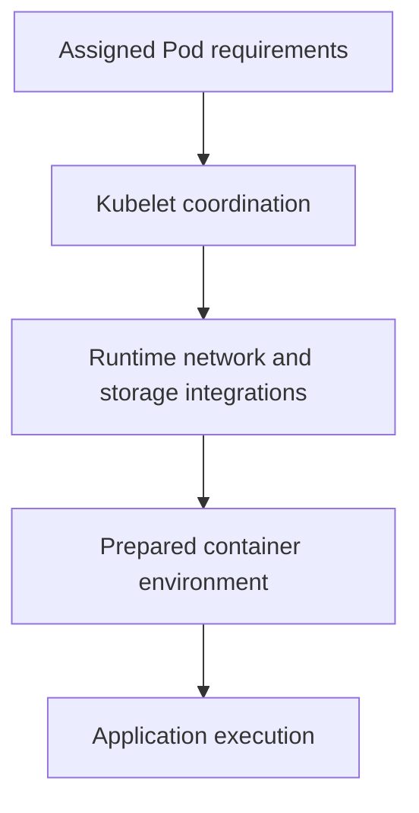

# CNI, CSI And CRI Extension Responsibilities

The node can start a container but cannot attach its volume or connect its Pod network. Runtime, networking and storage integrations provide different responsibilities.

## Learning objectives

- Distinguish CNI, CSI and CRI responsibilities.
- Identify core-to-extension integration points.
- Evaluate optional driver and policy capabilities.

## Before you start

This chapter is standalone reading material; no running cluster or installed tools are required. A Pod is the Kubernetes unit for running one or more containers, and a namespace groups namespaced objects. Treat the worked configurations as teaching examples rather than recorded observations from a provisioned environment.

## Responsible components and behavior

Kubernetes uses interfaces to connect core orchestration with networking, storage and container execution implementations. The Container Network Interface (CNI), Container Storage Interface (CSI) and Container Runtime Interface (CRI) describe different integration boundaries. An extension serving one boundary does not automatically satisfy the others.

## Runtime Execution Through CRI

The kubelet is the node agent responsible for local Pod execution. It communicates with a compatible runtime service through CRI to manage supported container and sandbox operations. A runtime needs the expected endpoint, version support and host configuration.

An image builder can produce a compatible container artifact without being the running CRI service selected by the kubelet. Similarly, a functioning registry does not guarantee that the runtime socket is reachable. Separate artifact creation and distribution from the execution interface used on each node.

Runtime behavior depends on host resources, namespaces, control groups and the configured isolation capabilities. Choosing a runtime does not universally encrypt application traffic or provide persistent storage. Those responsibilities belong to other components and application design.

## Pod Connectivity Through CNI

A CNI-based implementation configures supported container networking according to its plugin arrangement. It can assign addresses and establish the data path used for Pod communication. Different implementations can use routing, overlays or other mechanisms, with different host and infrastructure requirements.

Basic connectivity and NetworkPolicy enforcement are related but distinct capabilities. A plugin can provide usable Pod addresses without enforcing every NetworkPolicy resource. An administrator should confirm the supported policy model and actual enforcement rather than infer it solely from the presence of a networking DaemonSet.

Service traffic handling is another boundary. A kube-proxy implementation or supported replacement can provide Service behavior, depending on the selected stack. The assumption that every cluster must use exactly the same proxy process can misdirect diagnosis when a network implementation supplies the supported replacement.

## Persistent Storage Through CSI

A CSI driver integrates supported storage provisioning, attachment and mounting operations. Controller-side components and node-side components can have distinct roles. The appropriate StorageClass identifies a provisioner and relevant parameters; a requested claim can then lead to backend volume creation under that contract.

Provisioning, attachment and mount failures happen at different stages. A backing volume can exist while a node cannot attach or mount it. A node driver being healthy does not necessarily prove the controller has permission to create new backend storage. Check the failed operation and its responsible participant.

Snapshots and expansion need their own supported capabilities and configuration. The CSI interface does not guarantee that every driver supports every optional feature. A claim can request a behavior that the selected class or implementation cannot provide, even though ordinary volume creation works.

## Install And Evaluate The Correct Components

An extension can include custom definitions, access grants, controllers, node agents and configuration. Installing its resource package is not equivalent to demonstrating that the integration works on every eligible node. Version compatibility, required permissions and host prerequisites remain relevant.

For a Pod that cannot start, identify whether failure occurred in runtime preparation, network sandbox creation or storage preparation. A CNI error should not be addressed by arbitrarily replacing storage classes. A missing mount should not be blamed on a Service selector merely because application access also fails later.

A useful extension review maps each required operation to the interface and implementation responsible for it. It then verifies supported capabilities and the configured endpoints or resource relationships. This makes installation and diagnosis explainable without assuming that one plugin name supplies every cluster function.

## Work through the decision

The Container Runtime Interface (CRI) connects the kubelet with a supported runtime. The Container Network Interface (CNI) integration supplies supported network configuration. The Container Storage Interface (CSI) integrates storage operations. Similar abbreviations do not make their contracts interchangeable.

A plugin's installation must provide its own components, configuration and required credentials. CNI compatibility alone does not guarantee policy enforcement, and CSI support does not guarantee every access mode or replication property. Diagnose the failed operation and responsible integration before replacing a healthy runtime merely because a volume remains unavailable.

Execution depends on several integration contracts, and failure evidence should identify which responsibility is unresolved.

Execution depends on several integration contracts, and failure evidence should identify which responsibility is unresolved.

## Common pitfalls

> [!WARNING]
> CNI, CSI and CRI cover different integration contracts. Connectivity does not prove policy enforcement, a created volume does not prove mount success, and an installed builder does not prove kubelet runtime compatibility.
