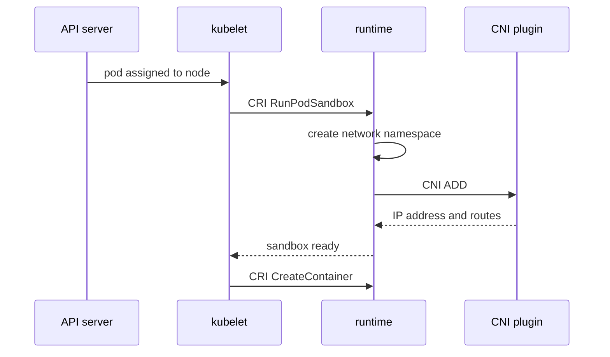

# How A Pod Gets Its Network

When you create a pod, the API server only stores an object. Nothing in the API server creates a network interface or assigns an IP address. Several components on the node do that work in a fixed order, and a failure at each step looks different. This part follows that order and names the component that acts at each step.

## The call chain on one node

Three components take part on the node where the scheduler placed the pod. The kubelet is the node agent: it watches the API server for pods that belong to its node and makes them run. The container runtime (for example containerd) pulls images and starts containers. The CNI plugin is an executable program that configures the network of one pod.

The kubelet does not call the CNI plugin. The kubelet talks to the runtime through the Container Runtime Interface (CRI), a gRPC API with calls such as `RunPodSandbox` and `CreateContainer`. A pod sandbox is the isolated environment that holds a pod: its Linux network namespace, plus a small container that keeps the namespace alive. The runtime creates the sandbox, and then the runtime calls the CNI plugin to give the sandbox a network.



The diagram shows that the kubelet starts the application containers only after the sandbox is ready. If the CNI plugin fails, the sandbox never becomes ready and no application container starts.

## What the CNI plugin receives and returns

The Container Network Interface is a specification for programs that configure network interfaces in Linux containers. The runtime runs the plugin binary once for each operation. It passes the operation and the target in environment variables, and it passes the network configuration as JSON on standard input.

The operations are:

- `ADD`: create the interface in the pod network namespace, assign an address and set up routes. The plugin prints a JSON result with the assigned addresses.
- `DEL`: remove the interface and release the address when the pod is deleted.
- `CHECK`: verify that the network of an existing pod is still as expected.
- `VERSION`: report which versions of the specification the plugin supports.

The important environment variables are `CNI_COMMAND` (the operation), `CNI_CONTAINERID` (the sandbox), `CNI_NETNS` (the path of the network namespace) and `CNI_IFNAME` (the name of the interface to create, normally `eth0`).

## Where the configuration and the binaries live

The runtime finds the plugin configuration in a directory on the node, by default `/etc/cni/net.d`. It reads the files in alphabetical order and uses the first valid one. The plugin binaries are in a second directory, by default `/opt/cni/bin`. A configuration file names a plugin with the field `type`, and the runtime runs the binary with that name.

A configuration list (a `.conflist` file) chains several plugins. This is an example of the shape, not the file of your cluster:

```json
{
  "cniVersion": "1.0.0",
  "name": "example-network",
  "plugins": [
    {
      "type": "bridge",
      "bridge": "cni0",
      "isGateway": true,
      "ipam": { "type": "host-local", "ranges": [[{ "subnet": "10.244.1.0/24" }]] }
    },
    { "type": "portmap", "capabilities": { "portMappings": true } }
  ]
}
```

The `bridge` plugin creates the interface and connects it to a Linux bridge on the node. Its `ipam` block names the IP address management plugin, which picks a free address from the subnet. The `portmap` plugin adds port mappings. Real network plugins such as Calico, Cilium, Flannel or kindnet ship their own binary and configuration, and many of them run an agent as a DaemonSet that writes the file.

## Seeing the chain in your cluster

Read what the kubelet reports about the runtime. The node object carries the runtime name and version in `status.nodeInfo`, which the kubelet fills in from the CRI.

<!-- astrona:playground:renew -->

```sh
kubectl get nodes -o wide
kubectl get nodes -o jsonpath='{.items[0].status.nodeInfo.containerRuntimeVersion}{"\n"}'
```

The wide output has a `CONTAINER-RUNTIME` column with the same value, written as `<name>://<version>`. Now read the network side of the node. The node condition `Ready` is true only when the runtime reports that its network is ready:

```sh
kubectl get nodes -o jsonpath='{.items[0].status.conditions[?(@.type=="Ready")].status}{"\n"}'
kubectl -n kube-system get pods -o wide
```

The pods in `kube-system` include the network agent of the cluster. In a kind cluster this is the default CNI plugin of kind, called kindnet. Its pod runs on every node and writes the configuration file to the node.

To see the file itself, start a debugging pod on the node. The command mounts the node file system under `/host`:

```sh
NODE="$(kubectl get nodes -o jsonpath='{.items[0].metadata.name}')"
kubectl debug node/"$NODE" -it --image=docker.io/library/busybox:1.37.0 -- ls /host/etc/cni/net.d /host/opt/cni/bin
```

The command lists the configuration file in the first directory and the plugin binaries in the second. The debugging pod stays in the `default` namespace after the command ends. List it with `kubectl get pods`, then delete the pod whose name starts with `node-debugger-` using `kubectl delete pod <name>`.

## Failure cases

A missing or broken CNI configuration shows up in two places. The node condition `Ready` becomes false, and the kubelet reports that the network plugin is not ready. Pods that need the pod network stay in `ContainerCreating` and the events of the pod show a `FailedCreatePodSandBox` message that names the CNI error. Pods that use `hostNetwork: true` do not need the plugin and still start, which is why the network agent itself can start on a node that has no network yet.

A different failure is an exhausted address range. The IPAM plugin has no free address, `ADD` fails, and new pods fail the same way while existing pods keep working. Read the events with `kubectl describe pod` to tell the two cases apart: one names a missing plugin, the other names the range.

A pod that is stuck for a CNI reason is never fixed by recreating the pod alone. You fix the plugin, its configuration or the address range, and then the kubelet retries the sandbox.

## What you know now

The kubelet asks the runtime for a sandbox through CRI, and the runtime calls the CNI plugin with `ADD` to attach it to the pod network. The plugin and its configuration live on the node, and the node reports readiness only when that network works. The next question is which addresses the plugin hands out, and how a stable Service address sits on top of changing pod addresses.

## Common pitfalls

> [!WARNING]
> - The kubelet does not run CNI plugins. The container runtime does, after the kubelet asks it for a sandbox. Look at the runtime and the plugin on the node, not at the API server.
> - A running pod does not prove the plugin is healthy for new pods. Existing pods keep their interface when the configuration breaks.
> - Pods with `hostNetwork: true` skip the plugin, so they cannot be used to test it.
> - A pod stuck in `ContainerCreating` is not always an image problem. Read the events before you decide.
