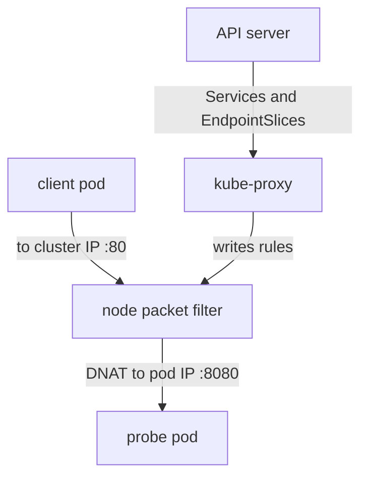

# Pod Addresses, Services And DNS

A pod gets an IP address, but that address changes every time the pod is replaced. Clients need a name and an address that stay the same. Kubernetes solves this with Services, kube-proxy and cluster DNS. This part explains where pod addresses come from and which component makes a Service address work.

## The Kubernetes network model

The Kubernetes network model sets three rules. Every pod gets its own IP address. Any pod can reach any other pod by that address without network address translation. Agents on a node, such as the kubelet, can reach all pods on that node. The CNI plugin is responsible for making these rules true on the cluster network. Kubernetes only defines them.

## Where pod addresses come from

The cluster has one large range for pods, called the cluster CIDR (Classless Inter-Domain Routing notation, for example an address followed by `/16`). When node IP address management is on, the kube-controller-manager splits that range and gives each node one smaller range. It writes the result to the field `spec.podCIDR` of the node object. This allocation is a core Kubernetes feature, and it works even though the CNI plugin does the networking.

Many CNI plugins use the node range through their IPAM plugin, for example `host-local`. Other plugins keep their own address pools and ignore `spec.podCIDR`. For that reason you must read the plugin documentation before you assume that a pod address lies in the range of `spec.podCIDR`. In a kind cluster with its default plugin the assumption holds, and you can check it.

<!-- astrona:playground:renew -->

```sh
kubectl get nodes -o jsonpath='{.items[0].spec.podCIDR}{"\n"}'
kubectl get pods -A -o wide
```

Compare the `IP` column with the range from the first command. Pods in `kube-system` that use `hostNetwork: true` show the node address instead. They do not get a pod address, because they do not go through the CNI plugin.

## Services and the cluster IP

A Service is an API object that gives a set of pods one stable virtual address, the cluster IP, and a port. The cluster IP comes from a second range, the service range, which the API server is started with (`--service-cluster-ip-range`). The API server allocates the address when it creates the Service. In the default `iptables` mode no network interface has this address.

The Service selects pods with a label selector. The EndpointSlice controller, part of the kube-controller-manager, watches the pods that match and writes their addresses and readiness into EndpointSlice objects. A pod that is not ready is left out of the ready endpoints.

```sh
kubectl -n starfleet get service probe
kubectl -n starfleet get endpointslices -l kubernetes.io/service-name=probe
kubectl -n starfleet get pods -l app=probe -o wide
```

The addresses in the EndpointSlice are the pod addresses from the third command. The cluster IP is a different address in the service range.

## What kube-proxy does

Because (in the default mode) no interface holds the cluster IP, something on every node must send traffic for it to a real pod. That is the job of kube-proxy. It runs on each node, watches Services and EndpointSlices through the API server, and programs the packet filter of the node. In `iptables` mode it writes rules, in `ipvs` mode it programs the kernel load balancer, and in `nftables` mode it writes nftables rules. The rules change the destination of a packet from the cluster IP to one pod address. This rewrite is destination network address translation (DNAT).



The diagram shows that kube-proxy does not carry the traffic. It only writes the rules, and the kernel of the node does the rewrite. Some CNI plugins replace kube-proxy and do the same rewrite with their own components, so you cannot assume that a kube-proxy pod exists in every cluster.

The `port` of a Service is the port clients use. The `targetPort` is the port of the container, which is 8080 here. This matters later, because a NetworkPolicy matches the container port, after the rewrite.

## Cluster DNS

Names are resolved by the cluster DNS service, CoreDNS, which runs as a Deployment in `kube-system` and is itself reached through a Service. The kubelet writes the file `/etc/resolv.conf` of each pod. The file lists the cluster DNS address as the name server and a search path of the form `<namespace>.svc.cluster.local`, `svc.cluster.local` and `cluster.local`.

Because of the search path, a pod in `starfleet` resolves `probe` to the Service in its own namespace. A pod in another namespace must use `probe.starfleet`. The full name is `probe.starfleet.svc.cluster.local`.

```sh
kubectl -n starfleet exec shuttle -- cat /etc/resolv.conf
kubectl -n starfleet exec shuttle -- nslookup probe
kubectl -n starfleet exec shuttle -- wget -q -O - -T 3 http://probe
kubectl -n outpost exec drifter -- wget -q -O - -T 3 http://probe.starfleet
```

The first command shows the name server and the search path. The `nslookup` result shows the cluster IP of the Service. The two `wget` requests return the page of the `probe` pods, because no policy exists yet. Scale the Deployment and watch the endpoints change while the cluster IP stays the same:

```sh
kubectl -n starfleet scale deployment probe --replicas=3
kubectl -n starfleet get endpointslices -l kubernetes.io/service-name=probe
```

## Failure cases

A Service with no endpoints returns connection errors. The usual causes are a selector that matches no pod, or pods that are not ready. Check the endpoints first: an empty EndpointSlice means the problem is the selector or the readiness probe, not the network.

If a pod can reach another pod by IP address but not by name, the problem is DNS: check that CoreDNS pods run and that `/etc/resolv.conf` is correct. If a pod cannot reach even a pod IP on another node, the problem is in the CNI plugin or in the network between nodes. If the pod IP works but the cluster IP does not, look at kube-proxy or its replacement.

## What you know now

The CNI plugin makes pod addresses work. The node range in `spec.podCIDR` comes from the controller manager, the Service address comes from the API server, the endpoints come from the EndpointSlice controller, the rewrite comes from kube-proxy, and the names come from CoreDNS. The open question is how to limit which pods may send traffic to which pods.

## Common pitfalls

> [!WARNING]
> - A cluster IP is normally not on any interface. In the default mode you cannot `ping` it, and a missing reply does not prove the Service is broken.
> - `hostNetwork` pods show the node address, not an address from the pod range.
> - A pod address is not stable. Never store it in configuration. Use the Service name.
> - Do not confuse the pod range (`spec.podCIDR`) with the service range. They are separate ranges with separate owners.
