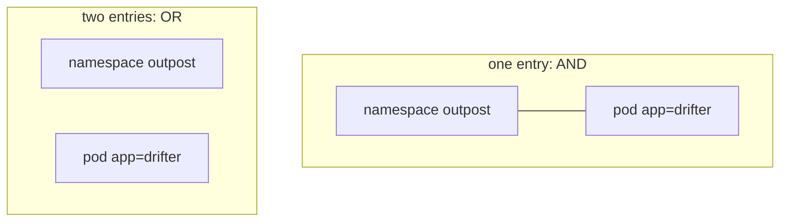

# NetworkPolicy And Who Enforces It

By default every pod can send traffic to every other pod. A NetworkPolicy is the Kubernetes object that limits this. The object is only a request, though: the API server stores it and does nothing more. This part shows how to write policies and why the CNI plugin decides whether they work.

## The object and the enforcer

A NetworkPolicy belongs to the API group `networking.k8s.io/v1`. The API server validates it and stores it in etcd. A component that comes with the CNI plugin, usually an agent on every node, watches NetworkPolicy objects and turns them into packet filter rules. That component is the enforcer.

If the CNI plugin has no enforcer, the policy is accepted, shown by `kubectl get`, and has no effect. Kubernetes does not warn about it. For this reason a green `kubectl apply` is never evidence that traffic is blocked. The proof is a test request.

## How a policy selects traffic

A policy has these fields under `spec`:

- `podSelector`: the pods the policy applies to, in the namespace of the policy. An empty selector `{}` selects all pods in the namespace.
- `policyTypes`: `Ingress`, `Egress` or both. Ingress is traffic that arrives at the selected pods. Egress is traffic that leaves them.
- `ingress`: a list of rules. Each rule has `from` (the allowed sources) and `ports` (the allowed destination ports).
- `egress`: a list of rules with `to` and `ports`.

A pod that no policy selects accepts all traffic. As soon as one policy selects a pod for a direction, that direction is closed for the pod, and only traffic that some policy allows gets through. The rules never subtract. If several policies select the same pod, the allowed traffic is the union of all their rules.

The sources in `from` are one of three kinds: a `podSelector` (pods in the namespace of the policy), a `namespaceSelector` (all pods in the matching namespaces) or an `ipBlock` (an address range, used mostly for traffic from outside the cluster). Every namespace has the automatic label `kubernetes.io/metadata.name` with its own name, which makes it easy to select one namespace.

## A default deny and an allow rule

Start with a policy that closes all incoming traffic in `starfleet`.

<!-- astrona:playground:renew -->

Save this as `networkpolicy-default-deny.yaml`:

```yaml
apiVersion: networking.k8s.io/v1
kind: NetworkPolicy
metadata:
  name: default-deny-ingress
  namespace: starfleet
spec:
  podSelector: {}
  policyTypes:
    - Ingress
```

The policy selects every pod, lists `Ingress`, and has no `ingress` rules, so nothing is allowed in.

Apply it:

```sh
kubectl apply -f networkpolicy-default-deny.yaml
```

Then check the result. Send a request from each client pod to the Service:

```sh
kubectl -n starfleet exec shuttle -- wget -q -O - -T 3 http://probe
kubectl -n outpost exec drifter -- wget -q -O - -T 3 http://probe.starfleet
```

If the CNI plugin of your cluster enforces policies, both requests now time out after three seconds. If both still return the page, your plugin does not enforce NetworkPolicy, or it needs a setting that this cluster does not have. Both results are valid information. Write down which one you see before you go on.

Now open one path. Save this as `networkpolicy-probe-ingress.yaml`:

```yaml
apiVersion: networking.k8s.io/v1
kind: NetworkPolicy
metadata:
  name: probe-ingress
  namespace: starfleet
spec:
  podSelector:
    matchLabels:
      app: probe
  policyTypes:
    - Ingress
  ingress:
    - from:
        - podSelector:
            matchLabels:
              app: shuttle
      ports:
        - protocol: TCP
          port: 8080
```

Apply it:

```sh
kubectl apply -f networkpolicy-probe-ingress.yaml
```

Then check the result:

```sh
kubectl -n starfleet describe networkpolicy probe-ingress
kubectl -n starfleet exec shuttle -- wget -q -O - -T 3 http://probe
kubectl -n outpost exec drifter -- wget -q -O - -T 3 http://probe.starfleet
```

With an enforcing plugin, the `shuttle` request works and the `drifter` request still times out. The port in the policy is 8080, the container port, although the client used the Service port 80. The packet filter rewrites the destination to the pod before the policy rules are evaluated, so a policy always names the container port.

## One entry or two entries

The difference between one combined `from` entry and two separate entries is the most common source of mistakes. Two selectors in the same entry are joined with AND. Two entries in the list are joined with OR.



In the first shape only drifter pods in the namespace `outpost` match. In the second shape every pod in `outpost` matches, and also every pod labelled `app=drifter` in the namespace of the policy. This YAML is the first shape:

```yaml
ingress:
  - from:
      - namespaceSelector:
          matchLabels:
            kubernetes.io/metadata.name: outpost
        podSelector:
          matchLabels:
            app: drifter
```

To make it the second shape, add a dash before `podSelector`. One character in the file changes the meaning, so read the dashes in the output of `kubectl describe networkpolicy`.

## Egress, DNS and the limits

An `Egress` policy limits traffic that leaves the selected pods. If you deny egress for a pod, name resolution also stops, because the pod can no longer reach the DNS service. Add an egress rule for the DNS pods on port 53 in UDP and TCP, or the pods cannot look up any name.

NetworkPolicy works at the IP address and port level (layers 3 and 4). It cannot match an HTTP path, a header or a user, and it has no deny rule and no log action in the standard API. Some plugins add their own policy objects for those features, which are outside the standard API.

Several fields depend on the plugin: whether it enforces egress, how it treats traffic from the node of a pod, and whether it supports port ranges. Always read what the plugin documents, and always test.

## What you know now

A NetworkPolicy is a stored request. The CNI plugin enforces it, so the same object can block traffic in one cluster and do nothing in another. Policies select pods, close a direction, and then allow paths one by one, and the destination port is the container port.

## Common pitfalls

> [!WARNING]
> - Applying a policy does not prove it is enforced. Always send a test request from an allowed and a denied pod.
> - Two selectors in one `from` entry mean AND. Two entries mean OR. One dash changes the meaning.
> - A policy that selects pods for egress also blocks DNS unless you allow port 53.
> - Use the container port in the policy, not the Service port.
> - NetworkPolicy objects only add allowed paths. You cannot remove access by writing a second policy.
