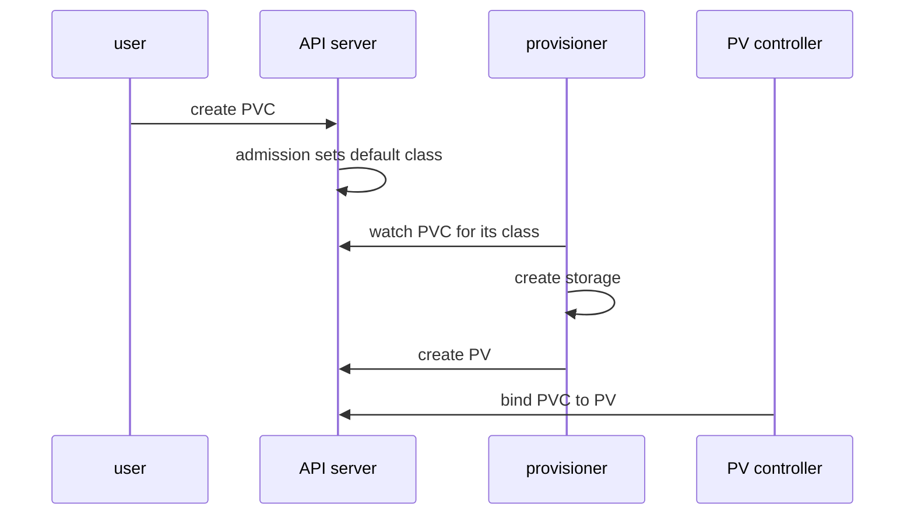

# StorageClass, Claims And Provisioning

A pod needs storage, but the person who writes the pod should not need to know which disk system the cluster uses. Kubernetes separates the request from the supply with three objects. This part defines them and follows one claim from creation to a bound volume, naming the component that acts at each step.

## The three objects

A PersistentVolume (PV) represents one piece of storage in the cluster. It is a cluster-scoped object that records the size, the access modes and how to reach the storage. A PersistentVolumeClaim (PVC) is a namespaced request for storage: a size, an access mode and, optionally, a class. A pod uses storage by naming a claim in `spec.volumes`, never a volume.

A StorageClass is a cluster-scoped object that describes a kind of storage. Its main fields are:

- `provisioner`: the name of the driver or controller that creates volumes for this class.
- `parameters`: settings that only the provisioner understands, for example a disk type.
- `reclaimPolicy`: what happens to the volume when its claim is deleted (`Delete` or `Retain`).
- `volumeBindingMode`: when the volume is created (`Immediate` or `WaitForFirstConsumer`).
- `allowVolumeExpansion`: whether a claim of this class may be made larger.
- `mountOptions` and `allowedTopologies`: mount flags and the zones where volumes may exist.

The `provisioner` and `parameters` of a class cannot be changed after creation. To change them you create a new class.

## The default class

One class can carry the annotation `storageclass.kubernetes.io/is-default-class: "true"`. When a claim is created without a `storageClassName`, the API server admission control fills in the default class. A claim with `storageClassName: ""` (an empty string) names no class at all and can only bind to a volume that an administrator created by hand, a method called static provisioning. If the cluster has no default class and the claim names none, the claim waits until a default class exists.

Read the default class of your playground. In kind it is named `standard`. It uses a local path provisioner, which is a dynamic provisioner but not a CSI driver. The Kubernetes objects around it are the same as with a CSI driver, so it is a good model.

<!-- astrona:playground:renew -->

```sh
kubectl get storageclass
kubectl get storageclass standard -o yaml
```

Find `provisioner`, `reclaimPolicy` and `volumeBindingMode` in the output, and the default-class annotation under `metadata.annotations`.

## Dynamic provisioning step by step

Dynamic provisioning means the volume is created on demand when a claim appears. The component that does this is the provisioner named in the class. For a CSI driver it is the `external-provisioner` sidecar container of the driver together with the driver. The PersistentVolume controller inside the kube-controller-manager then binds the claim to the new volume.



The diagram shows two components acting on API objects: the provisioner creates the PV, and the PV controller binds. The user never creates the PV.

## Immediate and WaitForFirstConsumer

With `volumeBindingMode: Immediate`, provisioning starts as soon as the claim exists. In a cluster with several zones, this can create a volume in a zone where the pod cannot run later.

With `WaitForFirstConsumer`, the claim stays `Pending` until a pod uses it. The scheduler then chooses a node for the pod with the storage constraints in mind. It writes the chosen node into the annotation `volume.kubernetes.io/selected-node` on the claim. Only then does the provisioner create a volume that the chosen node can reach. For this reason a `Pending` claim with no pod is the correct state for this mode, and not an error.

Create a claim that names no class. Save this as `pvc-cargo.yaml`:

```yaml
apiVersion: v1
kind: PersistentVolumeClaim
metadata:
  name: cargo
  namespace: starfleet
spec:
  accessModes:
    - ReadWriteOnce
  resources:
    requests:
      storage: 1Gi
```

Apply it:

```sh
kubectl apply -f pvc-cargo.yaml
```

Then check the result:

```sh
kubectl -n starfleet get pvc cargo
kubectl -n starfleet get pvc cargo -o jsonpath='{.spec.storageClassName}{"\n"}'
kubectl -n starfleet describe pvc cargo
```

The class name is filled in by the API server, although the file did not name it. If the class uses `WaitForFirstConsumer`, the claim is `Pending` and the events say it waits for the first consumer. Now add a pod that uses the claim. Save this as `pod-hauler.yaml`:

```yaml
apiVersion: v1
kind: Pod
metadata:
  name: hauler
  namespace: starfleet
spec:
  containers:
    - name: hauler
      image: docker.io/library/busybox:1.37.0
      command: ["sh", "-c", "echo stored > /cargo/manifest.txt && sleep 3600"]
      volumeMounts:
        - name: cargo
          mountPath: /cargo
  volumes:
    - name: cargo
      persistentVolumeClaim:
        claimName: cargo
```

Apply it:

```sh
kubectl apply -f pod-hauler.yaml
```

Then check the result:

```sh
kubectl -n starfleet wait --for=condition=Ready pod/hauler --timeout=120s
kubectl -n starfleet get pvc,pod
kubectl get pv
```

The claim is now `Bound` to a volume, and the volume list shows a PV that the provisioner created. If the pod does not become ready, read `kubectl -n starfleet describe pod hauler` and look at the volume events.

## Static provisioning

An administrator can also create a PV by hand, with its capacity, access modes and a reference to existing storage. A claim binds to it when the size, access modes and class match. The PV controller makes this choice, and it picks the smallest PV that satisfies the claim. This path is used for storage that already exists, and it is why `storageClassName: ""` exists.

## What you know now

The user writes the claim, the class describes the storage kind, the provisioner creates the volume, and the PV controller binds the two. The binding mode decides when creation starts. The open question is what the driver behind the provisioner is made of, and what happens after binding, when the pod runs.

## Common pitfalls

> [!WARNING]
> - A claim is `Pending` for two very different reasons: it waits for a first consumer by design, or provisioning failed. Read the events of the claim.
> - Omitting `storageClassName` is not the same as setting it to `""`. The first uses the default class. The second uses no class.
> - You cannot change `provisioner` or `parameters` of an existing class. Create a new class.
> - A claim is namespaced and a volume is not. A pod can only use claims from its own namespace.
