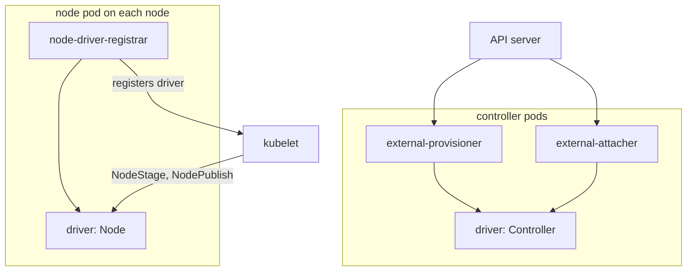

# CSI Drivers And Their Objects

Before CSI, the code for every storage system lived inside Kubernetes itself, and a storage vendor had to wait for a Kubernetes release to ship a fix. The Container Storage Interface (CSI) moved that code out. A storage vendor now ships a driver as ordinary containers, and Kubernetes talks to it through a standard gRPC API. This part opens a CSI driver and names the objects that connect it to the cluster.

## What the specification defines

The CSI specification defines three gRPC services. A driver can implement all of them or only some.

- **Identity**: reports the name and the capabilities of the driver. Every driver implements it.
- **Controller**: works on whole volumes, without a node. Calls include `CreateVolume`, `DeleteVolume`, `ControllerPublishVolume` (attach the volume to a node), `ControllerUnpublishVolume`, `ControllerExpandVolume` and `CreateSnapshot`.
- **Node**: works on one node. Calls include `NodeStageVolume` (prepare the volume once per node, for example format it and mount it at a staging path), `NodePublishVolume` (mount it into the path used by one pod), `NodeUnpublishVolume`, `NodeUnstageVolume`, `NodeExpandVolume` and `NodeGetInfo`.

A driver has a name in reverse domain form, such as `logbook.csi.astrona.io`. The StorageClass field `provisioner` holds this exact name, and that is how Kubernetes finds the right driver for a class.

## The parts of a driver in the cluster

A driver is not one program. It is two groups of pods, and each group has the driver container next to helper containers called sidecars. The Kubernetes project maintains the sidecars, so every vendor reuses the same Kubernetes-facing code.

The controller group runs as a Deployment or a StatefulSet, usually with a few replicas and leader election. Its sidecars watch API objects and call the Controller service:

- `external-provisioner` watches claims and calls `CreateVolume`, then creates the PV.
- `external-attacher` watches VolumeAttachment objects and calls `ControllerPublishVolume`.
- `external-resizer` watches claims for a larger request and calls `ControllerExpandVolume`.
- `external-snapshotter` handles snapshot objects.

The node group runs as a DaemonSet, so one pod runs on every node. It holds the driver container, which serves the Node service on a Unix socket in the kubelet plugin directory, and the `node-driver-registrar` sidecar. The registrar tells the kubelet that a driver with this name and socket exists on the node.



The diagram shows that the controller group never talks to the kubelet, and the kubelet never talks to the controller group. They meet only through API objects.

## The three Kubernetes objects

Three API objects describe drivers and their work. None of them runs a driver.

A **CSIDriver** (cluster-scoped, `storage.k8s.io/v1`) declares how Kubernetes must treat a driver of a given name. Its main fields are:

- `attachRequired`: whether the driver needs an attach step. The default is true. A driver for shared network storage that needs no attach sets it to false, and Kubernetes then skips the VolumeAttachment.
- `podInfoOnMount`: whether the kubelet passes pod information (name, namespace, service account) to `NodePublishVolume`.
- `volumeLifecycleModes`: `Persistent` (the normal PV-based volume, the default) and `Ephemeral` (an inline volume that lives and dies with the pod).
- `fsGroupPolicy`: whether Kubernetes changes ownership of the volume files to the pod `fsGroup`. The values are `ReadWriteOnceWithFSType` (the default), `File` and `None`.
- `storageCapacity`: whether Kubernetes tracks free capacity per topology, so the scheduler can avoid a node without space.

A **CSINode** is created by the kubelet, one per node. It lists the drivers registered on that node, with the node identifier the driver uses and its topology keys. The scheduler and the attach logic read it.

A **VolumeAttachment** (cluster-scoped) records that a volume must be attached to a node. The attach and detach controller in the kube-controller-manager creates it when a pod that uses an attachable volume is scheduled. The `external-attacher` of the driver sees it, calls `ControllerPublishVolume` and updates the object status.

## Reading the objects in your cluster

kind does not ship a CSI driver, so the lists below are mostly empty. That is useful: it shows what each object means by what is missing.

<!-- astrona:playground:renew -->

```sh
kubectl get csidriver
kubectl get csinode
kubectl get volumeattachment
```

The CSIDriver list is empty because kind installs no CSI driver. The CSINode list shows no registered driver, either as an empty list or as nodes with a driver count of zero. The VolumeAttachment list is empty because no driver needs an attach step.

Now create a CSIDriver object yourself, to read the fields. Save this as `csidriver-cargo.yaml`:

```yaml
apiVersion: storage.k8s.io/v1
kind: CSIDriver
metadata:
  name: cargo.csi.astrona.io
spec:
  attachRequired: false
  podInfoOnMount: true
  volumeLifecycleModes:
    - Persistent
    - Ephemeral
  fsGroupPolicy: File
```

Apply it:

```sh
kubectl apply -f csidriver-cargo.yaml
```

Then check the result:

```sh
kubectl get csidriver
kubectl get csidriver cargo.csi.astrona.io -o yaml
```

The object exists and the API server accepted every field. Nothing happens in the cluster, because no pods run a driver with this name. A CSIDriver object is a declaration. A driver is the set of pods that serve the Node and Controller services. If you create a StorageClass with the provisioner `cargo.csi.astrona.io` and a claim for it, the claim stays `Pending`: no `external-provisioner` is watching for that name.

## From a bound claim to a mounted volume

After the claim is bound, the pod still needs the volume on its node. The steps depend on `attachRequired`:

1. The scheduler places the pod, taking the node limits of the driver into account.
2. If `attachRequired` is true, the attach and detach controller creates a VolumeAttachment. The `external-attacher` attaches the volume to the node.
3. The kubelet volume manager calls `NodeStageVolume` once for the volume on that node.
4. The kubelet calls `NodePublishVolume` for the pod, which mounts the volume into the pod directory.
5. The runtime starts the container with that directory mounted.

The pod stays in `ContainerCreating` until step 4 ends. This order shows which component to inspect: the attach step is a controller-side problem, and the stage and publish steps are node-side problems.

## Migration from in-tree plugins

Kubernetes still has some older volume types written inside Kubernetes, called in-tree plugins. Almost all of them are deprecated and redirect to a CSI driver of the same storage system through the CSI migration feature. The pod and claim objects stay the same. This is why a new cluster needs a CSI driver, not a built-in volume type, for cloud disks.

## What you know now

A CSI driver is a controller group and a node group of pods, with Kubernetes sidecars in both. The class names it through the `provisioner` field. CSIDriver declares its behavior, CSINode lists what each node has registered, and VolumeAttachment records an attach request. The next question is what happens when a claim is deleted, when a volume must grow, and how to find a broken stage.

## Common pitfalls

> [!WARNING]
> - A CSIDriver object is not a driver. If no pods serve the Node and Controller services, nothing provisions or mounts volumes.
> - `provisioner` in the class must equal the driver name exactly, including the domain.
> - With `attachRequired: false`, no VolumeAttachment exists. An empty list is not a failure.
> - The controller group and the node group fail separately. A volume can be provisioned and still not mount.
