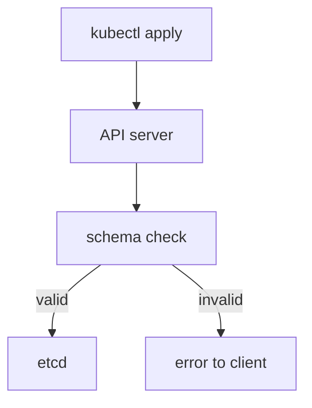

# CRD Structure And The OpenAPI Schema

A team wants a `Beacon` object: a named radio channel with a send interval. Kubernetes has no such type. A CustomResourceDefinition (CRD) tells the API server that the type exists, where to serve it and what a valid object looks like. This part builds the first CRD and shows how the API server uses its schema to reject bad input before anything is stored.

## What a CRD declares

A CRD is itself an API object of the kind `CustomResourceDefinition` in the group `apiextensions.k8s.io/v1`. Its `spec` has four required parts:

| Field | What it sets |
| --- | --- |
| `group` | The API group of the new type, such as `training.astrona.io`. It appears in `apiVersion` as `group/version` |
| `names` | The `kind` (`Beacon`), the lowercase `plural` (`beacons`) that forms the URL, the `singular`, and optional `shortNames` |
| `scope` | `Namespaced` or `Cluster`. A namespaced object lives in a namespace. A cluster-scoped object does not |
| `versions` | A list of versions. Each has a `name`, `served`, `storage` and a `schema` |

The name of the CRD must be `<plural>.<group>`, here `beacons.training.astrona.io`. The API server refuses a CRD with any other name.

## The first CRD

Save this as `crd-beacon.yaml`:

```yaml
apiVersion: apiextensions.k8s.io/v1
kind: CustomResourceDefinition
metadata:
  name: beacons.training.astrona.io
spec:
  group: training.astrona.io
  scope: Namespaced
  names:
    kind: Beacon
    plural: beacons
    singular: beacon
    shortNames:
      - bcn
  versions:
    - name: v1
      served: true
      storage: true
      schema:
        openAPIV3Schema:
          type: object
          properties:
            spec:
              type: object
              required:
                - channel
              properties:
                channel:
                  type: string
                  enum:
                    - alpha
                    - beta
                    - gamma
                interval:
                  type: integer
                  minimum: 5
                  maximum: 3600
```

<!-- astrona:playground:renew -->

Apply it:

```sh
kubectl apply -f crd-beacon.yaml
```

Then check the result:

```sh
kubectl get crd beacons.training.astrona.io
kubectl api-resources --api-group=training.astrona.io
```

The first command lists the CRD with its creation time. The second shows the new resource `beacons`, its short name `bcn`, the `NAMESPACED` column and the kind. The API server needs a moment to register the type, so if the second command shows nothing, run it again after a few seconds. The CRD reports the condition `Established` when the API server serves the new endpoint.

## How the schema validates

The field `schema.openAPIV3Schema` is a subset of the OpenAPI version 3 schema language. It describes the object as a tree. Each node has a `type` (`object`, `array`, `string`, `integer`, `number` or `boolean`) and, depending on the type, constraints: `required` and `properties` for objects, `enum`, `pattern` and `minLength` for strings, `minimum` and `maximum` for numbers, and `items`, `minItems` and `maxItems` for arrays.

A schema is **structural** when every node declares a `type`, and when `properties` and `items` are not combined with the logic keywords `anyOf`, `oneOf` and `allOf` in ways that change the type. The API server requires v1 CRDs to have a structural schema. This requirement is what lets it prune and default fields, as the next part shows.

The API server runs the check on every write to a custom object: create, update and patch. The check runs in the API server, inside the request, before the object reaches etcd. No controller is asked.

## Send a valid object

Save this as `beacon-scout.yaml`:

```yaml
apiVersion: training.astrona.io/v1
kind: Beacon
metadata:
  name: scout-beacon
  namespace: starfleet
spec:
  channel: beta
  interval: 30
```

Apply it:

```sh
kubectl apply -f beacon-scout.yaml
```

Then check the result:

```sh
kubectl -n starfleet get beacons
```

The object is created and the list shows its name and age. Nothing else happens: no pod starts and no other object appears, because the cluster has no controller for `Beacon`. The object is stored data only.

## Send invalid objects

Now send three objects that break the schema, one at a time. Use `--dry-run=server`, which sends the request through the full API server pipeline, including validation, but does not store anything. Run each of these commands:

```sh
kubectl apply --dry-run=server -f - <<'BEACON'
apiVersion: training.astrona.io/v1
kind: Beacon
metadata:
  name: bad-channel
  namespace: starfleet
spec:
  channel: delta
BEACON
```

The API server answers with an error that names the field `spec.channel`, says the value is unsupported and lists the supported values `alpha`, `beta` and `gamma`. Change `channel` to `beta` and `interval` to `1` to see the minimum rule: the error says the value must be greater than or equal to 5. Remove `channel` completely to see the `required` rule: the error says `spec.channel` is required.

A fourth case is a field that the schema does not know, such as `spec.colour`. Since `kubectl` 1.27 the default `--validate=strict` makes the API server return an error for an unknown field. The message starts with `strict decoding error` and names the field.



The diagram shows the order: the schema check happens in the API server, and only a valid object reaches etcd.

## Read the schema back

Users can read the schema without reading the CRD. `kubectl explain` fetches it from the API server:

```sh
kubectl explain beacons.spec
```

The output lists the fields `channel` and `interval` with their types, and marks `channel` as required. The same `explain` command works for any CRD that has a schema, so it is the fast way to learn an unfamiliar operator's API.

The schema describes shape and limits. It does not describe behavior: the `Beacon` you created does nothing yet. What the schema also cannot express with plain types is a rule that compares two fields or protects a field from change. The next part adds those rules, defaults and pruning.

## Common pitfalls

> [!WARNING]
> Do not name the CRD with anything other than `<plural>.<group>`. Do not leave out the `type` of a node in the schema; v1 CRDs require a structural schema. Do not expect a controller to reject a bad value; the API server does that in the request. Do not assume a created custom object has any effect; without a controller it is only stored data. Do not forget that the type needs a moment to become `Established` after you apply the CRD.
