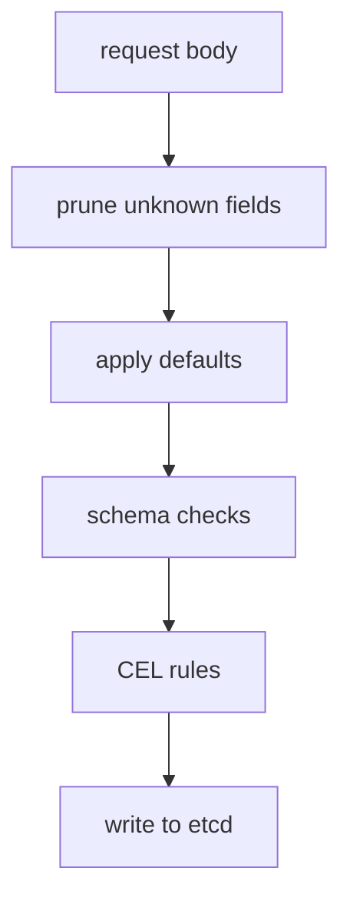

# Defaults, Pruning And CEL Validation Rules

A type-and-range schema cannot say that `maxInterval` must be larger than `minInterval`, and it cannot stop a user from changing a field after creation. The API server offers three more tools for this: defaulting, pruning and validation rules written in the Common Expression Language (CEL). This part extends the `Beacon` CRD with all three and shows when each one runs.

## Defaulting

A schema node can carry a `default`. The API server fills in the default when a field is missing. It does this in two places: when a request creates or updates an object, and when it reads an object from etcd. The second place matters: if you add a default to a CRD later, existing objects show the default value the next time they are read, even though the stored bytes did not change.

```yaml
interval:
  type: integer
  minimum: 5
  maximum: 3600
  default: 60
```

A default must itself pass the schema of its node, and it only applies when the parent object exists. If `spec` is missing, the default for `spec.interval` is not applied unless `spec` also has a `default: {}`. This is the most common reason that a default seems to be ignored.

## Pruning

When a request contains a field that the schema does not declare, the API server has two options. With **pruning** on, which is the default for `apiextensions.k8s.io/v1`, the server removes the unknown field before the object is stored. The user sees no error from the API itself. With the client or server field validation set to strict, `kubectl` makes the request fail instead, as the first part of this module showed.

The result of pruning is easy to see with a raw request that skips strict validation:

```sh
kubectl apply --validate=false -f - <<'BEACON'
apiVersion: training.astrona.io/v1
kind: Beacon
metadata:
  name: pruned-beacon
  namespace: starfleet
spec:
  channel: alpha
  colour: red
BEACON
kubectl -n starfleet get beacon pruned-beacon -o yaml
```

The stored object has `channel: alpha` and the default `interval`, but no `colour`. The field was dropped before the write to etcd.

Two schema markers change this behavior. `x-kubernetes-preserve-unknown-fields: true` on a node keeps unknown fields below that node, which is how a CRD can hold free-form data such as a map of labels or a copy of another object. `x-kubernetes-embedded-resource: true` marks a node that holds a full Kubernetes object, so the API server checks its `apiVersion`, `kind` and `metadata`.

## Validation rules with CEL

The field `x-kubernetes-validations` is a list of rules on a schema node. Each rule has a `rule`, which is a CEL expression that must evaluate to true, and an optional `message` shown to the user when the rule fails. In the rule, the variable `self` is the value of the node where the rule is written.

Save this as `crd-beacon-rules.yaml`. It replaces the first CRD and adds a second interval field, defaults and two rules:

```yaml
apiVersion: apiextensions.k8s.io/v1
kind: CustomResourceDefinition
metadata:
  name: beacons.training.astrona.io
spec:
  group: training.astrona.io
  scope: Namespaced
  names:
    kind: Beacon
    plural: beacons
    singular: beacon
    shortNames:
      - bcn
  versions:
    - name: v1
      served: true
      storage: true
      schema:
        openAPIV3Schema:
          type: object
          properties:
            spec:
              type: object
              required:
                - channel
              x-kubernetes-validations:
                - rule: "self.minInterval <= self.interval"
                  message: "interval must not be below minInterval"
                - rule: "self.channel == oldSelf.channel"
                  message: "channel cannot be changed after creation"
              properties:
                channel:
                  type: string
                  enum:
                    - alpha
                    - beta
                    - gamma
                interval:
                  type: integer
                  default: 60
                minInterval:
                  type: integer
                  default: 5
```

<!-- astrona:playground:renew -->

Apply it:

```sh
kubectl apply -f crd-beacon-rules.yaml
```

Then check the result:

```sh
kubectl get crd beacons.training.astrona.io -o jsonpath='{.status.conditions[?(@.type=="Established")].status}'
```

The command prints `True` when the updated CRD is served.

### How the two rules differ

The first rule compares two fields of the same object. It runs on every create and update. A CEL rule that refers to a field only runs when the field has a value; because both fields have defaults here, the values are always present.

The second rule uses `oldSelf`, the value of the node in the stored object. A rule that mentions `oldSelf` is a **transition rule**. It runs only on update, because on create no old object exists. The expression `self.channel == oldSelf.channel` makes the field immutable once the object exists. A shorter way to write the same protection is to put `rule: "self == oldSelf"` on the `channel` node itself.

### Test the rules

Create an object with `interval: 3` and `minInterval: 10` in a dry run. The API server rejects it with the message `interval must not be below minInterval`. Create an object with `channel: alpha`, then try to change the channel to `beta` with `kubectl patch`. The update fails with `channel cannot be changed after creation`.

## Cost and limits

CEL rules run inside the API server, so the API server bounds their cost. When the schema allows an unbounded list or string, a rule that loops over it may be rejected when you apply the CRD, with an error that the estimated cost is too high. Setting `maxItems`, `maxLength` or `maxProperties` on the node lets the API server compute a smaller worst-case cost and accept the rule.

The CEL environment is small on purpose. It has no network access, no file access and no loops except macros such as `all`, `exists` and `map` over lists. It can read only the object itself, which keeps validation fast and predictable.



The diagram shows the order of work for a write. Pruning and defaulting change the object first, and the checks then run against the changed object.

## Common pitfalls

> [!WARNING]
> Do not expect a default to appear when the parent object is missing and has no default of its own. Do not rely on pruning to report mistakes; it removes fields silently unless strict validation is on. Do not write a transition rule and expect it to run on create. Do not write an unbounded rule on an unbounded list; the API server may refuse the CRD for cost. Do not put secrets in a rule message; users see it in error output.
