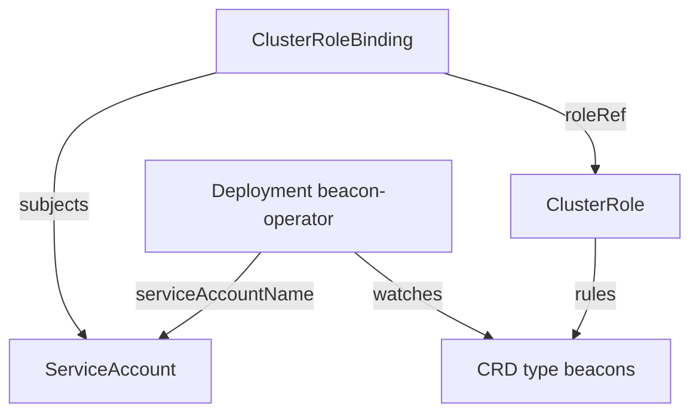

# The Objects That Make Up An Operator

An operator package is a bundle of Kubernetes objects, and each object answers one question: what type exists, who runs the program, who is the program and what may it do. Reading a bundle before you apply it is a core administrator skill, because a bundle often asks for broad permissions. This part names every object in a typical bundle and shows how they point at each other.

## The five kinds of object

| Object | Question it answers |
| --- | --- |
| CustomResourceDefinition | What new type does the API server serve? |
| Namespace | Where does the controller run? |
| ServiceAccount | Which identity does the controller use when it calls the API server? |
| ClusterRole and ClusterRoleBinding, or Role and RoleBinding | What may that identity do? |
| Deployment | Which container image runs, with which settings? |

Some bundles add more: a Service and a ValidatingWebhookConfiguration when the operator validates or converts objects, a Certificate when a certificate manager issues the webhook key pair, and a PodDisruptionBudget for availability. The five above are the minimum.

## How the objects point at each other

The links between objects are plain name references. Nothing checks them at apply time, so a typo shows up only when the controller runs.



The Deployment names the ServiceAccount in `spec.template.spec.serviceAccountName`. If the field is missing, the pods use the `default` ServiceAccount of the namespace, which has no useful permissions. The ClusterRoleBinding names the ServiceAccount and its namespace in `subjects`, and names the ClusterRole in `roleRef`. The ClusterRole lists the resource types in `rules`.

## What the controller needs permission for

A controller works in a loop: list and watch objects, compare them with the desired state, write changes. The permissions follow from that loop. For the `Beacon` type the ClusterRole needs these rules:

```yaml
rules:
  - apiGroups: ["training.astrona.io"]
    resources: ["beacons"]
    verbs: ["get", "list", "watch", "update", "patch"]
  - apiGroups: ["training.astrona.io"]
    resources: ["beacons/status"]
    verbs: ["get", "update", "patch"]
  - apiGroups: ["coordination.k8s.io"]
    resources: ["leases"]
    verbs: ["get", "list", "watch", "create", "update", "patch"]
  - apiGroups: [""]
    resources: ["events"]
    verbs: ["create", "patch"]
```

Each rule has a reason:

- `get`, `list` and `watch` on `beacons` feed the informer, the in-memory cache that the controller builds from a list followed by a watch.
- `update` and `patch` on `beacons` allow the controller to add and remove finalizers, which are stored in `metadata`.
- `beacons/status` is a separate resource name. A controller that writes status needs it, and the rule for `beacons` does not cover it.
- `leases` supports leader election: when more than one replica runs, only the replica that holds a Lease object acts, and the others wait.
- `events` lets the controller record what it did, which `kubectl describe` then shows.

A controller that also creates Deployments or Services for each custom resource needs those verbs for those types too, and the more it creates, the more power the bundle holds. This is why reading the ClusterRole before installing is worth the time.

## Cluster scope or namespace scope

A ClusterRole bound with a ClusterRoleBinding gives the permissions in every namespace. A ClusterRole bound with a RoleBinding in one namespace gives them in that namespace only. An operator that manages custom resources in one namespace can be restricted this way, and many operators also read an environment variable such as `WATCH_NAMESPACE` to limit the namespaces that the controller watches. The RBAC binding is the enforcement. The environment variable is only the controller's own choice and does not limit what the ServiceAccount is allowed to do.

## Reading a bundle

Save this as `operator-bundle.yaml`. It is a small bundle that holds the namespace, the identity, the permissions and the stand-in Deployment:

```yaml
apiVersion: v1
kind: Namespace
metadata:
  name: beacon-system
---
apiVersion: v1
kind: ServiceAccount
metadata:
  name: beacon-operator
  namespace: beacon-system
---
apiVersion: rbac.authorization.k8s.io/v1
kind: ClusterRole
metadata:
  name: beacon-operator
rules:
  - apiGroups: ["training.astrona.io"]
    resources: ["beacons", "beacons/status"]
    verbs: ["get", "list", "watch", "update", "patch"]
---
apiVersion: rbac.authorization.k8s.io/v1
kind: ClusterRoleBinding
metadata:
  name: beacon-operator
subjects:
  - kind: ServiceAccount
    name: beacon-operator
    namespace: beacon-system
roleRef:
  apiGroup: rbac.authorization.k8s.io
  kind: ClusterRole
  name: beacon-operator
---
apiVersion: apps/v1
kind: Deployment
metadata:
  name: beacon-operator
  namespace: beacon-system
spec:
  replicas: 1
  selector:
    matchLabels:
      app: beacon-operator
  template:
    metadata:
      labels:
        app: beacon-operator
    spec:
      serviceAccountName: beacon-operator
      containers:
        - name: manager
          image: docker.io/library/busybox:1.37.0
          command: ["sleep", "infinity"]
```

<!-- astrona:playground:renew -->

Before applying anything, list what the bundle would create and which API groups the role touches:

```sh
kubectl apply --dry-run=server -f operator-bundle.yaml
kubectl auth can-i list beacons.training.astrona.io --as=system:serviceaccount:beacon-system:beacon-operator
```

The first command validates the bundle against the API server without storing it. The second asks whether the identity may list `beacons`. Before the bundle is applied it answers `no`; after the apply it answers `yes`. The answer `no` after the apply points to a wrong name in the binding.

## Common pitfalls

> [!WARNING]
> Do not run a bundle that you have not read; its ClusterRole may allow secrets, nodes or wildcard verbs. Do not forget the `beacons/status` rule when the controller writes status. Do not expect an environment variable that limits namespaces to limit permissions; only RBAC does that. Do not leave out `serviceAccountName`, because the pods then run as the `default` ServiceAccount. Do not assume the objects are checked for matching names; a wrong reference is found only at run time.
